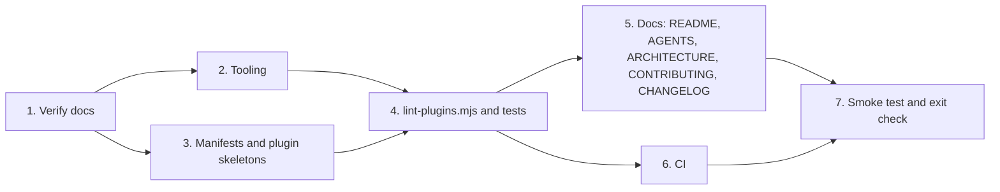

# PLAN-M0 — Scaffold and Tooling

**Source:** `docs/PLAN.md` §5 (M0), with §3, §4, §7–§11 as supporting context.
**Branch:** `m0-scaffold-and-tooling`
**Starting state:** MIT `LICENSE`, scaffolded `.gitignore`, and `docs/PLAN.md`. Nothing else.
**Goal:** An empty but fully wired marketplace. Two empty plugins, tooling, CI, and verified facts about the Claude Code plugin contract. M1 can then start on a solid base.

---

## 1. Scope

**In scope**

- Repo hygiene: README skeleton, `AGENTS.md`, `CHANGELOG.md`, `docs/ARCHITECTURE.md`, `docs/CONTRIBUTING.md`.
- Tooling: `package.json`, Vitest, oxlint, Prettier.
- `scripts/lint-plugins.mjs` with its own tests.
- Marketplace manifest, two plugin manifests, and empty plugin skeletons.
- GitHub Actions CI.
- Local install smoke test.
- Verification of the plugin contract against current Claude Code docs.

**Out of scope (later milestones)**

- Real hooks, the `init` skill, snippets, and the merge script (M1).
- Real skills (M2 and later).

---

## 2. Execution order

Verification runs first, because the doc findings may change the manifest shape, the lint rules, and the CI approach.



---

## 3. Work breakdown

### Step 1 — Verify against current docs (first)

Fetch the current Claude Code docs for plugins, plugin marketplaces, hooks, and skills. Record the findings for `docs/ARCHITECTURE.md` (Step 5). Confirm each item:

| Item                | Question to answer                                                                                                                                                                                      |
| ------------------- | ------------------------------------------------------------------------------------------------------------------------------------------------------------------------------------------------------- |
| `marketplace.json`  | Required and optional fields (`name`, `owner`, `plugins[].source`, `description`). Is a `version` or `metadata` field supported? Is `./plugins/lstk` the right `source` form?                           |
| `plugin.json`       | Required fields (is `name` the only one?). `version`, `description`, `author`, `license`, `repository`, `keywords`. Whether component directories (`skills/`, `agents/`, `hooks/`) are auto-discovered. |
| Empty plugins       | Whether a plugin with no components validates and installs, or needs at least one component. If one is required, record the minimal placeholder and keep it out of M2's real skill set.                 |
| Version and update  | How the update check treats `version`. Do unbumped changes propagate? (Feeds §10 of the main plan.)                                                                                                     |
| Hook JSON contract  | stdin payload fields, exit-code semantics, the JSON decision output, and `${CLAUDE_PLUGIN_ROOT}`. Needed for M1, recorded now.                                                                          |
| Skill frontmatter   | Which fields exist (`name`, `description`, `disable-model-invocation`, `allowed-tools`, …) and their constraints (name length and charset, description limits).                                         |
| Validation command  | Exact CLI form: `claude plugin validate <path>` and/or `/plugin validate`. Does it accept a marketplace path and a plugin path? Is the CLI usable non-interactively in CI?                              |
| Namespacing         | Confirm the skill namespace equals the plugin `name`, giving `/lstk:<skill>`.                                                                                                                           |
| Claude Code version | Record the version used, for the "last verified against" note.                                                                                                                                          |

**Deliverable:** a findings list (kept in the scratchpad until Step 5). Any deviation from `docs/PLAN.md` §4 is noted, and the plan doc is updated only if the user agrees.

### Step 2 — Tooling

Create the following.

- **`package.json`**
  - `"private": true`, `"type": "module"`, and an `engines.node` range (pick the current LTS, and match CI).
  - devDependencies only: `vitest`, `oxlint`, `prettier`. Pin to current versions, and let the lockfile pin the rest.
  - pin dependency versions to latest available
  - Scripts:
    - `test`: `vitest run --passWithNoTests`. Needed so an empty scaffold passes, though Step 4 adds real tests anyway.
    - `lint`: `oxlint`
    - `lint:fix`: `oxlint --fix`
    - `format`: `prettier --write .`
    - `format:check`: `prettier --check .`
    - `lint:plugins`: `node scripts/lint-plugins.mjs`
    - `validate`: `claude plugin validate` for each target (local-only if the CLI is unavailable in CI).
    - `check`: runs lint, format:check, test, and lint:plugins in sequence.
- **`package-lock.json`**, from `npm install`. Commit it, since CI uses `npm ci`.
- **`vitest.config.mjs`**: Node environment, `tests/**/*.test.mjs` include.
- **`.oxlintrc.json`**: sensible defaults. Enable the `correctness` category and `node` globals. Ignore `node_modules` and any fixtures directory.
- **`.prettierrc.json`** and **`.prettierignore`**: use the repo's style. LeanStacks defaults have been added to the branch to serve as a starting point. Ignore `package-lock.json`. Check that the existing `docs/PLAN.md` still passes `format:check`, and format it only if the user agrees, because it is an existing file.
- **`.editorconfig`** has been added to compliment `.prettierrc.json` with LeanStacks defaults.
- Confirm `.gitignore` already covers `node_modules/`. Do not edit it unless something is missing.

**Acceptance:** `npm test`, `npm run lint`, and `npm run format:check` all exit 0.

### Step 3 — Manifests and empty plugins

Create the structure from `docs/PLAN.md` §3, with the schema adjusted per Step 1.

```text
.claude-plugin/marketplace.json
plugins/lstk/.claude-plugin/plugin.json
plugins/lstk/skills/.gitkeep
plugins/lstk/agents/.gitkeep
plugins/lstk-guardrails/.claude-plugin/plugin.json
plugins/lstk-guardrails/hooks/.gitkeep
plugins/lstk-guardrails/skills/.gitkeep
```

- `marketplace.json`: name `lstk`, owner LeanStacks, and the two plugin entries from §4.
- Each `plugin.json`: `name` (`lstk` or `lstk-guardrails`), `version: "0.0.0"`, `description`, `author`, `license: "MIT"`, `repository`, and `homepage`. Add only the fields Step 1 confirms.
- Do **not** create `hooks.json` yet. An empty `hooks.json` may fail validation, and M1 owns it. Create it only if Step 1 shows a plugin needs one.
- Use `.gitkeep` only where the empty directory must exist. Remove these placeholders when real content arrives.
- The license in the plan layout says "MIT or Apache-2.0". The repo is MIT, so use MIT consistently.

**Acceptance:** `claude plugin validate` passes for the marketplace and for both plugins.

### Step 4 — `scripts/lint-plugins.mjs` with tests

**Behavior** (from the M0 acceptance criteria plus the §11 risk mitigation):

1. Locate and parse `.claude-plugin/marketplace.json`. Fail on missing file or invalid JSON.
2. Validate marketplace fields: `name`, `owner`, and a `plugins` array with unique names.
3. For each plugin entry:
   - The `source` path exists and is inside the repo.
   - `.claude-plugin/plugin.json` exists, is valid JSON, and its `name` matches the marketplace entry.
   - `version` is valid semver (when present).
   - No component directory (`skills/`, `agents/`, `hooks/`) is nested inside `.claude-plugin/`.
4. For each `skills/*/SKILL.md`:
   - Frontmatter parses.
   - `name` equals the directory name.
   - `description` is non-empty.
   - Other constraints from Step 1 (name charset and length).
5. For each `agents/*.md`: frontmatter parses, with `name` and `description` non-empty.
6. **Packaging check:** flag any `../` path reference in plugin files, since plugins cannot reference files outside their own directory (see §3 and §11 of the main plan).
7. Print every error with a file path and a reason. Exit 1 if any error exists, otherwise 0.

**Design constraints**

- Node built-ins only, with a small hand-written frontmatter parser (keep it dependency-free, per D4).
- Export the checks as pure functions (`lintRepo(rootDir)` returning an array of problems), with a thin CLI wrapper, so Vitest can call it directly.

**Tests** (`tests/lint-plugins.test.mjs`)

- Build fixtures in temporary directories (or `tests/fixtures/`), and keep fixtures out of oxlint.
- Cases: the valid empty scaffold passes, then each failure mode alone. These are a missing marketplace, bad JSON, a name mismatch, a missing `plugin.json`, a skill whose directory and `name` differ, an empty `description`, a missing frontmatter block, a `../` reference, and a duplicate plugin name.
- One test runs the linter against the real repo root and expects zero problems.

**Acceptance:** `npm run lint:plugins` passes on the real repo, and the Vitest suite covers every rule.

### Step 5 — Documentation

| File                   | Content                                                                                                                                                                                                                                                                                                                                                                    |
| ---------------------- | -------------------------------------------------------------------------------------------------------------------------------------------------------------------------------------------------------------------------------------------------------------------------------------------------------------------------------------------------------------------------- |
| `README.md`            | Skeleton: what lstk is, the two plugins, the install flow from §4, a status line ("pre-release, M0 scaffold"), a placeholder for the "Guardrail model" section (M1), a link to `docs/PLAN.md`, and the license.                                                                                                                                                            |
| `AGENTS.md`            | Written for this repo: layout, commands (`npm test`, `lint`, `format:check`, `lint:plugins`), conventions (ESM, Node built-ins only in hooks and scripts, plugins self-contained, Markdown plus Mermaid), and the no-`../` rule. Keep it short. Consider whether a `CLAUDE.md` that points to `AGENTS.md` is needed (verify how Claude Code loads `AGENTS.md` per Step 1). |
| `docs/ARCHITECTURE.md` | The Step 1 findings: manifest schema, version and update behavior, hook JSON contract, skill frontmatter rules, and the validation command. Add "Last verified against Claude Code version X on <date>", plus the layer diagram from §3.                                                                                                                                   |
| `docs/CONTRIBUTING.md` | Dev setup, the check commands, the public-repo leakage checklist (no client names or personal paths), the skill authoring conventions summary (§8), and the version-bump rule.                                                                                                                                                                                             |
| `CHANGELOG.md`         | Root file with an "Unreleased" section. (The main plan says per-plugin changelogs. Add `plugins/<name>/CHANGELOG.md` only if the user wants them now. Otherwise defer to the first release.)                                                                                                                                                                               |

Run Prettier over the new Markdown so `format:check` still passes.

### Step 6 — CI (`.github/workflows/ci.yml`)

- Trigger: `pull_request` (and `push` to `main`).
- One job on `ubuntu-latest`:
  1. `actions/checkout`.
  2. `actions/setup-node` with the Node version from `engines` and npm caching.
  3. `npm ci`.
  4. `npm run lint`
  5. `npm run format:check`
  6. `npm test`
  7. `npm run lint:plugins`
- Optional step: `claude plugin validate`, **only if** Step 1 shows the CLI installs and runs non-interactively without credentials. Otherwise leave it as a documented local check (the main plan §9 allows this).
- Set `permissions: contents: read`. Pin actions to a major version tag, or to a SHA if the user prefers.
- A `concurrency` group cancels superseded runs.

**Acceptance:** the workflow passes on a PR from this branch. Pushing the branch and opening a PR needs explicit user approval, so the plan stops at "ready to push" unless told otherwise.

### Step 7 — Local install smoke test and exit check

Run in a real Claude Code session, from the repo root.

1. `/plugin marketplace add ./`
2. `/plugin install lstk@lstk`
3. `/plugin install lstk-guardrails@lstk`
4. `/reload-plugins`, then confirm both plugins are listed.
5. Confirm the skill namespace behaves as expected once a skill exists. Not testable while the plugins are empty, so record it as an M2 check.
6. Uninstall and remove the local marketplace afterward, so the user's machine stays clean.

Steps 1 to 4 here change user-level Claude Code state. Run them only with the user's go-ahead, or hand the user the commands to run (`! <command>`).

**Final exit check**

- [ ] `npm test`, `npm run lint`, `npm run format:check`, and `npm run lint:plugins` all pass from a clean `npm ci`.
- [ ] `claude plugin validate` passes (marketplace and both plugins).
- [ ] Smoke test passes.
- [ ] CI is green on the PR.
- [ ] `docs/ARCHITECTURE.md` records the verified contract and the version note.
- [ ] No personal or client details exist anywhere in the repo.

---

## 4. Proposed commits

Following the repo's `commit-messages` skill (prefixes `feat`, `fix`, `chore`, `doc`):

1. `chore: add package.json and Vitest, oxlint, Prettier config`
2. `feat: add marketplace and empty plugin manifests`
3. `feat: add plugin lint script with tests`
4. `doc: add README, AGENTS, ARCHITECTURE, CONTRIBUTING, CHANGELOG`
5. `chore: add CI workflow`

Open the PR as a draft via the `create-pull-request` skill when the user is ready.

---

## 5. Risks and open questions

| Item                                                         | Handling                                                                                              |
| ------------------------------------------------------------ | ----------------------------------------------------------------------------------------------------- |
| Empty plugins may fail `validate` or install                 | Step 1 confirms. Fallback is a minimal placeholder component, clearly marked and removed in M1 or M2. |
| `claude` CLI not available in CI                             | Keep `claude plugin validate` a documented local check, as the main plan allows.                      |
| Docs differ from the intended manifest shape in `PLAN.md` §4 | Follow the docs, note the deviation in `ARCHITECTURE.md`, and propose a `PLAN.md` edit to the user.   |
| `docs/PLAN.md` may fail Prettier                             | Prefer `.prettierignore` or a user-approved reformat, rather than silently rewriting the plan.        |
| Smoke test touches user-level Claude Code state              | Get approval first, and clean up afterward.                                                           |

**Decisions the user may want to make before starting**

1. Prettier style choices (quote style and print width).
   - Added LeanStacks Prettier defaults to repo in `.prettierrc.json` and `.prettierignore`. Modify if needed.
   - Also added `.editorconfig` to complement `.prettierrc.json`. Modify if needed.
2. Per-plugin `CHANGELOG.md` now, or a single root changelog until the first release.
   - Use simplest approach until a more complex approach is needed.
3. Whether to run the smoke test directly or have the user run it.
   - User will run it. Provide user with the commands.
4. Whether to reformat `docs/PLAN.md` to satisfy Prettier or ignore it.
   - Reformat.
