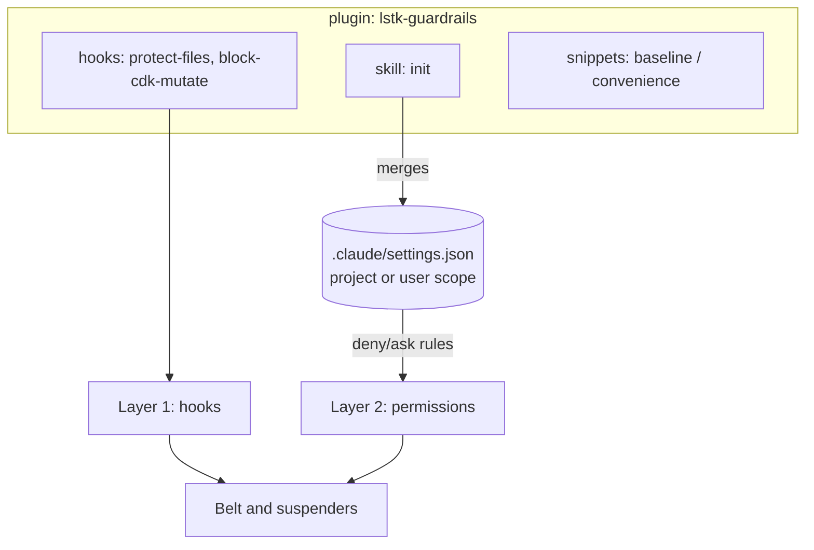

# lstk — LeanStacks Agentic Toolkit

A [Claude Code](https://code.claude.com) plugin marketplace that helps engineers and architects research, design,
develop, review, and harden applications, and prototype quickly. It is AWS-first and TypeScript-first.

> **Status:** pre-1.0. `lstk` and `lstk-guardrails` are `0.1.0`. `lstk` ships five skills so far, and more arrive in
> later milestones. See [docs/PLAN.md](docs/PLAN.md).

## Plugins

| Plugin            | Purpose                                                                                      |
| ----------------- | -------------------------------------------------------------------------------------------- |
| `lstk`            | Lifecycle skills and agents: research, design, develop, review, harden, prototype.           |
| `lstk-guardrails` | Deterministic guardrail hooks and an `init` skill that bootstraps safer permission settings. |

The plugins install independently, because enforcement posture varies by client. Skills are namespaced by plugin name,
for example `/lstk:<skill>`.

## Install

```text
/plugin marketplace add leanstacks/lstk
/plugin install lstk@lstk
/plugin install lstk-guardrails@lstk
```

Then run `/lstk-guardrails:init` to merge the guardrail permission rules into your settings (see
[Install and init](#install-and-init)).

## Skills

The `lstk` plugin provides these skills. Each runs as `/lstk:<name>`.

| Skill                 | Invocation                                    | Purpose                                                                                      |
| --------------------- | --------------------------------------------- | -------------------------------------------------------------------------------------------- |
| `commit-messages`     | Auto-triggered, or `/lstk:commit-messages`    | Writes commit messages in the repo's own convention, or `feat`, `fix`, `chore`, `doc`.       |
| `create-pull-request` | User-invoked only                             | Opens a draft GitHub PR from the current branch, using the repo's PR template.               |
| `agents-md-author`    | Auto-triggered, or `/lstk:agents-md-author`   | Creates, audits, or refreshes `AGENTS.md` after surveying the repo.                          |
| `repo-onboarding`     | Auto-triggered, or `/lstk:repo-onboarding`    | Produces or verifies `docs/PROJECT_OVERVIEW.md`: what the system is and how it is organized. |
| `local-setup-author`  | Auto-triggered, or `/lstk:local-setup-author` | Produces or verifies `docs/LOCAL_SETUP.md`: from a fresh clone to a running app.             |

Skills defer to the target repo: its `AGENTS.md`, `CONTRIBUTING.md`, and templates win over the skill's defaults.

## Guardrail model

`lstk-guardrails` protects against accidental or over-eager autonomous actions: deploying or destroying infrastructure,
and editing secrets, lockfiles, and git internals. It uses two layers.



1. **Layer 1, hooks.** Deterministic scripts that run before the tool call and can deny or ask.
2. **Layer 2, permission rules.** `deny`, `ask`, and optional `allow` rules in Claude Code settings, delivered by
   `init`.

### Hooks

| Hook               | Matches         | Behavior                                                                                                              |
| ------------------ | --------------- | --------------------------------------------------------------------------------------------------------------------- |
| `block-cdk-mutate` | `Bash`          | **Denies** CDK `deploy`, `destroy`, and `watch`. **Asks** on `bootstrap`. Allows `synth`, `diff`, `ls`, and the rest. |
| `protect-files`    | `Edit`, `Write` | **Denies** edits to protected paths. Everything else is allowed.                                                      |

`block-cdk-mutate` tokenizes the command rather than matching the raw string. It sees through `npx`, `npm exec`,
`npm run cdk -- deploy`, `cdk@<version>`, flags before the subcommand, `bash -c "..."`, `$(...)`, backticks, and chained
commands. It also denies package scripts and `make` targets named like `deploy` or `destroy`, and scripts whose body in
the nearest `package.json` runs `cdk deploy`, `destroy`, or `watch`.

`protect-files` resolves the path (`..` and symlinks included) before matching. Defaults: `.env`, `.env.*`,
`package-lock.json`, and `.git/`. `.env.example`, `.env.sample`, and `.env.template` are exempt.

### Configuration

Create `.claude/lstk.json` in the project root. Add `.claude/lstk.local.json` for personal overrides and keep it out of
git.

```json
{
  "protectedPatterns": ["secrets/", "*.pem"],
  "unprotectPatterns": ["package-lock.json"]
}
```

- `protectedPatterns` are added to the defaults.
- `unprotectPatterns` removes a default by its exact pattern string, or exempts a path from any pattern.
- Patterns are gitignore-like: no slash matches the name anywhere, a trailing `/` matches a directory, and `*` and `?`
  are wildcards. Negation (`!`) is not supported.
- A missing file means defaults. An invalid file is ignored with a warning on stderr.

### Limits

- **A hook is not a sandbox.** It sees the command string, not its effects. Indirect routes can evade it: a script that
  calls `cdk deploy`, `eval`, or a binary chosen through an environment variable.
- **Hooks fail open.** An unexpected internal error prints a warning to stderr and allows the call. The permission rules
  are the backstop.
- **The real guarantee is credentials.** Use a read-only AWS identity, and do not give the agent deploy credentials.

### Install and init

1. Install the plugin (see [Install](#install)).
2. Run `/lstk-guardrails:init`. Choose **user** scope (once per machine) or **project** scope (committed for the team),
   and whether to include the opt-in `convenience` allow rules.
3. Review the dry-run diff, then confirm. The merge is idempotent. It adds rules, never removes or reorders yours, and
   never touches `hooks`, `model`, `theme`, or unrelated keys. A `.bak` is kept on the first change.
4. **Remove any old `hooks` block** for these scripts from `~/.claude/settings.json`, otherwise the hooks run twice.
   Run `/reload-plugins` or restart Claude Code.

## Development

See [docs/CONTRIBUTING.md](docs/CONTRIBUTING.md) and [docs/ARCHITECTURE.md](docs/ARCHITECTURE.md).

## License

[MIT](LICENSE)
