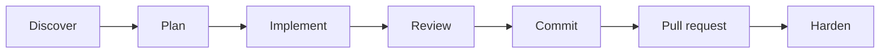
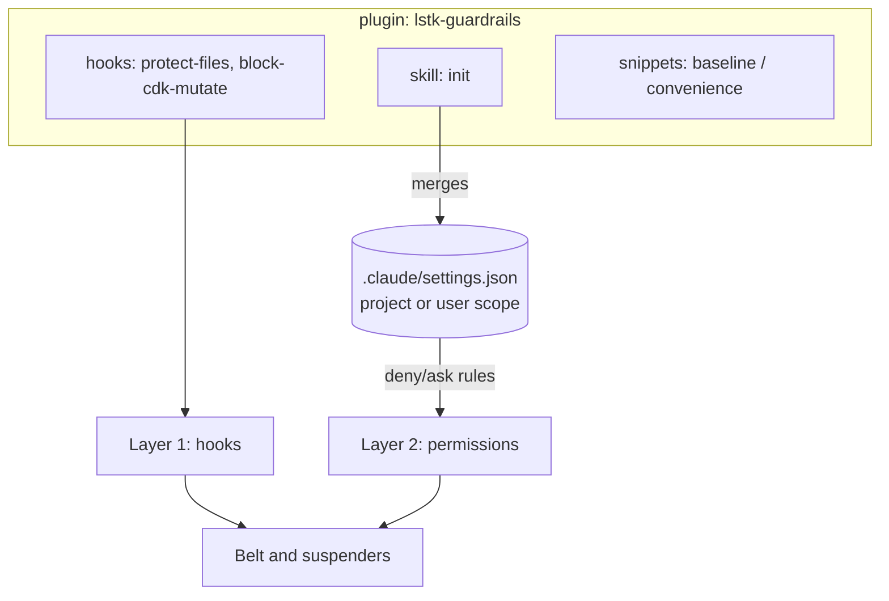

# lstk — LeanStacks Agentic Toolkit

A [Claude Code](https://code.claude.com) plugin marketplace that helps engineers and architects research, design,
develop, review, and harden applications, and prototype quickly. It is AWS-first and TypeScript-first.

> **Status:** pre-1.0. `lstk` is `0.4.1` and `lstk-guardrails` is `0.1.0`. `lstk` ships fourteen skills and two agents.
> Deferred ideas are tracked in the [backlog review](https://github.com/leanstacks/lstk/issues/21). See
> [docs/PLAN.md](docs/PLAN.md).

## Start here

- **New to lstk?** Read [Getting started](docs/guides/getting-started.md): install, set up guardrails, and take the first
  five minutes on your repo.
- **Know what you want to do?** Use the [guides index](docs/guides/README.md): add a feature, fix a bug, design a
  system, review a change, harden a service.
- **Want to see it run?** Read the [bug fix walkthrough](docs/guides/walkthrough-bug-fix.md), an annotated record of one
  real run.
- **Curious how it was made?** Read [how it was built](docs/HOW-IT-WAS-BUILT.md).

## Install

```text
/plugin marketplace add leanstacks/lstk
/plugin install lstk@lstk
/plugin install lstk-guardrails@lstk
```

Then run `/lstk-guardrails:init` to merge the guardrail permission rules into your settings (see
[Install and init](#install-and-init)).

## Plugins

| Plugin            | Purpose                                                                                      |
| ----------------- | -------------------------------------------------------------------------------------------- |
| `lstk`            | Lifecycle skills and agents: research, design, develop, review, harden, prototype.           |
| `lstk-guardrails` | Deterministic guardrail hooks and an `init` skill that bootstraps safer permission settings. |

The plugins install independently, because enforcement posture varies by client. Skills are namespaced by plugin name,
for example `/lstk:<skill>`.

## Workflows at a glance



lstk covers every stage except **Implement**, which is plain Claude Code made safer by the guardrails and better
grounded by `AGENTS.md`. See the [lifecycle map](docs/guides/lifecycle.md).

| I want to...                | Start with                                                                                           |
| --------------------------- | ---------------------------------------------------------------------------------------------------- |
| Learn an unfamiliar repo    | `repo-onboarding`, `agents-md-author`, `local-setup-author`                                          |
| Add a feature or fix a bug  | [Existing projects](docs/guides/existing-projects.md)                                                |
| Design a new system         | `solution-outline`, `tech-eval`, `adr-author` ([New projects](docs/guides/new-projects.md))          |
| Try an idea fast            | `prototype`, then `promote-prototype`                                                                |
| Review a change or a design | `code-reviewer`, `architecture-review` ([Review](docs/guides/review-and-hardening.md))               |
| Harden before a release     | `threat-model`, `cdk-iam-review` ([Hardening](docs/guides/review-and-hardening.md#harden-a-service)) |

## Skills

The `lstk` plugin provides these skills. Each runs as `/lstk:<name>`.

| Skill                 | Invocation                                     | Purpose                                                                                      |
| --------------------- | ---------------------------------------------- | -------------------------------------------------------------------------------------------- |
| `commit-messages`     | Auto-triggered, or `/lstk:commit-messages`     | Writes commit messages in the repo's own convention, or `feat`, `fix`, `chore`, `doc`.       |
| `create-pull-request` | User-invoked only                              | Opens a draft GitHub PR from the current branch, using the repo's PR template.               |
| `agents-md-author`    | Auto-triggered, or `/lstk:agents-md-author`    | Creates, audits, or refreshes `AGENTS.md` after surveying the repo.                          |
| `repo-onboarding`     | Auto-triggered, or `/lstk:repo-onboarding`     | Produces or verifies `docs/PROJECT_OVERVIEW.md`: what the system is and how it is organized. |
| `local-setup-author`  | Auto-triggered, or `/lstk:local-setup-author`  | Produces or verifies `docs/LOCAL_SETUP.md`: from a fresh clone to a running app.             |
| `stack-profile`       | Loaded by Claude when needed (not in the menu) | Default stack (TypeScript, NestJS, Lambda, React, CDK) for use where the repo is silent.     |
| `tech-eval`           | Auto-triggered, or `/lstk:tech-eval`           | Trade-off matrix and sourced recommendation, using parallel `researcher` agents.             |
| `adr-author`          | Auto-triggered, or `/lstk:adr-author`          | Writes and maintains Markdown ADRs, following the repo's convention.                         |
| `solution-outline`    | Auto-triggered, or `/lstk:solution-outline`    | Draft outline from requirements: components, risks, and an effort sketch.                    |
| `architecture-review` | User-invoked only                              | Design or CDK review by pillar, with trade-offs to decide. Writes `docs/reviews/`.           |
| `threat-model`        | User-invoked only                              | STRIDE threat table from code and infra, with mitigations. Writes `docs/threat-models/`.     |
| `cdk-iam-review`      | User-invoked only                              | Static IAM review of CDK TypeScript, with shown-only diffs. Writes `docs/reviews/`.          |
| `prototype`           | User-invoked only                              | Throwaway web or Lambda prototype in `prototypes/<name>/`, with a `PROTOTYPE.md`.            |
| `promote-prototype`   | User-invoked only                              | Cited gap list with relative effort for taking a prototype to production.                    |

### Agents

| Agent           | Tools                                           | Purpose                                                                |
| --------------- | ----------------------------------------------- | ---------------------------------------------------------------------- |
| `researcher`    | `Read`, `Grep`, `Glob`, `WebFetch`, `WebSearch` | Read-only research that returns a sourced report. Used by `tech-eval`. |
| `code-reviewer` | `Read`, `Grep`, `Glob`                          | Read-only change review. The caller supplies the diff or paths.        |

See [docs/examples](docs/examples/README.md) for worked examples of the design, review, and prototype skills.

Skills defer to the target repo: its `AGENTS.md`, `CONTRIBUTING.md`, and templates win over the skill's defaults.

## Guardrail model

`lstk-guardrails` protects against accidental or over-eager autonomous actions: deploying or destroying infrastructure,
and editing secrets, lockfiles, and git internals. It uses two layers.



1. **Layer 1, hooks.** Deterministic scripts that run before the tool call and can deny or ask.
2. **Layer 2, permission rules.** `deny`, `ask`, and optional `allow` rules in Claude Code settings, delivered by
   `init`.

### Hooks

| Hook               | Matches         | Behavior                                                                                                              |
| ------------------ | --------------- | --------------------------------------------------------------------------------------------------------------------- |
| `block-cdk-mutate` | `Bash`          | **Denies** CDK `deploy`, `destroy`, and `watch`. **Asks** on `bootstrap`. Allows `synth`, `diff`, `ls`, and the rest. |
| `protect-files`    | `Edit`, `Write` | **Denies** edits to protected paths. Everything else is allowed.                                                      |

`block-cdk-mutate` tokenizes the command rather than matching the raw string. It sees through `npx`, `npm exec`,
`npm run cdk -- deploy`, `cdk@<version>`, flags before the subcommand, `bash -c "..."`, `$(...)`, backticks, and chained
commands. It also denies package scripts and `make` targets named like `deploy` or `destroy`, and scripts whose body in
the nearest `package.json` runs `cdk deploy`, `destroy`, or `watch`.

`protect-files` resolves the path (`..` and symlinks included) before matching. Defaults: `.env`, `.env.*`,
`package-lock.json`, and `.git/`. `.env.example`, `.env.sample`, and `.env.template` are exempt.

### Configuration

Create `.claude/lstk.json` in the project root. Add `.claude/lstk.local.json` for personal overrides and keep it out of
git.

```json
{
  "protectedPatterns": ["secrets/", "*.pem"],
  "unprotectPatterns": ["package-lock.json"]
}
```

- `protectedPatterns` are added to the defaults.
- `unprotectPatterns` removes a default by its exact pattern string, or exempts a path from any pattern.
- Patterns are gitignore-like: no slash matches the name anywhere, a trailing `/` matches a directory, and `*` and `?`
  are wildcards. Negation (`!`) is not supported.
- A missing file means defaults. An invalid file is ignored with a warning on stderr.

### Limits

- **A hook is not a sandbox.** It sees the command string, not its effects. Indirect routes can evade it: a script that
  calls `cdk deploy`, `eval`, or a binary chosen through an environment variable.
- **Hooks fail open.** An unexpected internal error prints a warning to stderr and allows the call. The permission rules
  are the backstop.
- **The real guarantee is credentials.** Use a read-only AWS identity, and do not give the agent deploy credentials.

### Prototypes and guardrails

The prototype workflow (`/lstk:prototype`, `/lstk:promote-prototype`) runs with the hooks on.

- **Hooks stay on.** Scaffolding writes no protected path (no `.env`, no lockfile), so the hooks do not get in the way.
  `npm install` writes `package-lock.json` through Bash, which `protect-files` does not see.
- **Prototypes do not deploy.** The Lambda shape runs locally only and ships no CDK app. `block-cdk-mutate` denies
  `cdk deploy`, and the skills never ask you to disable a hook, edit your permission settings, or skip permission prompts.
  If a hook blocks a write, the skill reports the block and stops.
- **Legitimate overrides are yours to make.** To let the agent edit a protected path in one project, add the pattern to
  `unprotectPatterns` in `.claude/lstk.json` yourself. The skills never do this for you.
- **Limits.** A hook sees the command or path, not its effects. `promote-prototype` limits itself to one report file by
  its own instructions, and `Write` is not path-scoped, so that rule is text and not enforcement. Only `protect-files`
  stops a write to a protected path.

### Install and init

1. Install the plugin (see [Install](#install)).
2. Run `/lstk-guardrails:init`. Choose **user** scope (once per machine) or **project** scope (committed for the team),
   and whether to include the opt-in `convenience` allow rules.
3. Review the dry-run diff, then confirm. The merge is idempotent. It adds rules, never removes or reorders yours, and
   never touches `hooks`, `model`, `theme`, or unrelated keys. A `.bak` is kept on the first change.
4. **Remove any old `hooks` block** for these scripts from `~/.claude/settings.json`, otherwise the hooks run twice.
   Run `/reload-plugins` or restart Claude Code.

## For maintainers

These documents are for people changing lstk, not for people using it:

- [docs/CONTRIBUTING.md](docs/CONTRIBUTING.md) and [docs/ARCHITECTURE.md](docs/ARCHITECTURE.md)
- [docs/PLAN.md](docs/PLAN.md) and the per-milestone plans in [docs/plans](docs/plans)
- [docs/HOW-IT-WAS-BUILT.md](docs/HOW-IT-WAS-BUILT.md)

## License

[MIT](LICENSE)
