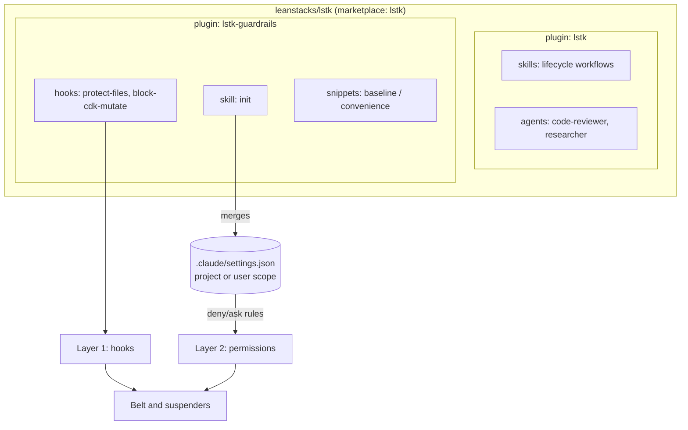

# Architecture

> **Last verified against Claude Code 2.1.319 on 2026-11-08**, using the official docs and `claude plugin validate`.
> Re-verify when Claude Code changes the plugin contract.

## Layers



## Verified plugin contract

### `marketplace.json`

- Location: `.claude-plugin/marketplace.json`. The directory containing `.claude-plugin/` is the marketplace root.
- Required: `name`, `owner` (with `owner.name`), `plugins`. Recommended: `description` (the validator warns without it).
- Optional: `version`, `metadata.{description,version,pluginRoot}`.
- Names allow letters, digits, `.`, `_`, `-`, and must start with a letter or digit. Several names are reserved
  (official marketplaces, `inline`, `skills-dir`, `synced`, and others).
- Each plugin entry requires `name` and `source`. A relative `source` must start with `./` and must not contain `..`.
  We use `./plugins/<name>`.
- The entry `name` is the install id (`name@marketplace`) and must equal the `name` in the plugin's `plugin.json`.

### `plugin.json`

- Only `name` is required. We also set `version`, `description`, `author`, `license`, `repository`, and `homepage`.
- `author` is an object (`name` required, `email` and `url` optional). `homepage` must parse as a URL.
- Unknown top-level keys are stripped, and the validator warns about them.
- `skills/`, `agents/`, and `hooks/hooks.json` are auto-discovered. Only `plugin.json` goes in `.claude-plugin/`.
- A plugin with no components validates, even with `--strict`. No placeholder component is needed.
- Plugin `name` is the component namespace: skills appear as `/lstk:<skill>`.

### Version and update behavior

- Version precedence: manifest `version`, then marketplace entry `version`, then the commit SHA.
- A pinned `version` keeps users on the cached copy until the string changes, so **unbumped changes do not propagate**.
  This is why we bump on every released change.
- A marketplace added from a local path loads plugin source in place at each session start, with no bump needed.
- Auto-update is off by default for third-party marketplaces. Users update with `claude plugin update`.
- Installed plugins are copied to `~/.claude/plugins/cache/<marketplace>/<plugin>/<version>/`. Paths that escape the
  plugin root are rejected, and files outside it are not copied. `${CLAUDE_PLUGIN_ROOT}` points at the cached copy.

### Hook contract (for M1)

- Hooks live in `hooks/hooks.json`, wrapped in a top-level `"hooks"` object: event, then matcher groups, then handlers.
- Command hooks receive JSON on stdin. Common fields: `session_id`, `cwd`, `permission_mode`, `hook_event_name`. For
  `PreToolUse`, also `tool_name`, `tool_input`, and `tool_use_id`.
- Exit codes for `PreToolUse`:
  - `0`: success. Stdout is parsed as JSON if it is one object. No JSON means the normal permission flow applies.
  - `2`: blocking error. The tool call is blocked and stderr is shown to Claude.
  - Any other code, **including 1**: non-blocking error. The call proceeds.
- JSON decision, printed to stdout on exit 0:

  ```json
  {
    "hookSpecificOutput": {
      "hookEventName": "PreToolUse",
      "permissionDecision": "deny",
      "permissionDecisionReason": "why, and what to do instead"
    }
  }
  ```

  `permissionDecision` is `allow`, `deny`, `ask`, or `defer`. Stdout must contain only the JSON object.

- A timeout does not block by default. `"onFailure": "block"` (v2.1.295+) makes failures and timeouts block.
- `${CLAUDE_PLUGIN_ROOT}` is substituted in `command` and `args`. Exec form (`command` plus `args`) avoids quoting issues.
  In shell form, wrap the variable in double quotes.

### Skill frontmatter

- All fields are optional, but `description` is recommended. Unknown fields are silently ignored.
- `name` defaults to the directory name: lowercase letters, digits, and hyphens. No maximum is documented. The linter
  caps it at 64 characters, following the Agent Skills spec.
- `description` plus `when_to_use` is truncated at 1,536 characters in the skill listing.
- Notable fields: `disable-model-invocation`, `user-invocable`, `allowed-tools`, `disallowed-tools`, `model`, `effort`,
  `context`, `agent`, `hooks`, `paths`.
- The opening `---` must be the first line of the file, or the whole file is treated as content.
- Keep `SKILL.md` under 500 lines.

### Agent frontmatter

- Required: `name` and `description`. Common: `tools`, `model`.
- Plugin agents ignore `hooks`, `mcpServers`, and `permissionMode`. Ship hooks at plugin level instead.

### Validation

```bash
claude plugin validate <path> [--strict] [--json]
```

- `<path>` is a marketplace root, a plugin directory, or a manifest file. Exit codes: `0` pass, `1` fail, `2` unexpected
  error. `--strict` turns warnings into failures.
- It runs offline and needs no credentials, so it works in CI.
- Plugin validation also prints "plugin directory" notes (missing per-plugin `README.md`, no icon). They apply only to
  Anthropic's directory and do not change the result, so we ignore them.

### `AGENTS.md`

Claude Code 2.1.277 and later reads `AGENTS.md` directly when no `CLAUDE.md` exists in the working directory or above.
We therefore ship `AGENTS.md` only. If a `CLAUDE.md` is ever added, it must import `@AGENTS.md`.

## Tooling

Node 24 (see `.nvmrc`), npm, Vitest, oxlint, and Prettier, all as devDependencies. `scripts/lint-plugins.mjs` checks
manifests, skill and agent frontmatter, and the no-`../` rule. CI runs the same checks plus
`claude plugin validate --strict`.
