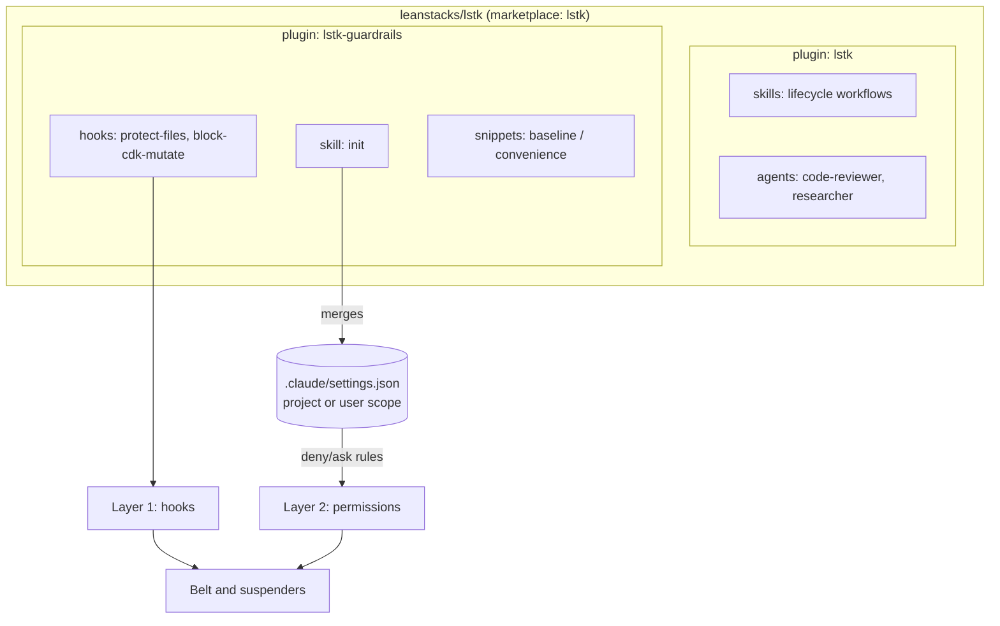

# Architecture

> **Last verified against Claude Code 2.1.319 on 2026-11-08**, using the official docs and `claude plugin validate`.
> Re-verify when Claude Code changes the plugin contract.

## Layers



## Verified plugin contract

### `marketplace.json`

- Location: `.claude-plugin/marketplace.json`. The directory containing `.claude-plugin/` is the marketplace root.
- Required: `name`, `owner` (with `owner.name`), `plugins`. Recommended: `description` (the validator warns without it).
- Optional: `version`, `metadata.{description,version,pluginRoot}`.
- Names allow letters, digits, `.`, `_`, `-`, and must start with a letter or digit. Several names are reserved
  (official marketplaces, `inline`, `skills-dir`, `synced`, and others).
- Each plugin entry requires `name` and `source`. A relative `source` must start with `./` and must not contain `..`.
  We use `./plugins/<name>`.
- The entry `name` is the install id (`name@marketplace`) and must equal the `name` in the plugin's `plugin.json`.

### `plugin.json`

- Only `name` is required. We also set `version`, `description`, `author`, `license`, `repository`, and `homepage`.
- `author` is an object (`name` required, `email` and `url` optional). `homepage` must parse as a URL.
- Unknown top-level keys are stripped, and the validator warns about them.
- `skills/`, `agents/`, and `hooks/hooks.json` are auto-discovered. Only `plugin.json` goes in `.claude-plugin/`.
- A plugin with no components validates, even with `--strict`. No placeholder component is needed.
- Plugin `name` is the component namespace: skills appear as `/lstk:<skill>`.

### Version and update behavior

- Version precedence: manifest `version`, then marketplace entry `version`, then the commit SHA.
- A pinned `version` keeps users on the cached copy until the string changes, so **unbumped changes do not propagate**.
  This is why we bump on every released change.
- A marketplace added from a local path loads plugin source in place at each session start, with no bump needed.
- Auto-update is off by default for third-party marketplaces. Users update with `claude plugin update`.
- Installed plugins are copied to `~/.claude/plugins/cache/<marketplace>/<plugin>/<version>/`. Paths that escape the
  plugin root are rejected, and files outside it are not copied. `${CLAUDE_PLUGIN_ROOT}` points at the cached copy.

### Hook contract (as built in M1)

- Hooks live in `hooks/hooks.json`, wrapped in a top-level `"hooks"` object: event, then matcher groups, then handlers.
- Command hooks receive JSON on stdin. Common fields: `session_id`, `cwd`, `permission_mode`, `hook_event_name`. For
  `PreToolUse`, also `tool_name`, `tool_input`, and `tool_use_id`.
- Exit codes for `PreToolUse`:
  - `0`: success. Stdout is parsed as JSON if it is one object. No JSON means the normal permission flow applies.
  - `2`: blocking error. The tool call is blocked and stderr is shown to Claude.
  - Any other code, **including 1**: non-blocking error. The call proceeds.
- JSON decision, printed to stdout on exit 0:

  ```json
  {
    "hookSpecificOutput": {
      "hookEventName": "PreToolUse",
      "permissionDecision": "deny",
      "permissionDecisionReason": "why, and what to do instead"
    }
  }
  ```

  `permissionDecision` is `allow`, `deny`, `ask`, or `defer`. Stdout must contain only the JSON object.

- A timeout does not block by default. `"onFailure": "block"` (v2.1.295+) makes failures and timeouts block.
- `${CLAUDE_PLUGIN_ROOT}` is substituted in `command` and `args`. Exec form (`command` plus `args`) avoids quoting issues.
  In shell form, wrap the variable in double quotes.

### `lstk-guardrails` design (as built)

- **Decision mechanism.** Hooks print the JSON `permissionDecision` (`deny` or `ask`) with a reason and exit 0. They never
  use exit 2, so a real exit 2 or other code is never confused with a matched rule.
- **Fail open.** `runHook` catches any unexpected error, prints `lstk-guardrails: <hook> internal error (<msg>); failing
open` to stderr, and exits 0. The permission rules from `init` are the backstop.
- **Module map** (`hooks/lib/`, Node built-ins only): `stdin.mjs` (read and parse JSON), `decision.mjs` (`deny`, `ask`,
  `allow`, `warn`), `run.mjs` (`runHook`), `tokenize.mjs` (shell-aware tokenizer), `paths.mjs` (normalization, symlink
  resolution, glob matching), `config.mjs` (loads `.claude/lstk.json`).
- **`block-cdk-mutate`.** Denies `deploy`, `destroy`, `watch`. Asks on `bootstrap`. Also inspects package-manager scripts
  and `make` targets, including script bodies in the nearest `package.json`. Deny wins over ask.
- **`protect-files`.** Resolves `..` and symlinks, then matches gitignore-like patterns against the path relative to
  `CLAUDE_PROJECT_DIR` (or `cwd`).
- **`.claude/lstk.json`.** `{ "protectedPatterns": string[], "unprotectPatterns": string[] }`. Patterns are added to the
  defaults (`.env`, `.env.*`, `package-lock.json`, `.git/`, with `.env.example`, `.env.sample`, and `.env.template`
  exempt). `unprotectPatterns` removes a default by exact string or exempts a path. `.claude/lstk.local.json` merges
  after it. Invalid config warns and falls back to defaults. Unknown keys are ignored.
- **`merge-settings.mjs`.** Adds snippet entries to `permissions.deny`, `ask`, and (opt-in) `allow` in the user or
  project `settings.json`. It never removes or reorders entries, never touches `hooks` or other keys, is idempotent,
  refuses invalid input (exit 1), writes atomically with a `.bak` on first change, and supports `--dry-run`. Exit codes:
  0 success or no change, 1 refused, 2 unexpected error.
- **`init` skill.** Asks scope and whether to include `convenience`, shows the dry run and any conflicts, applies on
  confirmation, and reminds the user to remove any old `hooks` block. The `${CLAUDE_PLUGIN_ROOT}` finding is under
  Skill frontmatter below.

### Skill frontmatter

- All fields are optional, but `description` is recommended. Unknown fields are silently ignored.
- `name` defaults to the directory name: lowercase letters, digits, and hyphens. No maximum is documented. The linter
  caps it at 64 characters, following the Agent Skills spec.
- `description` plus `when_to_use` is truncated at 1,536 characters in the skill listing.
- Notable fields: `disable-model-invocation`, `user-invocable`, `allowed-tools`, `disallowed-tools`, `model`, `effort`,
  `context`, `agent`, `hooks`, `paths`.
- The opening `---` must be the first line of the file, or the whole file is treated as content.
- Keep `SKILL.md` under 500 lines.
- Path variables in plugin skills (verified in M1 against the skills and plugin reference docs):
  - `${CLAUDE_PLUGIN_ROOT}` is substituted as text in the Markdown body and in Bash rules in `allowed-tools`. It is
    substituted only in plugin skills. `${CLAUDE_PROJECT_DIR}` is substituted in the same two places.
  - `${CLAUDE_SKILL_DIR}` resolves to the skill's own directory, not the plugin root. Verified in M2 (Claude Code
    2.1.322) with a scratch plugin loaded through `--plugin-dir`: it is substituted in the Markdown body and in
    `allowed-tools`, and `Bash(node "${CLAUDE_SKILL_DIR}/scripts/x.mjs" *)` matched a double-quoted command under
    `dontAsk`. Use this form to run a skill's own script. Confirming it from the installed cache path is part of the
    M2 smoke test (see the PR description).
  - `CLAUDE_PLUGIN_ROOT` is **not** exported as an environment variable to Bash commands that Claude runs. It is
    exported only to hook commands, MCP stdio servers, and LSP servers. A script cannot read it from the shell.
  - `allowed-tools` uses the space form, `Bash(cmd *)`. The `:*` suffix is accepted as an equivalent.
  - The docs do not say whether a double-quoted path in an `allowed-tools` rule matches the same command. The `init`
    skill uses `Bash(node "${CLAUDE_PLUGIN_ROOT}/scripts/merge-settings.mjs" *)`. The M1 smoke test confirmed it works.

### Agent frontmatter

Verified in M3 Phase 1 (Claude Code 2.1.322, 2026-11-11) against the sub-agents and plugin components docs.

- Required: `name` and `description`.
- Supported: `tools`, `disallowedTools`, `model`, `effort`, `maxTurns`, `skills`, `memory`, `background`, `isolation`
  (`worktree` only), `color`, and a few others. Unknown fields are silently ignored.
- Plugin agents ignore `hooks`, `mcpServers`, `permissionMode`, and `initialPrompt`. Ship hooks at plugin level instead.
- `tools` is an allowlist, written as a comma string or a YAML list. Omitting it inherits every tool, so the linter
  requires it. `WebFetch` and `WebSearch` are valid names. Some tools are always removed from subagents (for example
  `AskUserQuestion` and `ExitPlanMode`).
- `model` accepts `sonnet`, `opus`, `haiku`, `fable`, a full model ID, or `inherit`. When omitted it falls through to
  the main conversation's model.
- `skills` preloads the full content of each listed skill at startup. It does not inherit from the parent, and it
  cannot preload a skill with `disable-model-invocation: true`.
- Verified in M3 Phase 3 (2.1.322, headless `claude -p` with `--plugin-dir`): a subagent with
  `tools: Read, Grep, Glob, WebFetch, WebSearch` can call `WebFetch` and `WebSearch`. Without an explicit
  instruction, Claude launched parallel `Agent` calls as background tasks and the session ended before the reports
  returned. The `researcher` sets `background: false`, and `tech-eval` tells Claude to wait for every report.
- The linter requires a non-empty `tools` list and rejects `Bash`, `Write`, `Edit`, and `NotebookEdit`. Plugin agents
  are read-only.
- Triggering of the M3 skills (2026-11-11, 2.1.322): consumers that apply `stack-profile` often load it alongside
  themselves, so a "negative" for one skill may show another firing. A prompt that refers to requirements it does not
  contain (for example "here are the requirements") does not trigger `solution-outline`, because Claude asks for
  them first. Evals must carry the content they refer to.

### Reference skills and skill-to-skill use

- `user-invocable: false` hides a skill from the `/` menu and from `/name`, but Claude can still load it through the
  Skill tool, and its description stays in context. `disable-model-invocation: true` is the opposite: Claude cannot load
  it and its description is not in context.
- The docs describe no skill-to-skill reference mechanism. Verified in M3 (2.1.322) with a scratch plugin loaded through
  `--plugin-dir`: a skill whose body said "apply the `ref-skill` skill" caused Claude to call the Skill tool with
  `scr:ref-skill`, and a `user-invocable: false` skill loaded and returned its content. Skills therefore refer to
  each other by name, never by file path.

### Validation

```bash
claude plugin validate <path> [--strict] [--json]
```

- `<path>` is a marketplace root, a plugin directory, or a manifest file. Exit codes: `0` pass, `1` fail, `2` unexpected
  error. `--strict` turns warnings into failures.
- It runs offline and needs no credentials, so it works in CI.
- Plugin validation also prints "plugin directory" notes (missing per-plugin `README.md`, no icon). They apply only to
  Anthropic's directory and do not change the result, so we ignore them.

### `AGENTS.md`

Claude Code 2.1.277 and later reads `AGENTS.md` directly when no `CLAUDE.md` exists in the working directory or above.
We therefore ship `AGENTS.md` only. If a `CLAUDE.md` is ever added, it must import `@AGENTS.md`.

## Tooling

Node 24 (see `.nvmrc`), npm, Vitest, oxlint, and Prettier, all as devDependencies. `scripts/lint-plugins.mjs` checks
manifests, skill and agent frontmatter, and the no-`../` rule. CI runs the same checks plus
`claude plugin validate --strict`.
