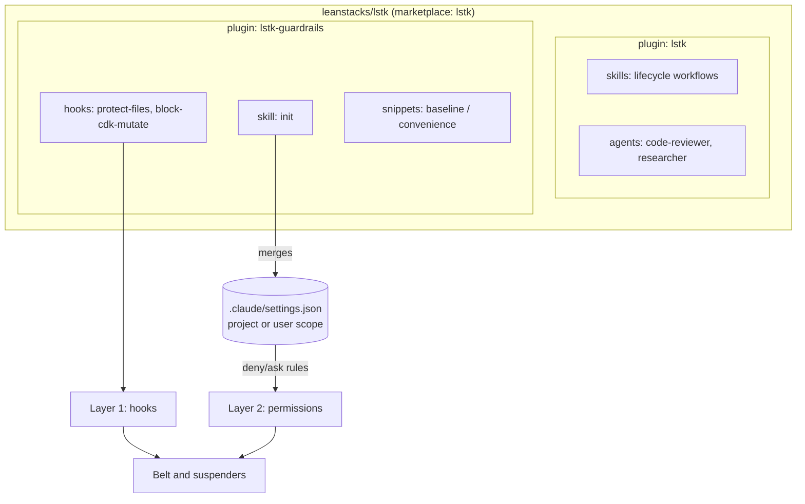
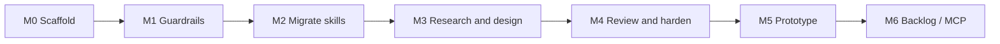

# lstk — LeanStacks Agentic Toolkit: Implementation Plan

**Repo:** `github.com/leanstacks/lstk` · **Site:** leanstacks.com · **Status:** Draft v1

---

## 1. Purpose and scope

A Claude Code plugin marketplace that helps engineers and architects **research, design, develop, review, and harden** applications, and **prototype** quickly. It is AWS-first and TypeScript-first, and doubles as a public portfolio project.

**Non-goals (for now)**

- Multi-agent portability (Codex, Cursor). Claude Code only.
- AWS MCP servers. Deferred (see §12).
- Style enforcement through prose. oxlint and Prettier own style.
- A large skill catalog on day one. Skills are added from real use.

---

## 2. Decisions

| #   | Decision                                                                                                                                         | Rationale                                                                            |
| --- | ------------------------------------------------------------------------------------------------------------------------------------------------ | ------------------------------------------------------------------------------------ |
| D1  | One public repo that is also the marketplace; marketplace name `lstk`                                                                            | Single install source across machines and consultants                                |
| D2  | Two plugins: **`lstk`** (lifecycle skills and agents) and **`lstk-guardrails`** (hooks plus guardrail bootstrap)                                 | Enforcement posture varies by client, so guardrails must install independently       |
| D3  | Plugin names double as the skill namespace, so use `lstk` and `lstk-guardrails`, **not** `core` and `guardrails`                                 | Yields `/lstk:adr-author` rather than `/core:adr-author`                             |
| D4  | Hooks are rewritten in **Node `.mjs`, zero dependencies**                                                                                        | macOS and Linux only, and Node is already guaranteed by your stack. Vitest-testable. |
| D5  | Permission rules (`deny`/`ask`/`allow`) cannot ship in a plugin. Deliver them via an **`init` skill that merges a vetted snippet into settings** | Plugin `settings.json` supports only the `agent` key                                 |
| D6  | Stack defaults live in a reference skill and are overridable by the target repo's `AGENTS.md` and config                                         | Degrades gracefully in non-matching repos                                            |
| D7  | Dogfood the stack: TS ESM, Vitest, oxlint, Prettier, npm                                                                                         | Portfolio coherence                                                                  |
| D8  | Skills with side effects set `disable-model-invocation: true`                                                                                    | Prevents Claude from creating PRs or commits unprompted                              |

---

## 3. Repository layout

```text
lstk/
├── .claude-plugin/
│   └── marketplace.json              # marketplace "lstk", lists both plugins
├── plugins/
│   ├── lstk/
│   │   ├── .claude-plugin/plugin.json
│   │   ├── skills/
│   │   │   ├── commit-messages/SKILL.md
│   │   │   ├── create-pull-request/SKILL.md
│   │   │   ├── agents-md-author/SKILL.md
│   │   │   ├── repo-onboarding/SKILL.md
│   │   │   ├── local-setup-author/SKILL.md
│   │   │   └── ...                   # added per milestone (agents-md-author also has scripts/recon.mjs)
│   │   └── agents/                   # code-reviewer.md, researcher.md (later)
│   └── lstk-guardrails/
│       ├── .claude-plugin/plugin.json
│       ├── hooks/
│       │   ├── hooks.json
│       │   ├── protect-files.mjs
│       │   ├── block-cdk-mutate.mjs
│       │   └── lib/                  # shared helpers: stdin, decision, run, tokenize, paths, config
│       ├── skills/init/SKILL.md      # /lstk-guardrails:init
│       ├── scripts/merge-settings.mjs
│       └── snippets/
│           ├── baseline.json         # deny + ask
│           └── convenience.json      # allow (opt-in)
├── tests/                            # Vitest: hooks, merge script, frontmatter lint
├── scripts/lint-plugins.mjs          # manifest and frontmatter validation
├── docs/                             # ARCHITECTURE.md, CONTRIBUTING.md, this plan
├── .github/workflows/ci.yml
├── package.json                      # devDeps only: vitest, oxlint, prettier
├── AGENTS.md
├── CHANGELOG.md
├── LICENSE                           # MIT or Apache-2.0
└── README.md
```

**Packaging constraints to respect**

- Only `plugin.json` goes inside `.claude-plugin/`. `skills/`, `agents/`, and `hooks/` sit at the plugin root.
- Installed plugins are copied to a cache directory. **A plugin cannot reference files outside its own directory** (no `../`). Shared hook code therefore lives only in `lstk-guardrails`, and nothing is shared across plugins.
- Hooks reference scripts via `${CLAUDE_PLUGIN_ROOT}`.
- Hook scripts have no `node_modules` at runtime, so they must use only Node built-ins.



---

## 4. Manifests

> Schema verified against Claude Code 2.1.319 in M0 (see `docs/ARCHITECTURE.md`). Notes: marketplace `description` is
> recommended (the validator warns without it), and plugin `author` must be an object with a `name`.

**`.claude-plugin/marketplace.json`**

```json
{
  "name": "lstk",
  "description": "LeanStacks Agentic Toolkit: a Claude Code plugin marketplace.",
  "owner": { "name": "LeanStacks", "url": "https://leanstacks.com" },
  "plugins": [
    {
      "name": "lstk",
      "source": "./plugins/lstk",
      "description": "LeanStacks Agentic Toolkit: research, design, develop, review, harden, prototype."
    },
    {
      "name": "lstk-guardrails",
      "source": "./plugins/lstk-guardrails",
      "description": "Deterministic guardrail hooks and a settings bootstrap for safer agentic coding."
    }
  ]
}
```

**`plugins/lstk-guardrails/hooks/hooks.json`**

```json
{
  "hooks": {
    "PreToolUse": [
      {
        "matcher": "Edit|Write",
        "hooks": [
          {
            "type": "command",
            "command": "node \"${CLAUDE_PLUGIN_ROOT}/hooks/protect-files.mjs\""
          }
        ]
      },
      {
        "matcher": "Bash",
        "hooks": [
          {
            "type": "command",
            "command": "node \"${CLAUDE_PLUGIN_ROOT}/hooks/block-cdk-mutate.mjs\""
          }
        ]
      }
    ]
  }
}
```

**Install flow (each machine)**

```text
/plugin marketplace add leanstacks/lstk
/plugin install lstk@lstk
/plugin install lstk-guardrails@lstk
/lstk-guardrails:init            # once per machine (user scope) or per repo (project scope)
```

After installing, **remove the `hooks` block from the existing `~/.claude/settings.json`**, otherwise the hooks run twice.

---

## 5. Milestones



### M0 — Scaffold and tooling (done)

| Task                                              | Acceptance criteria                                                                                                |
| ------------------------------------------------- | ------------------------------------------------------------------------------------------------------------------ |
| Repo, license, README skeleton, AGENTS.md         | Public repo exists with a license                                                                                  |
| Tooling: `package.json`, Vitest, oxlint, Prettier | `npm test`, `npm run lint`, and `npm run format:check` pass on an empty scaffold                                   |
| `scripts/lint-plugins.mjs`                        | Validates manifests, then checks that every skill has `name` matching its directory and a non-empty `description`  |
| Manifests and empty plugins                       | `claude plugin validate` (or `/plugin validate`) passes                                                            |
| CI (GitHub Actions)                               | Runs lint, format check, tests, and plugin lint on PR                                                              |
| Local install smoke test                          | `/plugin marketplace add ./` then install both plugins; `/reload-plugins` shows them                               |
| **Verify against current docs**                   | Manifest schema, version and update behavior, and hook JSON contract confirmed and noted in `docs/ARCHITECTURE.md` |

### M1 — Guardrails plugin (done)

_As built:_ `block-cdk-mutate` also **asks** on `bootstrap` and inspects package scripts and `make` targets. `.claude/lstk.json` supports `unprotectPatterns` to remove a default, and `.claude/lstk.local.json` adds personal overrides. Hooks block through the JSON `permissionDecision`. See `docs/plans/PLAN-M1.md`.

| Task                                                                                                                                     | Acceptance criteria                                                                                                                                                                               |
| ---------------------------------------------------------------------------------------------------------------------------------------- | ------------------------------------------------------------------------------------------------------------------------------------------------------------------------------------------------- |
| **Characterization tests first**: run the existing Bash hooks against a fixture matrix of inputs and record expected allow/block results | Fixture table committed, with both blocked and allowed cases                                                                                                                                      |
| Port `block-cdk-mutate` to `.mjs`                                                                                                        | All fixtures pass. Covers `cdk`, `npx cdk`, `npm exec cdk`, `npm run cdk -- deploy`, and chained commands (`a && cdk deploy`). Blocks `deploy`, `destroy`, and `watch`                            |
| Port `protect-files` to `.mjs` with config                                                                                               | Default patterns built in. Per-project override in `.claude/lstk.json` (`protectedPatterns` added to the defaults, with an explicit way to remove one)                                            |
| Hook contract                                                                                                                            | Reads tool-call JSON from stdin, blocks via the documented exit-code or JSON mechanism with an actionable stderr message                                                                          |
| Failure semantics                                                                                                                        | Matched pattern means block. **Unexpected internal error means fail open with a stderr warning** (a crashing hook must not brick the session). The permission layer is the backstop for that case |
| `snippets/baseline.json` and `convenience.json`                                                                                          | Derived from the existing settings; see §7                                                                                                                                                        |
| `merge-settings.mjs` plus `init` skill                                                                                                   | See §7. Idempotent, with a dry-run diff, and tested                                                                                                                                               |
| README section "Guardrail model"                                                                                                         | Explains the layers, the threat model, and the limits (a hook is not a sandbox)                                                                                                                   |

### M2 — Migrate existing skills into `lstk`

| Task                               | Acceptance criteria                                                                                                                                                                                       |
| ---------------------------------- | --------------------------------------------------------------------------------------------------------------------------------------------------------------------------------------------------------- |
| Move the 5 skills                  | Each at `plugins/lstk/skills/<name>/SKILL.md`, invokable as `/lstk:<name>`                                                                                                                                |
| Normalize frontmatter              | Descriptions state _what_ and _when to trigger_, in third person. `create-pull-request` is `disable-model-invocation: true`. Consider the same for `commit-messages` only if auto-triggering proves noisy |
| Strip client or personal specifics | Review pass for anything unsafe in a public repo                                                                                                                                                          |
| Baseline evals                     | At least 3 trigger prompts (should and should not fire) per skill, documented in `tests/evals/`                                                                                                           |
| Cross-link                         | `repo-onboarding`, `local-setup-author`, and `agents-md-author` reference each other's outputs                                                                                                            |

**Status: done (released as `lstk` 0.1.0 and `lstk-guardrails` 0.1.0).** As built, see `docs/plans/PLAN-M2.md`:

- `recon.sh` was ported to `agents-md-author/scripts/recon.mjs` (Node built-ins, tested), because plugins ship no shell scripts.
- Descriptions are third person and under 500 characters. `lint-plugins` caps them at 1024 and checks relative links.
- `commit-messages` defers to the repo's own commit convention and keeps the four-prefix format as a fallback.
- Evals are one `tests/evals/<skill>.json` per skill, with a shape test that requires one for every skill. A manual run is in `tests/evals/RESULTS.md`.

### M3 — Research and design

| Skill / agent                       | Notes                                                                                                                                                                                                                        |
| ----------------------------------- | ---------------------------------------------------------------------------------------------------------------------------------------------------------------------------------------------------------------------------- |
| `stack-profile`                     | Reference-only skill carrying the default profile (NestJS-containers, Lambda-serverless, Vite+React, CDK-TS, ESM, Vitest, oxlint, Prettier, npm workspaces). States its precedence rule: **repo `AGENTS.md` and config win** |
| `tech-eval` plus `researcher` agent | Read-only tools, isolated context, outputs a trade-off matrix and a recommendation section. Matches your "trade-offs first" format                                                                                           |
| `adr-author`                        | Markdown ADRs in `docs/adr/`, with Mermaid where helpful                                                                                                                                                                     |
| `solution-outline`                  | Requirements to components, risks, assumptions, and a staffing and effort sketch. Marked as draft output for human review                                                                                                    |

**Acceptance:** each skill has a trigger eval set and a worked example in `docs/examples/`.

**Status: done (released as `lstk` 0.2.0).** As built, see `docs/plans/PLAN-M3.md`:

- `stack-profile` is reference-only (`user-invocable: false`). Consumer skills name it and repeat its precedence rule, and never link its files.
- `researcher` is read-only (`Read`, `Grep`, `Glob`, `WebFetch`, `WebSearch`), runs in the foreground (`background: false`), and defines the report format that `tech-eval` consumes.
- `lint-plugins` requires agents to declare `tools` without `Bash`, `Write`, `Edit`, or `NotebookEdit`. A test requires a worked example for `tech-eval`, `adr-author`, and `solution-outline`.
- Worked examples share one fictional scenario (an order-tracking API) in `docs/examples/`. `stack-profile` has none, being reference-only.

### M4 — Review and harden

| Skill / agent                 | Notes                                                                                                          |
| ----------------------------- | -------------------------------------------------------------------------------------------------------------- |
| `code-reviewer` agent         | Read-only tools. Reviews for correctness, maintainability, and test gaps against the repo's stated conventions |
| `architecture-review`         | Reviews a design doc or CDK app against Well-Architected-style questions, with trade-offs rather than verdicts |
| `threat-model`                | STRIDE-style table grounded in actual code and infra, with mitigations and residual risk                       |
| `cdk-iam-review`              | Least-privilege review of CDK constructs. Evaluate whether cdk-nag output should feed it                       |
| `dependency-audit` (optional) | Wraps `npm audit` plus triage guidance. Only if it clearly adds value beyond running the command               |

**Status: in progress.** `code-reviewer`, `architecture-review`, `threat-model`, and `cdk-iam-review` are built. `dependency-audit` is **not built**: a hand run on the fixture showed only reachability as added value, which a plain prompt already gives (see `docs/plans/PLAN-M4.md`, Phase 6).

**Acceptance:** each runs on a sample repo (`examples/` or a linked fixture) and produces output that is reproducibly structured.

### M5 — Prototype

| Piece                     | Behavior                                                                                                                                                                                |
| ------------------------- | --------------------------------------------------------------------------------------------------------------------------------------------------------------------------------------- |
| `prototype` skill         | Scaffolds in `prototypes/<name>/` (Vite+React and mocked API, or a single Lambda handler). Writes a `PROTOTYPE.md` stating **throwaway by default**, what is faked, and known shortcuts |
| `promote-prototype` skill | Runs a gap analysis against production expectations (tests, auth, error handling, IaC, observability) and emits a **gap list with relative effort**, which feeds estimates              |
| Guardrail interaction     | Hooks stay active. Prototypes get speed from scaffolding, not from weakened safety                                                                                                      |

### M6 — Backlog (grow from real use)

- Scaffold skills: `nestjs-module`, `lambda-handler`, `react-feature`, `cdk-construct`.
- AWS docs and CDK MCP servers: off by default, documented credentials surface, verify maintained servers at that time.
- `PostToolUse` hook to run Prettier and oxlint on edited files. It must detect tool presence and fail soft.
- Marketplace polish: screenshots or an asciinema demo, plus a "how it was built" doc.

---

## 6. Hook design

| Concern                               | Approach                                                                                                                                                                                                                          |
| ------------------------------------- | --------------------------------------------------------------------------------------------------------------------------------------------------------------------------------------------------------------------------------- |
| Input parsing                         | `lib/stdin.mjs` reads and parses JSON. Tolerates missing fields                                                                                                                                                                   |
| Path matching (`protect-files`)       | Normalize to a path relative to the project root. Resolve `..` and symlinks before matching, so a traversal path cannot dodge the patterns                                                                                        |
| Command matching (`block-cdk-mutate`) | Tokenize rather than regex the raw string. Handle `&&`, `;`, `\|`, subshells, `npx`/`npm exec`/`npm run` wrappers, and `--` argument passthrough                                                                                  |
| Messages                              | Say _what_ was blocked, _why_, and _what to do instead_ (e.g. "run `cdk synth` or `cdk diff`; deployment is done by a human or a pipeline")                                                                                       |
| Testing                               | Table-driven Vitest tests, with blocked and allowed cases kept in sync with the characterization matrix                                                                                                                           |
| Known limit                           | A hook sees the command string, not its effects. An indirect route (a script that calls `cdk deploy`) can evade it. Document this, and rely on the permission layer plus not granting deploy credentials to the agent environment |

---

## 7. `init` skill and settings merge

**Snippets** (derived from your existing settings; `model` and `theme` excluded as personal preferences)

- `baseline.json`: all current `deny` and `ask` rules (force-push, `reset --hard`, `clean -fd`, CDK deploy, destroy, watch and bootstrap, `~/.ssh` and `.git/config` reads, `gh release`, `gh repo delete`).
- `convenience.json`: the `allow` rules. These save prompts and add no safety, so they are **opt-in**.

**Behavior of `/lstk-guardrails:init`**

1. Ask the scope: **user** (`~/.claude/settings.json`, once per machine) or **project** (`.claude/settings.json`, committed for the team).
2. Run `merge-settings.mjs --scope <s> --dry-run` and show the diff.
3. On confirmation, apply.

**Merge rules (tested)**

- Union and deduplicate arrays. **Never remove or reorder existing user entries.**
- Idempotent: a second run produces no diff.
- Preserve unrelated keys. Create the file if it does not exist. Refuse to write if the existing file is invalid JSON.
- Report any existing `allow` rule that conflicts with a snippet `deny` rule (deny wins at runtime, but the user should know).
- Never touch `hooks`; the plugin supplies those.

---

## 8. Skill authoring conventions

- **Description is the trigger.** Third person, with what it does and when to use it, and concrete trigger phrases. Keep it tight, because every description sits in context permanently.
- **Progressive disclosure.** `SKILL.md` stays short. Detail goes in `reference.md`, `templates/`, and `examples/` loaded on demand.
- **Deterministic work goes in scripts, judgment goes in prose.**
- **Output contracts.** State the exact artifact (path, format, sections) so results are reviewable.
- **Defer to the repo.** Read `AGENTS.md` and project config first, and apply the `stack-profile` defaults only where the repo is silent.
- **Side effects need explicit invocation.** Use `disable-model-invocation: true` for anything that commits, pushes, opens PRs, or writes outside the working tree.
- **Docs and diagrams** are Markdown with Mermaid.
- **Agent definitions** restrict `tools` to the minimum. Plugin agents cannot carry `hooks`, `mcpServers`, or `permissionMode`, so rely on plugin-level hooks and tool restriction.

---

## 9. Testing strategy

| Layer                          | Tool                                        | Runs in CI                                                                              |
| ------------------------------ | ------------------------------------------- | --------------------------------------------------------------------------------------- |
| Hook logic, merge script       | Vitest                                      | Yes                                                                                     |
| Manifest and frontmatter lint  | `scripts/lint-plugins.mjs`                  | Yes                                                                                     |
| Style                          | oxlint, Prettier                            | Yes                                                                                     |
| Plugin loads and validates     | `claude plugin validate --strict`           | Yes (CLI installed via npm; runs offline with no credentials)                           |
| Skill trigger and output evals | `skill-creator` eval workflow, run manually | **No** (needs model access). Results summarized in `tests/evals/RESULTS.md` per release |

---

## 10. Release and versioning

- Semver per plugin via `version` in each `plugin.json`, and git tags like `lstk-v0.1.0` and `lstk-guardrails-v0.1.0`.
- `CHANGELOG.md` per plugin.
- **Bump the version on every released change.** Verify in M0 how the update check treats versions, since unbumped changes may not propagate to other machines.
- Pre-1.0 while the skill set is settling. Cut `0.1.0` at the end of M2, which is the first genuinely useful and safe state. M1 ships `lstk-guardrails` as `0.1.0-alpha.1` so installed users receive it.

---

## 11. Risks

| Risk                                          | Mitigation                                                                                      |
| --------------------------------------------- | ----------------------------------------------------------------------------------------------- |
| Hooks give false confidence                   | Document the limits (§6), keep permission rules as a second layer, never claim sandboxing       |
| Skill sprawl harms triggering                 | Gate new skills on a real recurring workflow and an eval set                                    |
| Over-opinionated stack defaults               | `stack-profile` yields to repo conventions                                                      |
| Plugin cache isolation breaks path references | Keep each plugin self-contained, enforce with the lint script (flag `../` references)           |
| Public-repo leakage (client details)          | Review checklist in `CONTRIBUTING.md`, applied in M2 migration                                  |
| Docs drift as Claude Code evolves             | M0 verification, plus a "last verified against Claude Code version X" note in `ARCHITECTURE.md` |

---

## 12. Deferred and open items

- AWS MCP servers (deferred, M6).
- Whether to build a small Windows/WSL story (out of scope, macOS and Linux only).
- Whether a second guardrail layer should include a `UserPromptSubmit` or `PostToolUse` hook (evaluate after M1 use).
- Public marketplace listing and discoverability (after `0.1.0`).
