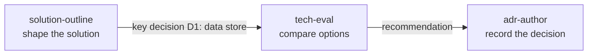

# Worked examples

One fictional scenario runs through these examples: **Example Orders**, a small order-tracking API for a made-up
retailer. The three skills read as one lifecycle.

| Example                                    | Skill              | Shows                                                      |
| ------------------------------------------ | ------------------ | ---------------------------------------------------------- |
| [solution-outline.md](solution-outline.md) | `solution-outline` | A draft outline with components, risks, and effort ranges. |
| [tech-eval.md](tech-eval.md)               | `tech-eval`        | A trade-off matrix and a sourced recommendation for D1.    |
| [adr-author.md](adr-author.md)             | `adr-author`       | The resulting ADR and its index entry.                     |

`stack-profile` has no example of its own. It is reference-only, and its effect is visible in the **Stack** lines of the
other three.

## Read these as illustrations

- The company, system, and numbers are fictional.
- Source entries show the _shape_ of sourcing (key, title, URL, date or `undated`). Figures quoted from them are
  illustrative and not verified. A real run fetches and cites current pages.
- Real output varies from run to run. Check the structure and the discipline (ranges, assumptions, source keys), not the
  exact wording.
