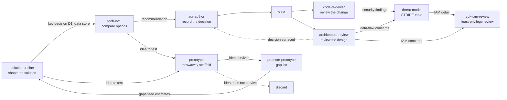

# Worked examples

One fictional scenario runs through these examples: **Example Orders**, a small order-tracking API for a made-up
retailer. The skills and the agent read as one lifecycle: design, prototype, then review and harden the built result.

| Example                                          | Skill                   | Shows                                                      |
| ------------------------------------------------ | ----------------------- | ---------------------------------------------------------- |
| [solution-outline.md](solution-outline.md)       | `solution-outline`      | A draft outline with components, risks, and effort ranges. |
| [tech-eval.md](tech-eval.md)                     | `tech-eval`             | A trade-off matrix and a sourced recommendation for D1.    |
| [adr-author.md](adr-author.md)                   | `adr-author`            | The resulting ADR and its index entry.                     |
| [code-reviewer.md](code-reviewer.md)             | `code-reviewer` (agent) | A fixed-format code review with cited findings.            |
| [architecture-review.md](architecture-review.md) | `architecture-review`   | Findings by pillar and trade-offs to decide.               |
| [threat-model.md](threat-model.md)               | `threat-model`          | A data-flow diagram and a STRIDE threat table.             |
| [cdk-iam-review.md](cdk-iam-review.md)           | `cdk-iam-review`        | A principal inventory, findings, and shown-only diffs.     |
| [prototype.md](prototype.md)                     | `prototype`             | A scaffolded web prototype and its `PROTOTYPE.md`.         |
| [promote-prototype.md](promote-prototype.md)     | `promote-prototype`     | A cited gap list with relative effort for that prototype.  |

`stack-profile` has no example of its own. It is reference-only, and its effect is visible in the **Stack** lines of the
design examples.

## Read these as illustrations

- The company, system, and numbers are fictional.
- Source entries show the _shape_ of sourcing (key, title, URL, date or `undated`). Figures quoted from them are
  illustrative and not verified. A real run fetches and cites current pages.
- Real output varies from run to run. Check the structure and the discipline (ranges, assumptions, source keys), not the
  exact wording.
