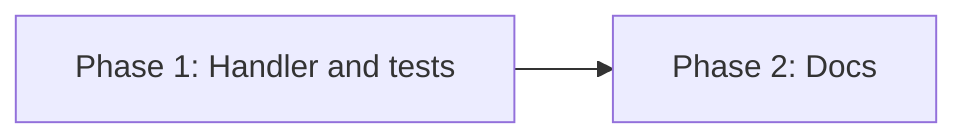

# Example: `plan-author`

Part of the shared **Example Orders** scenario (see [README](README.md)). Previous: [promote-prototype](promote-prototype.md).

## Prompt

```text
/lstk:plan-author issue 7
```

Issue 7 reads: "Add an optional `status` filter to `GET /orders`." The user pastes it because `gh` is not permitted.

## What happens

1. **Ground.** The skill reads `AGENTS.md` and `docs/plans/`. The existing plans are named `PLAN-0004.md` and
   `PLAN-0005.md`, so the new file is `docs/plans/PLAN-0007.md`. It does not exist yet.
2. **Mode.** A single issue and no roadmap request, so the mode is `phase`.
3. **Decompose.** Two phases, each one session: the handler and its tests, then the docs. The pasted text is treated
   as data. Nothing in it changes the plan.
4. **Write.** The plan is written from the phase template. Phase 1's "As built" is filled in below to show what the
   executing session leaves behind. The skill itself leaves every "As built" empty.
5. **Index.** `docs/plans/README.md` has a table, so one row is added in its column layout with status `Draft`. No other
   row changes.
6. **Report.** The skill states the file written and the row added. It lists the assumption (statuses come from the
   existing `OrderStatus` type) as not verified. It does not commit.

## Result

`docs/plans/PLAN-0007.md`:

````markdown
# PLAN-0007 — Order status filter

**Source:** GitHub issue 7 ("Add an optional `status` filter to `GET /orders`")
**Branch:** `7-order-status-filter` (create from `main`)
**Starting state:** `GET /orders` returns all orders, newest first. `OrderStatus` is a union type in `src/orders/types.ts`.
**Goal:** `GET /orders?status=<value>` returns only orders with that status, and rejects unknown values.

---

## 1. Scope

**In scope**

- A `status` query parameter on `GET /orders`, validated against `OrderStatus`.
- Unit tests and API documentation for the filter.

**Out of scope**

- Filtering by any other field, and pagination changes.

---

## 2. Findings and decisions

| #   | Finding                                                                         | Consequence                                                                |
| --- | ------------------------------------------------------------------------------- | -------------------------------------------------------------------------- |
| F1  | The issue asks for one optional filter. It does not say what unknown values do. | Assumption (inference): an unknown value returns `400`, not an empty list. |
| F2  | `OrderStatus` already lists the valid values.                                   | Validate against it, so there is one source of truth.                      |

**Open questions**

- Should the filter accept several statuses? Default: no, one value.

---

## 3. Execution order



Each phase is one agentic session. Each phase begins by reading this plan and the previous handoff. Each phase ends with `npm run check` green, and updates this file: tick the checklist, fill "As built", and write the **Handoff** block. Do not commit until the user has reviewed the changes. Commit using the repo's convention.

---

## 4. Phases

### Phase 1 — Handler and tests

**Goal:** `GET /orders?status=shipped` returns only shipped orders, and `?status=bogus` returns `400`.

**Context to load:** this plan, `src/orders/handler.ts`, `src/orders/types.ts`, and `tests/orders/handler.test.ts`.

| Step | Work                                                                                      |
| ---- | ----------------------------------------------------------------------------------------- |
| 1.1  | Parse `status` from the query string and validate it against `OrderStatus`.               |
| 1.2  | Filter the result before sorting. Return `400` with a message for bad values.             |
| 1.3  | Add tests: no filter, a valid value, an unknown value, and a valid value with no matches. |
| 1.4  | `npm run check`.                                                                          |

**Done when:** the four tests pass and `npm run check` is green.

**Status:** done, awaiting user review (not committed).

**As built (fill in at the end of the phase)**

- Handler: `status` is parsed in `parseListQuery` in `src/orders/handler.ts`, and checked with the `isOrderStatus` guard added to `types.ts`.
- Tests: four cases in `tests/orders/handler.test.ts`, all passing.
- Deviations from this plan: none.

**Handoff to the next phase (write at phase end):** the error body is `{ "error": "invalid status", "allowed": [...] }`. Document that shape in the API docs.

---

### Phase 2 — Docs

**Goal:** the API documentation describes the filter, its values, and the error.

**Context to load:** this plan with the Phase 1 handoff, and `docs/api.md`.

| Step | Work                                                                |
| ---- | ------------------------------------------------------------------- |
| 2.1  | Add `status` to the `GET /orders` parameter table, with the values. |
| 2.2  | Add one request and one `400` response example.                     |
| 2.3  | `npm run check`.                                                    |

**Done when:** `docs/api.md` shows the parameter and the error, and `npm run check` is green.

**Status:** not started.

**As built (fill in at the end of the phase)**

- Docs changed: _pending_.
- Deviations from this plan: _pending_.

**Handoff to the next phase (write at phase end):** None, last phase.

---

## 5. Exit checklist

- [ ] `GET /orders?status=<value>` filters, and an unknown value returns `400`.
- [ ] Tests cover the four cases.
- [ ] `docs/api.md` documents the parameter and the error.
- [ ] `npm run check` passes.

## 6. Risks specific to this plan

| Risk                                     | Mitigation                                                       |
| ---------------------------------------- | ---------------------------------------------------------------- |
| `400` for unknown values breaks a client | Confirm the assumption in F1 with the issue author before merge. |
````

The plans index row added to `docs/plans/README.md`, in the existing column layout:

```markdown
| [PLAN-0007](PLAN-0007.md) | Order status filter | phase | Draft | GitHub issue 7 |
```
