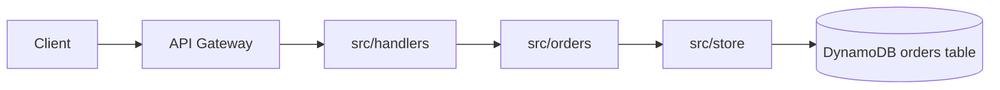

# Example: `repo-onboarding`

Part of the shared **Example Orders** scenario (see [README](README.md)). This one runs on the built result, so it sits
after the design examples. Its output is a document for humans and coding agents.

## Prompt

```text
Onboard me to this repo. Produce or update docs/ARCHITECTURE.md.
```

## What happens

1. **Discover.** The skill looks for an existing primary doc. `docs/ARCHITECTURE.md` and `docs/PROJECT_OVERVIEW.md` are
   both absent, so the verdict is `MISSING`. It finds `README.md`, `AGENTS.md`, `docs/LOCAL_SETUP.md`, and
   `docs/adr/0001-use-dynamodb-for-order-data-store.md`, and reads them as inputs.
2. **Survey.** It reads the manifest, the handler entry point, the CDK app, and one file per layer. It does not install,
   build, or run anything, and it does not open `.env`.
3. **Write.** It creates `docs/ARCHITECTURE.md` from the architecture template. The invariants and contracts come
   before the tech stack. Setup and commands are links to `docs/LOCAL_SETUP.md` and `AGENTS.md`, not copies.
4. **Hand off.** It gives a short brief in chat and a menu of next steps. It does not modify `AGENTS.md` or
   `docs/LOCAL_SETUP.md`. It does not commit.

## Result

`docs/ARCHITECTURE.md` (trimmed):

````markdown
# Example Orders: Architecture

> For humans and coding agents.
> **Last verified:** 2026-11-28 · commit `3f9a1c2`
> Maintainers: update this file when you change structure, entry points, or contracts.

## Purpose

An order-tracking API for a retailer: create an order, read it, and list orders. It does not take payment or manage
stock (inferred from the README, which says payments are out of scope).

## Architecture and data flow

Request flow: API Gateway invokes one Lambda handler per route. Handlers call the order service, which is the only code
that talks to DynamoDB. Dependencies point inward: `handlers` imports `orders`, and `orders` imports `store`. Nothing
imports `handlers`.



## Repository structure

```text
src/
  handlers/   one file per route; parses input, calls the service
  orders/     order rules and the shared types (types.ts)
  store/      the DynamoDB client and queries
infra/        CDK app: API, functions, table
docs/         ARCHITECTURE.md, LOCAL_SETUP.md, adr/
```

## Central contracts and invariants

- `OrderStatus` in `src/orders/types.ts` is the single source of the status values. Handlers and the store import it and
  never redeclare the strings.
- Only `src/store` may import the AWS SDK. A handler that imports it breaks the layering that the tests rely on.
- Order ids are ULIDs generated in `src/orders`, never by the store. The table sorts on them, so newest-first listing
  depends on that.
- Table and index names come from `infra/`. Code reads them from environment variables set there, and does not
  hard-code them. See `docs/adr/0001-use-dynamodb-for-order-data-store.md` for why DynamoDB.

## Tech stack

| Layer   | Technology          | Notes                                   |
| :------ | :------------------ | :-------------------------------------- |
| Runtime | Node.js, TypeScript | ESM only                                |
| API     | API Gateway, Lambda | One function per route                  |
| Data    | DynamoDB            | Single table, see the ADR               |
| Infra   | AWS CDK             | `infra/`                                |
| Test    | Vitest              | Run through the commands in `AGENTS.md` |

## Where to go next

- Setup: [docs/LOCAL_SETUP.md](LOCAL_SETUP.md)
- Commands and agent rules: [AGENTS.md](../AGENTS.md), and `.github/workflows/ci.yml` for what CI runs
- Decisions: [docs/adr/](adr/)

## Open questions

- Which environments exist? The CDK app defines one stack and no stage names. Ask the platform team.
````

## What to notice

- The headings follow the template: purpose and shape first, the invariants an agent cannot see from the code next, the
  tech stack after them, and unknowns last.
- There is no "Getting started" or "Development workflow" section. `docs/LOCAL_SETUP.md` and `AGENTS.md` own those, and
  this file links to them.
- `AGENTS.md` links to this file with a plain link. It does not import it, so it does not load into every session.
- Inferred text is labeled, and the unknown goes in "Open questions".
- The path, the commit, and the date are fictional. A real run stamps the commit it checked.
