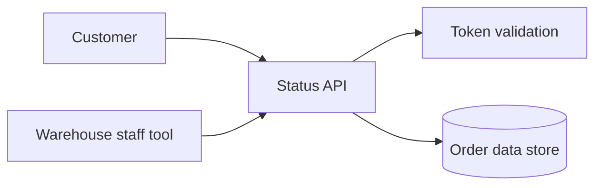

# Example: `solution-outline`

Part of the shared **Example Orders** scenario (see [README](README.md)). Next in the lifecycle: [tech-eval](tech-eval.md).

## Prompt

```text
Outline a solution for a small order-tracking API. Customers check order status, and warehouse staff post status
updates. About 50 requests per second at peak. Three engineers, three months. No existing repo.
```

## Result

````markdown
# Solution outline: Example Orders tracking API

> **Draft for human review. Estimates are rough.**

**Date:** 2026-11-11
**Stack:** No repo, so the `stack-profile` defaults apply (TypeScript ESM, AWS CDK in TypeScript, Vitest). This is a
default and not a requirement.

## Summary

A read-heavy API lets customers look up an order's status, and a smaller write path lets warehouse staff post updates.
The proposed shape is a managed serverless API in front of a key-based data store. The main risk is the data store
choice, which is costly to reverse.

## Requirements and assumptions

**Functional**

- Customers look up an order's current status and its history.
- Warehouse staff post status updates for an order.

**Non-functional**

- About 50 requests per second at peak (given).

**Constraints**

- Three engineers, three months (given).

**Assumptions**

| #   | Assumption                                       | Impact if wrong                                  |
| --- | ------------------------------------------------ | ------------------------------------------------ |
| A1  | Reads outnumber writes by about 20 to 1          | A write-heavy load changes the data store choice |
| A2  | Customers authenticate through an existing IdP   | Add an identity component and about 1 to 2 pd    |
| A3  | Lookups are by order ID, not by free-text search | Search needs an index or a different store       |
| A4  | Staff use an internal tool that calls this API   | A staff UI adds frontend work, not sized here    |
| A5  | One AWS region, no multi-region requirement      | Multi-region roughly doubles infrastructure work |

## Architecture

| Component        | Responsibility                           | Interfaces           | Notes  |
| ---------------- | ---------------------------------------- | -------------------- | ------ |
| Status API       | Serves order lookups and accepts updates | HTTPS in, store out  | A1, A3 |
| Order data store | Holds orders and their status history    | API in               | See D1 |
| Auth             | Validates customer and staff tokens      | Token in, claims out | A2     |
| Infrastructure   | Provisions the above as code             | CDK app              | A5     |



## Key decisions

| #   | Decision                  | Options noted                                | Next step                      |
| --- | ------------------------- | -------------------------------------------- | ------------------------------ |
| D1  | Order data store          | DynamoDB, Aurora Serverless (PostgreSQL)     | `tech-eval`, then `adr-author` |
| D2  | Compute model for the API | Lambda behind API Gateway, NestJS containers | `tech-eval`, then `adr-author` |

## Risks

| #   | Risk                                         | Likelihood | Impact | Mitigation                                   |
| --- | -------------------------------------------- | ---------- | ------ | -------------------------------------------- |
| R1  | Data store choice does not fit later queries | Medium     | High   | Settle D1 early. List access patterns first. |
| R2  | Requirements grow (search, notifications)    | High       | Medium | Keep them out of scope and list as open Qs.  |

## Staffing and effort sketch

| Component or work item   | Role             | Effort range | Assumption |
| ------------------------ | ---------------- | ------------ | ---------- |
| Status API (read, write) | Backend engineer | 8 to 14 pd   | A1, A3     |
| Data store and model     | Backend engineer | 4 to 8 pd    | D1 open    |
| Auth integration         | Backend engineer | 3 to 6 pd    | A2         |
| Infrastructure as code   | Cloud engineer   | 6 to 10 pd   | A5         |
| Tests and CI             | Any engineer     | 5 to 9 pd    | None       |

**Total:** 26 to 47 person-days, **only valid under** A1 to A5, and **excluding** the staff UI (A4), search, and
operations setup.

## Open questions

1. Does an IdP already exist, and which one? (product owner)
2. Is there a staff UI to build, or only an API? (product owner)

## Confidence and unknowns

- **Confidence:** low to medium. The requirements are short and D1 is open.
- **Biggest unknowns:** the data store choice, the IdP integration, and the scope of the staff tool.
- **Not covered:** detailed design, security review, and operations.
````

## What to check

- The **banner** is the first line after the title, and **Confidence and unknowns** is present.
- Every effort figure is a **range** with an assumption, and the total names what it excludes.
- **Key decisions** are listed with options and are not settled. Each names a next step.
- Nothing is invented without an assumption: the 20 to 1 read ratio appears as A1, not as a requirement.
- The **Stack** line says the profile is a default, not a requirement. In a repo with its own `AGENTS.md`, that line
  would cite the repo instead.
