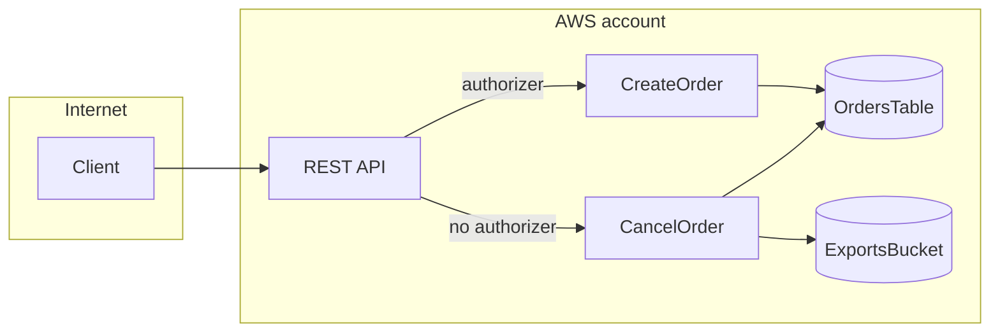

# Example: `threat-model`

Part of the shared **Example Orders** scenario (see [README](README.md)). Previous: [architecture-review](architecture-review.md).
Next: [cdk-iam-review](cdk-iam-review.md).

## Prompt

```text
/lstk:threat-model Threat model the Example Orders API in infra/ and src/. STRIDE, please.
```

## What happens

1. **Build the system model** from code and infrastructure, each element cited, and draw it as a data-flow diagram.
2. **Apply STRIDE per element.** A threat with no evidence moves to **Assumptions to verify**.
3. **Write** `docs/threat-models/example-orders.md`. Secrets are reported by location and kind, never by value.

This skill is not a security audit or a penetration test.

## Result

````markdown
# Threat model: Example Orders

**Date:** 2026-11-11
**Status:** Threat model for human judgment. Not a security audit.

## Scope and sources

- **Modeled:** `infra/lib/orders-stack.ts`, `src/handlers/`
- **Conventions read:** `AGENTS.md`
- **Stack basis:** repo-stated, with `stack-profile` defaults for the gaps

## System model



| Element         | Kind        | Boundary | Source                           |
| --------------- | ----------- | -------- | -------------------------------- |
| Client          | actor       | Internet | assumed                          |
| REST API        | entry point | Edge     | `infra/lib/orders-stack.ts:57`   |
| CancelOrder     | process     | AWS      | `infra/lib/orders-stack.ts:38`   |
| OrdersTable     | data store  | AWS      | `infra/lib/orders-stack.ts:16`   |
| ExportsBucket   | data store  | AWS      | `infra/lib/orders-stack.ts:20`   |
| Webhook signing | secret      | AWS      | `src/handlers/cancel-order.ts:2` |

## Assumptions

- The Cognito user pool issues tokens to customers only. Verify the pool settings.

### Assumptions to verify

- Order IDs may be guessable. Check how they are generated.

## Threats

| ID    | Element         | STRIDE | Threat                                 | Evidence                         | Existing control | Mitigation                               | Residual risk                         | Confidence |
| ----- | --------------- | ------ | -------------------------------------- | -------------------------------- | ---------------- | ---------------------------------------- | ------------------------------------- | ---------- |
| TM-01 | REST API        | S, E   | Anyone can cancel any order            | `infra/lib/orders-stack.ts:62`   | none found       | Attach the authorizer, check ownership   | high, no caller identity on the route | high       |
| TM-02 | ExportsBucket   | I      | Exported data is readable by anyone    | `infra/lib/orders-stack.ts:20`   | ACL-only block   | Block public access, serve by signed URL | high, public read is explicit         | high       |
| TM-03 | Webhook signing | I      | Key in source can leak with the repo   | `src/handlers/cancel-order.ts:2` | none found       | Move to a secret store, rotate the key   | medium, depends on repo access        | high       |
| TM-04 | CancelOrder     | E      | Role allows every DynamoDB action      | `infra/lib/orders-stack.ts:45`   | table-scoped ARN | Narrow actions (see `cdk-iam-review`)    | medium, scoped to one table           | high       |
| TM-05 | CancelOrder     | D      | A 15-minute timeout lets calls pile up | `infra/lib/orders-stack.ts:38`   | none found       | Set a short timeout                      | low, concurrency is not capped here   | medium     |

## Top risks

1. **TM-01:** exposed to the internet, one request cancels an order, and no identity is checked.
2. **TM-02:** the bucket is public by design in code, and the contents are unknown.

## Mitigation plan

| Order | Threats | Change                                    | Effort |
| ----- | ------- | ----------------------------------------- | ------ |
| 1     | TM-01   | Attach the authorizer to the cancel route | small  |
| 2     | TM-02   | Block public access and use signed URLs   | medium |
| 3     | TM-03   | Move the signing key to a secret store    | medium |

Residual risk is the owner's decision. Nothing here is marked accepted.

## Not reviewed

- Deployed state, the Cognito configuration, dependencies, and other accounts. No injection attempts seen.

## Confidence and limits

Static reading only. It is not an audit, can miss threats, and can be wrong.
````

## What a human should verify

- Every threat has evidence that exists. Anything without evidence belongs under **Assumptions to verify**.
- No secret value appears anywhere. TM-03 gives the location and kind only.
- Residual risk is a rating with a rationale, never "accepted".
