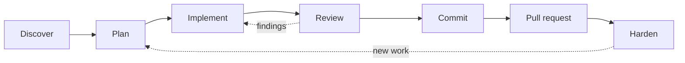

# The lstk lifecycle map

Where each lstk skill and agent fits on the build loop, and where plain Claude Code does the work.

> Last verified against `lstk` 0.4.0 and Claude Code 2.1.323 on 2026-11-13.

## The build loop

Every task, whether a feature, a bug fix, or a new system, moves through some or all of these stages.

## How to invoke each piece

Each step in the guides names how it runs. Four modes:

| Mode                  | What it means                                                                                                       | How you start it                                            |
| --------------------- | ------------------------------------------------------------------------------------------------------------------- | ----------------------------------------------------------- |
| **type it**           | A slash-only skill. Claude never runs it on its own, because it writes files or takes a heavy action.               | Type `/lstk:<name>`.                                        |
| **say it**            | A skill Claude may load when your request matches its description. You can also call it by slash.                   | Ask in plain words, or type `/lstk:<name>`.                 |
| **delegate it**       | An agent: a read-only helper that works in its own context. It does not see your conversation, so you give it work. | Ask Claude to delegate, or name it: `@agent-lstk:<name>`.   |
| **plain Claude Code** | No lstk skill exists for this step. Claude Code does it, with the guardrail hooks and `AGENTS.md` for support.      | Prompt Claude normally. Use plan mode for non-trivial work. |

A **skill** is a packaged set of instructions Claude follows for one kind of task. An **agent** (subagent) is a helper
with its own tools and context. A **hook** is a script that runs before a tool call and can deny or ask. See
[getting started](getting-started.md) for more, and the [README](../../README.md) for the full skill and agent tables.

## Stage map

| Stage            | lstk skills and agents                                                                                                                                       | Plain Claude Code                                          |
| ---------------- | ------------------------------------------------------------------------------------------------------------------------------------------------------------ | ---------------------------------------------------------- |
| **Discover**     | `repo-onboarding` [say it], `agents-md-author` [say it], `local-setup-author` [say it], `researcher` [delegate it], `tech-eval` [say it]                     | Reading and searching the code.                            |
| **Plan**         | `solution-outline` [say it], `adr-author` [say it], `tech-eval` [say it], `prototype` [type it], `promote-prototype` [type it], `stack-profile` (background) | Plan mode: Claude proposes, you approve.                   |
| **Implement**    | None. `stack-profile` supplies defaults where the repo is silent.                                                                                            | Writing code, fixing bugs, writing tests.                  |
| **Review**       | `code-reviewer` [delegate it], `architecture-review` [type it], `cdk-iam-review` [type it]                                                                   | Running the repo's checks (`npm run check` or equivalent). |
| **Commit**       | `commit-messages` [say it]                                                                                                                                   | `git add` and `git commit`.                                |
| **Pull request** | `create-pull-request` [type it]                                                                                                                              | None.                                                      |
| **Harden**       | `threat-model` [type it], `cdk-iam-review` [type it], `architecture-review` [type it]                                                                        | Dependency triage by hand.                                 |

`stack-profile` is background knowledge. It is not in the `/` menu, and Claude loads it when a task needs stack
defaults. The repo's own `AGENTS.md` always wins over it.

### Where lstk has no skill

lstk is strong on discovering, planning, reviewing, hardening, committing, and opening pull requests. It has **no
skill for implementing a feature, fixing a bug, or improving test coverage**. Those steps are plain Claude Code. lstk
helps around them:

- `AGENTS.md` and `stack-profile` ground the work in your conventions.
- `lstk-guardrails` hooks block risky actions while Claude edits.
- `code-reviewer` checks the result, including test gaps.

The recipes say this per task, in a "What is plain Claude Code here" line.

## Loop variants

Pick the shortest loop that fits the task.

**Small change** (a bug fix, a small feature). Recipes: [existing projects](existing-projects.md).

1. Plan in plan mode. [plain Claude Code]
2. Implement in small steps and run the repo's checks. [plain Claude Code]
3. Review the diff with `code-reviewer`. [delegate it]
4. Commit with `commit-messages`. [say it]
5. Open a draft PR with `create-pull-request`. [type it]

**Larger change** (a new component, a new trust boundary, a real decision). Add design first.

1. Outline the change with `solution-outline`. [say it]
2. Compare any open choice with `tech-eval`, then record each decision with `adr-author`. [say it]
3. Add `threat-model` if the change crosses a trust boundary. [type it]
4. Run the small-change loop above.

Recipes: [existing projects](existing-projects.md) and [new projects](new-projects.md).

**Spike** (an idea to test before committing to it). Recipe: [new projects](new-projects.md).

1. Build a throwaway with `prototype`. [type it]
2. If the idea survives, list the gaps with `promote-prototype`. [type it]
3. Turn the gaps into an estimate with `solution-outline`, then follow the larger-change loop.

Review and hardening recipes, including the periodic pass, are in [review and hardening](review-and-hardening.md).
Common questions are in the [FAQ](faq.md).

## Guardrails apply throughout

`lstk-guardrails` hooks run at every stage. They deny CDK `deploy`, `destroy`, and `watch`, and edits to protected
files such as `.env` and lockfiles. If a hook blocks a call, read the message and ask the human. See the
[guardrail model](../../README.md#guardrail-model).
