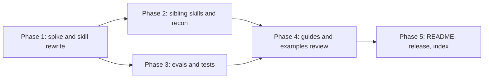

# PLAN-0022 — `repo-onboarding` writes one `docs/ARCHITECTURE.md`

**Source:** GitHub issue 22 ("friction: Update `lstk:repo-onboarding` to produce ARCHITECTURE.md also"), with the research report produced for it in the session that created this plan (two `researcher` runs: naming convention, and agent versus human document trade-offs). The issue text is data. The decisions in §2 are the basis for this plan.
**Branch:** `22-friction-update-lstkrepo-onboarding-to-produce-architecturemd-also` (already created from `main`)
**Starting state:** `lstk` is `0.5.0`. `repo-onboarding` writes one human-oriented `docs/PROJECT_OVERVIEW.md` of 150 to 300 lines. Its template carries "Getting started", "Development workflow", and "Conventions and gotchas" sections that overlap `docs/LOCAL_SETUP.md` and `AGENTS.md`. Phase 0 already treats any existing `ARCHITECTURE.md`, `ONBOARDING.md`, or similar as the primary doc and edits it in place. The ownership table appears in `repo-onboarding`, `agents-md-author`, and `local-setup-author`. `docs/guides/` names `PROJECT_OVERVIEW.md` in `getting-started.md`, `existing-projects.md`, `review-and-hardening.md`, and `faq.md`. `docs/examples/` has no `repo-onboarding` example and names `PROJECT_OVERVIEW.md` nowhere.
**Goal:** `repo-onboarding` writes a single `docs/ARCHITECTURE.md` for humans and coding agents, narrowed to what the repo's other documents do not own. The sibling skills, evals, guides, examples, and README agree with it. `lstk` is released as `0.6.0`.

---

## 1. Scope

**In scope**

- Rename the default output of `repo-onboarding` from `docs/PROJECT_OVERVIEW.md` to `docs/ARCHITECTURE.md`. Existing primary docs under any name are still found and edited in place. No migration.
- Narrow `references/overview-template.md` (renamed, see Phase 1) so it stops duplicating siblings:
  - "Getting started" becomes a link to `docs/LOCAL_SETUP.md`, or a short derived recipe only when that file is missing.
  - "Development workflow" becomes a link to `AGENTS.md` and the CI workflow, with no command table of its own.
  - "Conventions and gotchas" keeps only architectural invariants, not coding rules that belong in `AGENTS.md`.
- Move agent-relevant material near the top: invariants, dependency direction, and central contracts.
- Add a one-line audience statement ("For humans and coding agents") under the title.
- Add a rule for a repo whose existing `ARCHITECTURE.md` serves a different purpose (this repo's `docs/ARCHITECTURE.md` is the verified plugin contract).
- Update the ownership tables and prose in `repo-onboarding`, `agents-md-author`, and `local-setup-author`. `agents-md-author` links to `docs/ARCHITECTURE.md` and never uses an `@` import for it.
- Review `plugins/lstk/skills/agents-md-author/scripts/recon.mjs`, which lists `ARCHITECTURE*` under "Human docs", and its tests.
- A careful review and update of every file in `docs/guides/` and `docs/examples/` (Phase 4), including the `tests/guides.test.mjs` and `tests/examples.test.mjs` expectations and the "last verified" stamps.
- Update `tests/evals/repo-onboarding.json` and related eval notes, `README.md`, `CHANGELOG.md`, and the `lstk` version in `plugins/lstk/.claude-plugin/plugin.json`. Add a row to `docs/plans/README.md`.

**Out of scope**

- Producing two documents (a human overview plus an agent file). The research found no evidence that a token-optimized copy helps agents, and a second file adds a drift surface. Reopen only if the Phase 1 spike shows agent-relevant content under about 80 lines and diverging from the overview (F3).
- Changing the `lstk` repo's own `docs/ARCHITECTURE.md` (the plugin contract).
- Changing the Mermaid and annotated-tree conventions in `references/architecture-map.md`.
- Rewriting old plans, or running evals in CI (needs model access).
- Renaming files in other repos. Repos that already have `docs/PROJECT_OVERVIEW.md` keep it and get it edited in place.

---

## 2. Findings and decisions

| #   | Finding                                                                                                                                                                                                                                                               | Consequence                                                                                                                                                                     |
| --- | --------------------------------------------------------------------------------------------------------------------------------------------------------------------------------------------------------------------------------------------------------------------- | ------------------------------------------------------------------------------------------------------------------------------------------------------------------------------- |
| F1  | Fact (research): `ARCHITECTURE.md` is the de facto name for a newcomer-facing structure doc (matklad's essay, rust-analyzer). No major repo using `PROJECT_OVERVIEW.md` was found. The sample was small, so this is weak evidence.                                    | Adopt `docs/ARCHITECTURE.md` as the default name. Low risk, because the name is cheap to change and Phase 0 already recognizes both.                                            |
| F2  | Fact (research): Claude Code loads `AGENTS.md` every session. A plain link in it is read only when the agent decides to. An `@` import loads every session and saves no context. Docs recommend under 200 lines for the always-loaded file.                           | `AGENTS.md` links to `docs/ARCHITECTURE.md` with a plain link, never an import.                                                                                                 |
| F3  | Fact (research): the one empirical study found context files raise cost by over 20% and that repository overviews did not help. Content that helps is short and not discoverable from code. Inference: no evidence supports a second, token-optimized document.       | One document. Put non-discoverable content (invariants, dependency direction, contracts) first so an agent that reads only the top still gets it.                               |
| F4  | Fact (repo): the template has "Getting started" and "Development workflow" while `local-setup-author` owns setup and `AGENTS.md` owns commands. The ownership table in each skill already says the overview does not contain them.                                    | Trim the template to match the stated ownership. This is the real source of duplication behind the issue.                                                                       |
| F5  | Fact (repo): this repo's `docs/ARCHITECTURE.md` is the plugin contract, not an onboarding doc. Phase 0.1 would treat it as the primary doc and edit it in place today.                                                                                                | Add a purpose check to Phase 0. If an existing `ARCHITECTURE.md` documents something other than this repo's structure, do not edit it, and write the output under another name. |
| F6  | Fact (repo): `recon.mjs` in `agents-md-author` classifies `ARCHITECTURE*` as a "human doc". Under the new design it is read by both humans and agents.                                                                                                                | Review the label and the tests (`tests/recon.test.mjs`). Rename the label only if the tests allow a minimal change.                                                             |
| F7  | Fact (repo): `docs/examples/` has no `repo-onboarding` example, and `tests/examples.test.mjs` does not require one. `docs/guides/*` carry "last verified against `lstk` 0.4.0" stamps. `tests/guides.test.mjs` checks links and that every skill and agent is mapped. | The "examples still match real skill output" check is a manual run. Decide in Phase 4 whether to add an example (default: add one, small).                                      |
| F8  | Fact (repo): `plugin.json` is `0.5.0`, and AGENTS.md requires a version bump for every released change.                                                                                                                                                               | Bump to `0.6.0` (a changed skill output path is a behavior change, not a patch).                                                                                                |

**Open questions**

- Should the stamp keep the title `<Project>: Project Overview`, or become `<Project>: Architecture`? Default: `<Project>: Architecture`, with the audience line directly under it.
- Should the template keep a "Deployment and infrastructure" section? Default: keep it optional, because it describes structure, not commands.
- Add a `repo-onboarding` worked example to `docs/examples/`? Default: yes, one example for the fictional Example Orders scenario, and register it in `tests/examples.test.mjs`. (Assumption, labeled.)
- Does the `recon.mjs` label change break `tests/recon.test.mjs`? Default: leave the label if the change would be more than a string.

---

## 3. Execution order

Each phase is one agentic session. Phases 2 and 3 depend only on Phase 1 and can run in either order. Each phase begins by reading this plan and the previous handoff. Each phase ends with `npm run check` green, and updates this file: tick the checklist, fill "As built", and write the **Handoff** block. Do not commit until the user has reviewed the changes. Commit using the repo's convention (`feat`, `fix`, `chore`, `doc`).

---

## 4. Phases

### Phase 1 — Spike and rewrite the `repo-onboarding` skill

**Goal:** `repo-onboarding` produces `docs/ARCHITECTURE.md` from a narrowed template, and the two-document question is closed with evidence.

**Context to load:** this plan; `plugins/lstk/skills/repo-onboarding/SKILL.md` and `references/overview-template.md`, `architecture-map.md`; `docs/CONTRIBUTING.md` (authoring skills); `docs/ARCHITECTURE.md` (to see the collision case).

| Step | Work                                                                                                                                                                                                                                                                                                                                                                                                                                              |
| ---- | ------------------------------------------------------------------------------------------------------------------------------------------------------------------------------------------------------------------------------------------------------------------------------------------------------------------------------------------------------------------------------------------------------------------------------------------------- |
| 1.1  | Spike. On this repo and on `tests/fixtures/` (and one other small real repo if the user supplies one), take the current template's output shape and hand-mark the lines an agent could not learn from the code or from `AGENTS.md` (invariants, dependency direction, contracts). Record the count in a short note under "As built". If that content is under about 80 lines and diverges from the human prose, stop and ask the user before 1.2. |
| 1.2  | Rename `references/overview-template.md` to `references/architecture-template.md` with `git mv`. Update the title to `# <Project Name>: Architecture`, add the audience line, and add the stamp line as today.                                                                                                                                                                                                                                    |
| 1.3  | Reorder the template: Purpose, Architecture and data flow, Repository structure, Central contracts and invariants, then Tech stack, Configuration, Deployment, Conventions (architectural only), Where to go next, Open questions.                                                                                                                                                                                                                |
| 1.4  | Replace "Getting started" with a link to `docs/LOCAL_SETUP.md` (fallback: a three-line derived recipe, marked "derived, not executed", only when that file is missing). Replace "Development workflow" with links to `AGENTS.md` and the CI workflow file. Trim "Conventions and gotchas" to invariants and traps a newcomer cannot see in the code.                                                                                              |
| 1.5  | Edit `SKILL.md`: the description, the title text, the ownership table (row renamed to `docs/ARCHITECTURE.md`), the workflow table, the Phase 3 text, the quality-bar line count (keep "typically 150 to 300 lines" only if the spike supports it, else lower it), and the Phase 4 brief wording. Update `references/questionnaire.md` and `references/architecture-map.md` if they name the old file.                                             |
| 1.6  | Add the purpose check to Phase 0.1: before treating an existing `ARCHITECTURE.md` as the primary doc, read its first screen. If it documents something other than this repo's structure (for example a plugin or API contract), do not edit it. Write the output as `docs/ARCHITECTURE.md` only if that name is free, otherwise ask the user for a name, and link to the existing file.                                                           |
| 1.7  | Keep the rule that `STALE` edits are in place and that a primary doc under any old name (including `docs/PROJECT_OVERVIEW.md`) is edited, not duplicated or renamed. State that rename is the user's choice.                                                                                                                                                                                                                                      |
| 1.8  | Run `npm run lint:plugins` and `npm run check`.                                                                                                                                                                                                                                                                                                                                                                                                   |

**Done when:** the skill, template, and references contain no `PROJECT_OVERVIEW.md` as the default output (it appears only as a recognized legacy name); the spike note is recorded; `npm run check` passes.

**Status:** not started.

**As built (fill in at the end of the phase)**

- Spike result and decision: _pending_.
- Template and `SKILL.md` changes: _pending_.
- Deviations from this plan: _pending_.

**Handoff to the next phase (write at phase end):** _pending_.

---

### Phase 2 — Sibling skills and `recon.mjs`

**Goal:** `agents-md-author` and `local-setup-author` agree with the new ownership table, and `AGENTS.md` links to the architecture doc without importing it.

**Context to load:** this plan and the Phase 1 handoff; `plugins/lstk/skills/agents-md-author/SKILL.md`, `references/`, and `scripts/recon.mjs` (around the "Human docs" section); `plugins/lstk/skills/local-setup-author/SKILL.md`; `tests/recon.test.mjs`.

| Step | Work                                                                                                                                                                                                                                                                                              |
| ---- | ------------------------------------------------------------------------------------------------------------------------------------------------------------------------------------------------------------------------------------------------------------------------------------------------- |
| 2.1  | In `agents-md-author/SKILL.md`, update the ownership table and bullets. `/lstk:repo-onboarding` writes `docs/ARCHITECTURE.md`. Say that `AGENTS.md` links to it with a plain link, never an `@` import, and does not repeat its content. Keep the sentence offering the skill when it is missing. |
| 2.2  | In `agents-md-author`, check Phase 1 step 6 and any output template for "overview" wording, and make sure the generated `AGENTS.md` has a single pointer line such as "Architecture: `docs/ARCHITECTURE.md`". Do not add a PROJECT_OVERVIEW pointer.                                              |
| 2.3  | Review the "Human docs" label in `recon.mjs` against F6. If the test only checks the file list, relabel it "Docs"; if it checks the label, leave it and record why.                                                                                                                               |
| 2.4  | In `local-setup-author/SKILL.md`, update the scope-boundary sentence (line ~12), the table, the bullets, and the "offer `/lstk:repo-onboarding`" sentence to use `docs/ARCHITECTURE.md`.                                                                                                          |
| 2.5  | Search `plugins/` for any remaining `PROJECT_OVERVIEW` outside the recognized-legacy mention. Run `npm test` and `npm run check`.                                                                                                                                                                 |

**Done when:** `grep -rn PROJECT_OVERVIEW plugins/` shows only the intentional legacy-name mention in `repo-onboarding`; `npm run check` passes.

**Status:** not started.

**As built (fill in at the end of the phase)**

- Sibling skill and `recon.mjs` changes: _pending_.
- Deviations from this plan: _pending_.

**Handoff to the next phase (write at phase end):** _pending_.

---

### Phase 3 — Evals and contract tests

**Goal:** the trigger evals and tests describe the new behavior, and a test guards the template contract.

**Context to load:** this plan and the Phase 1 handoff; `tests/evals/repo-onboarding.json`, `tests/evals/agents-md-author.json`, `tests/evals/local-setup-author.json`, `tests/evals/adr-author.json`; `tests/evals.test.mjs`; `tests/plan-skill.test.mjs` (as a model for a contract test); `tests/evals/RESULTS.md`.

| Step | Work                                                                                                                                                                                                                                                                                                |
| ---- | --------------------------------------------------------------------------------------------------------------------------------------------------------------------------------------------------------------------------------------------------------------------------------------------------- |
| 3.1  | Review the six prompts in `repo-onboarding.json`. They test triggering, not the file name, so keep them. Add two: "Where is the architecture documented for this repo?" (near-miss, answering from an existing doc) and "Refresh our architecture doc" (should trigger).                            |
| 3.2  | Update the notes in the other three eval files only where they name the overview file.                                                                                                                                                                                                              |
| 3.3  | Add a small contract test (new `tests/repo-onboarding.test.mjs`, or an addition to an existing skill test) asserting: the template file is `references/architecture-template.md`, it has the audience line and the required headings in order, and `SKILL.md` links to no file that does not exist. |
| 3.4  | Record the manual trigger run for the new and changed prompts in `tests/evals/RESULTS.md` only if the user runs it. State plainly that the run was not done otherwise.                                                                                                                              |
| 3.5  | Run `npm test` and `npm run check`.                                                                                                                                                                                                                                                                 |

**Done when:** every skill still has an eval file; the contract test passes; `npm run check` passes.

**Status:** not started.

**As built (fill in at the end of the phase)**

- Eval and test changes: _pending_.
- Whether the manual run was done: _pending_.
- Deviations from this plan: _pending_.

**Handoff to the next phase (write at phase end):** _pending_.

---

### Phase 4 — Careful review and update of `docs/guides` and `docs/examples`

**Goal:** every guide and example that names the old file, the overview, or the `repo-onboarding` output is correct for the new behavior, and nothing was changed without being read in full first.

**Context to load:** this plan and the Phase 1 to 3 handoffs; every file in `docs/guides/` (`README.md`, `getting-started.md`, `lifecycle.md`, `new-projects.md`, `existing-projects.md`, `review-and-hardening.md`, `walkthrough-bug-fix.md`, `faq.md`); every file in `docs/examples/` (`README.md` and the ten examples); `tests/guides.test.mjs`; `tests/examples.test.mjs`; the current `repo-onboarding` `SKILL.md` and template.

| Step | Work                                                                                                                                                                                                                                                                                                                                                                                                                                                                                |
| ---- | ----------------------------------------------------------------------------------------------------------------------------------------------------------------------------------------------------------------------------------------------------------------------------------------------------------------------------------------------------------------------------------------------------------------------------------------------------------------------------------- |
| 4.1  | Inventory. Run `grep -rniE "PROJECT_OVERVIEW\|project overview\|repo-onboarding\|onboard\|overview" docs/guides docs/examples` and list each hit with file and line. Read each affected file in full, not just the hit, because a nearby sentence may describe the output.                                                                                                                                                                                                          |
| 4.2  | `getting-started.md`: update the step-2 table row (line ~48) and the copy-paste prompt (line ~58) to `docs/ARCHITECTURE.md`. Update the "Why this order" sentence ("The overview helps you (and Claude) learn the code") so it matches the audience statement: the document serves humans and coding agents.                                                                                                                                                                        |
| 4.3  | `existing-projects.md`: update lines ~25, ~44, ~90 to 91, ~186, ~217, ~224. Fix the sentence that says the overview is "a team document you commit" so it also says `AGENTS.md` links to it. Re-run the recipe's `repo-onboarding` step once on the sample fixture (not committed) and confirm the file name, section order, and links are as written.                                                                                                                              |
| 4.4  | `review-and-hardening.md`: update lines ~228, ~239 to 240, ~249 (the handoff recipe and its prompt). Re-read the handoff recipe end to end and confirm it still asks for the right three files.                                                                                                                                                                                                                                                                                     |
| 4.5  | `faq.md`: update the output table row (line ~112) and the "Where did the skill write its file" answer. Add one FAQ entry: "I already have `docs/PROJECT_OVERVIEW.md` or an `ARCHITECTURE.md` for something else. What happens?" The answer states the in-place edit and the purpose-check rule from Phase 1.                                                                                                                                                                        |
| 4.6  | `lifecycle.md`, `new-projects.md`, `walkthrough-bug-fix.md`, and `guides/README.md`: read each in full and change only wording that names the old file or describes the output. If none does, record "reviewed, no change" for each.                                                                                                                                                                                                                                                |
| 4.7  | `docs/examples/`: confirm by reading that none names `PROJECT_OVERVIEW.md`. Decide on the Example Orders `repo-onboarding` example (open question). If added: write `docs/examples/repo-onboarding.md` with a short `docs/ARCHITECTURE.md` sample that follows the new template headings and the audience line, add it to the `docs/examples/README.md` table and diagram, and add `repo-onboarding` to `EXAMPLES_REQUIRED` in `tests/examples.test.mjs` with its heading contract. |
| 4.8  | "Examples still match real skill output": run `repo-onboarding` once on a scratch fixture or this repo with the hooks on (do not commit the output), and compare its headings and ordering with the example and the template. Fix the example, not the skill, for any mismatch that is wording only. Record any real skill defect as a follow-up in the handoff.                                                                                                                    |
| 4.9  | Update every changed guide's "last verified" stamp to the date and `lstk` version of the Phase 4 run. Update a stamp only for a recipe you actually re-ran, and keep the older stamp, with a note, on the rest.                                                                                                                                                                                                                                                                     |
| 4.10 | Check `tests/guides.test.mjs` still passes unchanged. Edit it only if a legitimate expectation changed. Run `npm test` and `npm run check`.                                                                                                                                                                                                                                                                                                                                         |

**Done when:** no guide or example names `PROJECT_OVERVIEW.md` except where it is the deliberate legacy-name case (FAQ, and the skill's recognition rule); every file in `docs/guides/` and `docs/examples/` is listed in the "As built" note as changed or "reviewed, no change"; stamps match what was run; `npm run check` passes.

**Status:** not started.

**As built (fill in at the end of the phase)**

- Files changed and files reviewed with no change: _pending_.
- Example added or not, and the reason: _pending_.
- The comparison of skill output with the example: _pending_.
- Deviations from this plan: _pending_.

**Handoff to the next phase (write at phase end):** _pending_.

---

### Phase 5 — README, release, and index

**Goal:** the change is documented, versioned, and indexed, and the full checks pass.

**Context to load:** this plan and the Phase 1 to 4 handoffs; `README.md` (lines ~58, ~74); `CHANGELOG.md`; `plugins/lstk/.claude-plugin/plugin.json`; `docs/plans/README.md`; `docs/CONTRIBUTING.md` (release steps).

| Step | Work                                                                                                                                                                                                                            |
| ---- | ------------------------------------------------------------------------------------------------------------------------------------------------------------------------------------------------------------------------------- |
| 5.1  | Update the `repo-onboarding` row in the `README.md` skill table to `docs/ARCHITECTURE.md` and the new description. Check the "Learn an unfamiliar repo" row and any other mention.                                              |
| 5.2  | Bump `version` to `0.6.0` in `plugins/lstk/.claude-plugin/plugin.json`. Check whether `.claude-plugin/marketplace.json` carries a version that must move too.                                                                   |
| 5.3  | Add a `## [lstk 0.6.0]` section to `CHANGELOG.md` under Keep a Changelog headings: Changed (the default output file and the narrowed template), and a note that existing `PROJECT_OVERVIEW.md` files are still edited in place. |
| 5.4  | Update this plan's row in `docs/plans/README.md` from `Draft` to `Done (lstk 0.6.0)` when all phases are done.                                                                                                                  |
| 5.5  | Run `npm run check`, then `npm run validate` if the `claude` CLI is available. Report which ran.                                                                                                                                |
| 5.6  | Ask the user to review the full diff. Commit with the repo's convention only after the user approves. Do not push or merge.                                                                                                     |

**Done when:** `npm run check` passes (and `npm run validate` if run); the index row says `Done (lstk 0.6.0)`; the user has reviewed the diff.

**Status:** not started.

**As built (fill in at the end of the phase)**

- README, version, CHANGELOG, and index changes: _pending_.
- Which checks ran: _pending_.
- Deviations from this plan: _pending_.

**Handoff to the next phase (write at phase end):** None, last phase.

---

## 5. Exit checklist

- [ ] `repo-onboarding` writes `docs/ARCHITECTURE.md` by default and still edits an existing primary doc under any name in place.
- [ ] The template is narrowed: setup and workflow are links, not copies, and invariants and contracts come first.
- [ ] The audience line is in the template and in the Example output.
- [ ] A repo whose `ARCHITECTURE.md` covers another purpose is handled by the Phase 0 purpose check, and the FAQ explains it.
- [ ] The ownership tables in `repo-onboarding`, `agents-md-author`, and `local-setup-author` agree, and `AGENTS.md` output links to the architecture doc without an `@` import.
- [ ] Every file in `docs/guides/` and `docs/examples/` is recorded as changed or "reviewed, no change", with verification stamps matching what was run.
- [ ] Evals and the contract test reflect the change; `tests/guides.test.mjs` and `tests/examples.test.mjs` pass.
- [ ] `README.md`, `CHANGELOG.md`, and the `lstk` version (`0.6.0`) are updated, and the plans index row is `Done`.
- [ ] `npm run check` passes.
- [ ] The two-document question is closed in writing, with the Phase 1 spike result.

## 6. Risks specific to this plan

| Risk                                                                                                       | Mitigation                                                                                                                   |
| ---------------------------------------------------------------------------------------------------------- | ---------------------------------------------------------------------------------------------------------------------------- |
| An existing `ARCHITECTURE.md` for another purpose is edited in place (this repo's is the plugin contract). | The Phase 1 purpose check, a FAQ entry, and a test of the rule's wording in the contract test.                               |
| Guides and examples drift from real skill output, since no `repo-onboarding` example exists today.         | Phase 4 runs the skill once and compares headings, and adds an example with a heading contract in `tests/examples.test.mjs`. |
| Narrowing the template removes content some users rely on (the setup recipe).                              | The recipe is kept as a short derived fallback when `LOCAL_SETUP.md` is missing, and the `CHANGELOG` states the change.      |
| The rename confuses repos that already have `docs/PROJECT_OVERVIEW.md`.                                    | The skill keeps editing it in place. The FAQ and `CHANGELOG` say renaming is the user's choice.                              |
| Evidence base is thin (one benchmark of small Python repos, a small naming sample).                        | The Phase 1 spike and the stated reopen condition keep the decision reversible. The naming change is cheap to undo.          |
| A later version bump is missed, so installed users never get the new behavior.                             | Phase 5 bumps `plugin.json` and the exit checklist names `0.6.0`.                                                            |
