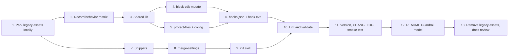

# PLAN-M1 — Guardrails Plugin

**Source:** `docs/PLAN.md` §5 (M1), with §3, §4, §6, §7, §9, §10 as supporting context. Hook contract: `docs/ARCHITECTURE.md`.
**Branch:** `3-m1---guardrails-plugin`
**Starting state:** M0 is merged. Both plugins are empty. Three legacy assets sit untracked: `plugins/lstk-guardrails/hooks/block-cdk-mutate.sh`, `plugins/lstk-guardrails/hooks/protect-files.sh`, and `docs/settings.json`.
**Goal:** A working `lstk-guardrails` plugin. Two Node `.mjs` hooks (no dependencies), a settings merge script, an `init` skill, two settings snippets, and tests for all of it. The plugin version moves to `0.1.0-alpha.1` (see Step 11). No legacy file is committed.

---

## 1. Scope

**In scope**

- A committed behavior matrix (`hook-matrix.json`) recording expected allow, ask, and deny results. It is built by running the legacy Bash hooks **locally**. The legacy files themselves are never committed.
- `block-cdk-mutate.mjs`, `protect-files.mjs`, `hooks.json`, and shared `lib/` helpers.
- `.claude/lstk.json` per-project configuration for protected patterns.
- `snippets/baseline.json` and `snippets/convenience.json`.
- `scripts/merge-settings.mjs` and the `init` skill.
- README "Guardrail model" section, CHANGELOG, and a documentation review.

**Out of scope**

- `lstk` plugin skills (M2+).
- `PostToolUse` and `UserPromptSubmit` hooks (PLAN §12, evaluate after M1 use).
- Windows support. macOS and Linux only.

---

## 2. Findings from the legacy assets

The legacy hooks do more than PLAN §5 describes. The port must keep this behavior or record a deliberate change.

| Area                    | Legacy behavior                                                                                                                                                                                              | Port decision                                                                                                                                                                         |
| ----------------------- | ------------------------------------------------------------------------------------------------------------------------------------------------------------------------------------------------------------ | ------------------------------------------------------------------------------------------------------------------------------------------------------------------------------------- |
| CDK subcommands         | Denies `deploy`, `destroy`, `watch`. **Asks** on `bootstrap`.                                                                                                                                                | Keep both. PLAN §5 lists only the deny set, so the `ask` tier is an addition to confirm and document.                                                                                 |
| Invocation forms        | `cdk`, `aws-cdk`, `cdk@2.x`, flags before the subcommand, `bash -c "..."`, `$(...)`, backticks, chained commands.                                                                                            | Keep all of them.                                                                                                                                                                     |
| Package scripts         | For `npm`/`pnpm`/`yarn`/`bun`, denies a script whose **name** looks like `deploy`/`destroy` (`cdk:deploy`, `deploy:prod`) or whose **body in the nearest `package.json`** runs `cdk deploy\|destroy\|watch`. | Keep. Resolve the nearest `package.json` from `cwd` upward.                                                                                                                           |
| `make`                  | Denies targets named like `deploy`/`destroy`.                                                                                                                                                                | Keep.                                                                                                                                                                                 |
| Failure mode            | **Fail closed**: no `jq` or unparseable input exits 2.                                                                                                                                                       | **Conflict.** PLAN §5 says unexpected internal errors **fail open** with a stderr warning. Follow the plan. Note the reversal in the CHANGELOG. The permission layer is the backstop. |
| Message                 | Tells Claude not to retry or work around, and to run `synth`/`diff`.                                                                                                                                         | Keep the wording intent. It already satisfies the "what, why, instead" rule.                                                                                                          |
| `protect-files` matcher | Substring match on the raw path for `.env`, `package-lock.json`, `.git/`. Exit 2. Normalizes backslashes.                                                                                                    | Replace with real path matching (see Step 5). The substring match over-blocks (`.environment.ts`, `foo.env.example`) and under-blocks traversal and symlinks.                         |
| Settings                | `deny`, `ask`, `allow` rules plus personal `model`, `theme`, `defaultMode`, and a `hooks` block pointing at `~/.claude/hooks/*.sh`.                                                                          | Rules go to snippets. `model`, `theme`, `defaultMode`, and `hooks` are excluded (PLAN §7).                                                                                            |

**Decisions (resolved).**

1. Keep the `ask` tier for `cdk bootstrap` in the hook. **Accepted.**
2. Keep package-script and `make` inspection. **Accepted.**
3. Default protected patterns: `.env` files (`.env`, `.env.*`, but not `.env.example`), `package-lock.json`, anything under `.git/`. **Accepted.**
4. Legacy files inform the port and may be used **locally for the duration of this milestone** to confirm the functionality is ported. They are **never committed, not even as test fixtures**, and are deleted before the milestone pull request is created. **Decided.** Consequences:
   - No committed test spawns a legacy script, so the committed suite needs no `bash` or `jq`.
   - Legacy expectations survive only as data in the committed `hook-matrix.json`, recorded from the legacy scripts.
   - Snippets are written by hand from the legacy `settings.json`, and snippet tests do not read it.

---

## 3. Execution order



---

## 4. Work breakdown

### Step 1 — Park the legacy assets locally (never committed)

- Move `plugins/lstk-guardrails/hooks/*.sh` and `docs/settings.json` into a new `.legacy/` directory at the repo root. Nothing legacy may remain under `plugins/` or `docs/`, because plugin validation and the lint script scan the plugin tree.
- Exclude the directory **locally** by adding `.legacy/` to `.git/info/exclude`. Do not edit the committed `.gitignore` or `.prettierignore`, so no trace of the legacy files lands in the repo.
- These files are never pushed. Read them only to inform the port.
- If `npm run format:check` complains about `.legacy/`, run it with the directory moved aside temporarily.

**Done when:** `git status` shows no legacy files, `git ls-files | grep -i legacy` is empty, and `npm run check` passes.

### Step 2 — Record the behavior matrix first

Goal: pin down what the Bash hooks do before porting, then keep only the recorded result.

- Create `tests/fixtures/hook-matrix.json`, a table of `{ id, hook, input, legacy, target, reason? }` rows. `legacy` and `target` are `allow`, `deny`, or `ask`. `reason` is required whenever the two differ.
- Create a **local-only** runner at `.legacy/characterize.mjs` (excluded from git with the rest of `.legacy/`). It spawns each legacy script with every row's `input` on stdin and checks the result against the row's `legacy` value. Run it now to confirm the matrix is accurate, and again at the end of Steps 4 and 5 as a parity check against the ports. It needs `bash` and `jq` locally and is not part of CI.
- The committed port tests (Steps 4 and 5) assert each row's `target` value. They never run legacy code.
- Exit-code mapping for the legacy scripts: deny is a JSON `permissionDecision: "deny"` or exit 2, ask is JSON `ask`, allow is exit 0 with empty stdout.
- Fixture coverage for `block-cdk-mutate` (Bash `tool_input.command`):

| Group           | Cases                                                                                                                                                                                                                                                                                                                                        |
| --------------- | -------------------------------------------------------------------------------------------------------------------------------------------------------------------------------------------------------------------------------------------------------------------------------------------------------------------------------------------- |
| Deny            | `cdk deploy`, `cdk destroy`, `cdk watch`, `npx cdk deploy`, `npx aws-cdk deploy`, `npm exec cdk deploy`, `npm run cdk -- deploy`, `cdk@2.150.0 deploy`, `cdk -a x deploy`, `cdk deploy --all`, `a && cdk deploy`, `a; cdk destroy`, `a \| cdk deploy`, `bash -c "cdk deploy"`, `echo $(cdk deploy)`, `` `cdk deploy` ``, multi-line commands |
| Deny (wrappers) | `npm run deploy`, `pnpm cdk:deploy`, `yarn deploy:prod`, `make deploy`, `make infra-destroy`, a package script whose body runs `cdk deploy` (fixture `package.json` in a temp dir)                                                                                                                                                           |
| Ask             | `cdk bootstrap`, `npx cdk bootstrap aws://1/us-east-1`                                                                                                                                                                                                                                                                                       |
| Allow           | `cdk synth`, `cdk diff`, `cdk ls`, `cdk doctor`, `npx cdk synth`, `git status`, `echo deploy`, `ls cdk.out`, `cdk-nag deploy-check` (token boundary), `npm test`, `npm run build`, empty command                                                                                                                                             |

- Fixture coverage for `protect-files` (`tool_input.file_path`): block `.env`, `apps/api/.env`, `.env.local`, `package-lock.json`, `sub/package-lock.json`, `.git/config`, `.git/hooks/pre-commit`; allow `src/index.ts`, `README.md`, `package.json`.
- Known legacy flaws get rows where `legacy` and `target` differ, each with a `reason`: `.environment.ts` and `.env.example` (legacy blocks, target allows), and `../x/.env` and symlink cases (legacy relies on the substring, target resolves the path). A row that needs files on disk (package scripts, symlinks) names a small setup recipe that the test builds in a temp directory.
- A committed `tests/hook-matrix.test.mjs` checks the matrix shape: unique ids, valid values, a `reason` on every divergence, and coverage of each group above.

**Done when:** the matrix is committed with blocked and allowed cases, the local runner passes against the legacy scripts, and the matrix shape test passes.

### Step 3 — Shared hook library

Files under `plugins/lstk-guardrails/hooks/lib/`. Node built-ins only, no `../` outside the plugin.

| File           | Responsibility                                                                                                                                                                                                   |
| -------------- | ---------------------------------------------------------------------------------------------------------------------------------------------------------------------------------------------------------------- |
| `stdin.mjs`    | Read stdin fully and `JSON.parse`. Return `{}` for empty input. Tolerate missing fields. Throws a typed error on malformed JSON so the caller can fail open with a warning.                                      |
| `decision.mjs` | `deny(reason)`, `ask(reason)`, `allow()`. Writes the `hookSpecificOutput` JSON to stdout and exits 0 (the documented JSON mechanism). Stdout carries only that object. `warn(msg)` writes to stderr.             |
| `run.mjs`      | `runHook(handler)`: wraps parse, handler, and a `try/catch`. Any unexpected error prints `lstk-guardrails: <hook> internal error (<msg>); failing open` to stderr and exits 0. A matched rule is never an error. |
| `tokenize.mjs` | Shell-aware tokenizer for Step 4.                                                                                                                                                                                |
| `paths.mjs`    | Path normalization and glob matching for Step 5.                                                                                                                                                                 |
| `config.mjs`   | Loads `.claude/lstk.json` for Step 5.                                                                                                                                                                            |

Design choice: use the JSON `permissionDecision` mechanism for deny and ask (it supports `ask`, and carries the reason to Claude), not exit 2. Exit 2 stays out, because exit 1 and other codes fail open and the two must not be confused.

Unit tests: `tests/hooks/lib/*.test.mjs`. Cover empty stdin, malformed JSON, missing `tool_input`, and the fail-open path (a handler that throws results in exit 0 and a stderr warning).

**Done when:** lib tests pass and the fail-open behavior is asserted.

### Step 4 — Port `block-cdk-mutate` to `.mjs`

File: `plugins/lstk-guardrails/hooks/block-cdk-mutate.mjs`.

Approach (PLAN §6: tokenize, do not regex the raw string):

1. Read `tool_input.command` and `cwd`. Empty command means allow.
2. Split into simple-command segments on `;`, `|`, `||`, `&&`, `&`, newlines, and subshell parens or backticks. Respect quotes.
3. Unwrap nested shells: for `bash|sh|zsh -c "<string>"` and for `$(...)` and backtick bodies, recurse on the inner string.
4. Per segment, strip leading `VAR=value` assignments and wrappers (`env`, `time`, `command`, `nohup`, `sudo`).
5. Detect the CDK executable: a token equal to `cdk`, `aws-cdk`, or `cdk@<version>`, possibly behind `npx`, `npm exec`, `pnpm dlx|exec`, `yarn dlx|exec`, `bunx`, or `npm run <script> --`. Skip option tokens (and their values for known value flags such as `-a`, `--app`, `-c`, `--context`, `--profile`) to find the subcommand. A token after `--` counts.
6. Subcommand in {`deploy`, `destroy`, `watch`} means **deny**. `bootstrap` means **ask**. Anything else allows.
7. Package-manager and `make` segments: apply the script-name rule (`^([a-z0-9]+[:_-])*(deploy|destroy)([:_-].*)?$`), and look up the script body in the nearest `package.json` (walk up from `cwd`) and re-check that body with steps 2 to 6. Guard against recursion (depth limit, visited set).
8. Deny wins over ask across all segments.

Messages (stderr is not used; reasons go in the JSON):

- Deny: "Blocked: `<what>`. Autonomous CDK deploy, destroy, and watch are disabled by lstk-guardrails. Do not retry or wrap it in a script. Run `cdk synth` or `cdk diff` to validate, and ask the user to run the deployment, or leave it to a pipeline."
- Ask: "`cdk bootstrap` changes shared resources in the target AWS account and region. Confirm before running."

Tests: `tests/hooks/block-cdk-mutate.test.mjs`, table-driven from `hook-matrix.json` using each row's `target` expectation. Also run the local `.legacy/characterize.mjs` parity check, and explain any row where the port differs from `legacy` without a recorded `reason`. Run through both the exported pure function (`evaluate(input) => { decision, reason }`) and one spawned-process test per decision type to cover the stdin and stdout contract.

**Done when:** all matrix rows pass, the local parity check shows no unexplained differences, including `cdk`, `npx cdk`, `npm exec cdk`, `npm run cdk -- deploy`, `a && cdk deploy`, and the deny set `deploy`, `destroy`, `watch`.

### Step 5 — Port `protect-files` to `.mjs` with configuration

File: `plugins/lstk-guardrails/hooks/protect-files.mjs`.

Matching (PLAN §6):

1. Read `tool_input.file_path` (Edit and Write). Absent means allow. Optionally also inspect `notebook_path` if the matcher is extended later. Not in M1.
2. Resolve to an absolute path against `cwd`, normalize backslashes, resolve `..`, then `realpath` the deepest existing ancestor so symlinks cannot dodge the patterns. If the target does not exist yet (new file), resolve its parent.
3. Compute the path relative to the project root. Project root is `CLAUDE_PROJECT_DIR` if set, else `cwd`. If the path is outside the root, match on the absolute path.
4. Match each pattern as a glob against the relative path with gitignore-like semantics: no slash means match the basename anywhere; trailing `/` means a directory anywhere in the path; `*` and `?` wildcards; `!` is not supported in patterns (negation is the separate `unprotect` list below).

Built-in defaults (decision 3): `.env`, `.env.*`, `package-lock.json`, `.git/`. Defaults exempt `.env.example`, `.env.sample`, and `.env.template` through a built-in allow exception.

Configuration, `.claude/lstk.json` in the project root:

```json
{
  "protectedPatterns": ["secrets/", "*.pem"],
  "unprotectPatterns": ["package-lock.json"]
}
```

- `protectedPatterns` are **added** to the defaults.
- `unprotectPatterns` is the explicit way to **remove** a default. It matches a default by its exact pattern string. It also lets a user exempt a path from any pattern.
- Missing file means defaults. Invalid JSON or wrong types: warn on stderr and use the defaults (fail open on config, never crash). Unknown keys are ignored.
- Also read `.claude/lstk.local.json` if present (uncommitted personal overrides) and merge after the project file. Add `.claude/lstk.local.json` to the documented `.gitignore` advice. _Optional. Drop it if it adds noise._

Block message: "Blocked: `<rel path>` matches protected pattern `<pattern>`. Protected files are changed by a human. Ask the user to make this edit, or to add the pattern to `unprotectPatterns` in `.claude/lstk.json`."

Tests: `tests/hooks/protect-files.test.mjs` from the matrix, plus config cases (add, remove, local override, invalid JSON, missing file), traversal (`src/../.env`), and symlink (temp dir, `ln -s .env alias`) cases.

**Done when:** matrix rows pass, the local parity check shows no unexplained differences, config behavior is tested, and traversal and symlink cases block.

### Step 6 — `hooks.json` and end-to-end hook test

- Write `plugins/lstk-guardrails/hooks/hooks.json` as in PLAN §4. Use exec form to avoid quoting problems (`"command": "node"`, `"args": ["${CLAUDE_PLUGIN_ROOT}/hooks/protect-files.mjs"]`), after confirming exec form is valid in `docs/ARCHITECTURE.md`. Otherwise use the shell form in PLAN §4. Add a modest `timeout`. Do **not** set `onFailure: "block"`, because failure semantics are fail open by design.
- Test `tests/hooks/hooks-json.test.mjs`: parse the manifest, assert both matchers, assert every referenced script exists on disk, and assert the command uses `${CLAUDE_PLUGIN_ROOT}` with no `../`.
- Remove `plugins/lstk-guardrails/hooks/.gitkeep`.

**Done when:** the manifest test passes and `npm run lint:plugins` accepts the hooks directory.

### Step 7 — Settings snippets

Create `plugins/lstk-guardrails/snippets/baseline.json` and `convenience.json`, written by hand from the rules in `.legacy/settings.json`.

- `baseline.json`: `{ "permissions": { "deny": [...], "ask": [...] } }` with all legacy deny and ask rules: force-push, `reset --hard`, `clean -fd`, CDK deploy, destroy, and watch (both the `cdk x` and `cdk * x` forms), CDK bootstrap, `~/.ssh` and `.git/config` reads, `git push*`, `gh release`, `gh repo delete`.
- `convenience.json`: `{ "permissions": { "allow": [...] } }` with the legacy allow rules. Opt-in.
- Exclude `model`, `theme`, `defaultMode`, and `hooks`.
- Local check only: compare the snippet arrays with `.legacy/settings.json` to confirm no rule was dropped. The committed tests never read it.
- Test `tests/snippets.test.mjs`: valid JSON, only the `permissions` key, arrays of non-empty strings, no duplicates, no entry in `allow` that a `deny` rule also matches textually, and no personal paths.

**Done when:** snippet tests pass.

### Step 8 — `merge-settings.mjs`

File: `plugins/lstk-guardrails/scripts/merge-settings.mjs`. Node built-ins only. Exports pure functions (`mergeSettings(existing, snippets)`, `diffSettings(a, b)`, `findConflicts(merged)`) plus a CLI.

CLI:

```text
node merge-settings.mjs --scope <user|project> [--include-convenience] [--dry-run] [--project-dir <dir>]
```

- Scope `user` targets `~/.claude/settings.json`. Scope `project` targets `<project-dir>/.claude/settings.json`. Honor `--settings-file <path>` for tests.
- Snippets are located relative to the script (`../snippets/`), never outside the plugin.
- `baseline.json` always applies. `convenience.json` applies only with `--include-convenience`.

Merge rules (all tested, from PLAN §7):

1. Union and deduplicate arrays. Existing entries keep their order and position. New entries append.
2. Never remove or reorder existing entries.
3. Idempotent: a second run reports "no changes" and writes nothing.
4. Preserve unrelated keys and their order. Create the file and parent directory if missing.
5. Refuse to write if the existing file is not valid JSON, or if `permissions` or its arrays have the wrong type. Exit non-zero with a clear message and leave the file untouched.
6. Never touch `hooks`.
7. Report any existing `allow` rule that conflicts with a snippet `deny` rule (deny wins at runtime, but the user should know). Conflict detection is a conservative textual and glob comparison. State that it is best effort.
8. `--dry-run` prints a readable diff (added entries per array) and writes nothing. Without it, write atomically (temp file, then rename) and preserve a `.bak` of the original on first change. Keep two-space JSON formatting with a trailing newline.
9. Exit codes: `0` success or no changes, `1` refused (invalid input), `2` unexpected error.

Tests: `tests/merge-settings.test.mjs` with temp directories. Cover each rule, a missing file, invalid JSON, wrong types, idempotency (merge twice, assert byte-equal), unrelated key preservation, existing-user-entry order, conflict report, dry-run writes nothing, and the CLI exit codes.

**Done when:** all rules are covered by passing tests.

### Step 9 — `init` skill

File: `plugins/lstk-guardrails/skills/init/SKILL.md`. Invoked as `/lstk-guardrails:init`.

Frontmatter:

```yaml
---
name: init
description: Bootstraps lstk guardrail permission rules (deny and ask, optional allow) into Claude Code settings at user or project scope. Use when installing lstk-guardrails or when the user asks to set up, apply, or refresh guardrail settings.
disable-model-invocation: true
allowed-tools: Bash(node "${CLAUDE_PLUGIN_ROOT}/scripts/merge-settings.mjs":*)
---
```

Body (short, under 100 lines; the script holds the logic):

1. Ask the scope: **user** (once per machine) or **project** (committed for the team).
2. Ask whether to include the opt-in `convenience` allow rules (default no).
3. Run the script with `--dry-run` and show the diff and any conflict report.
4. On the user's confirmation, run it again without `--dry-run`.
5. Report what changed. Remind the user to **remove any old `hooks` block** for these scripts from `~/.claude/settings.json`, otherwise hooks run twice (PLAN §4), and that `/reload-plugins` or a restart may be needed.
6. State the contract: it never touches `hooks`, `model`, `theme`, or unrelated keys.

Verify how `${CLAUDE_PLUGIN_ROOT}` is available to skill content and `allowed-tools` before writing. If it is not substituted there, point Claude at the script path using the documented skill-directory variable instead. Record the finding in `docs/ARCHITECTURE.md`.

Remove `plugins/lstk-guardrails/skills/.gitkeep`.

**Done when:** the lint script accepts the skill (name equals directory, non-empty description) and a manual run on a scratch project walks the flow end to end.

### Step 10 — Lint and validation

- Extend `scripts/lint-plugins.mjs` only if needed: check `hooks/hooks.json` is valid JSON and references scripts that exist, and that no plugin file contains `../`. Add tests to `tests/lint-plugins.test.mjs` for any new rule.
- Run `npm run check` and `npm run validate`. Fix every warning (`--strict`).
- Confirm the plugin tree has no `.sh` files and no test fixtures.

**Done when:** `npm run check` and `npm run validate` both pass.

### Step 11 — Version, CHANGELOG, and smoke test

- PLAN §10 says to cut `0.1.0` at the end of M2. M1 is a released change to an installable plugin, so bump `plugins/lstk-guardrails/.claude-plugin/plugin.json` from `0.0.0` to `0.1.0-alpha.1` so installed users receive it.
- Update `CHANGELOG.md` under `[Unreleased]`: added hooks, snippets, merge script, `init` skill, and `.claude/lstk.json`. Under **Changed**, note the behavior differences from the legacy Bash hooks (fail open on internal error, path-aware matching, `.env.example` no longer blocked, `jq` no longer required). Do not name the legacy files.
- Local smoke test, recorded in the PR description:
  1. `/plugin marketplace add ./`, install `lstk-guardrails@lstk`, `/reload-plugins`.
  2. Ask Claude to run `cdk deploy`. Expect a denial with the actionable message. `cdk synth` runs. `cdk bootstrap` prompts.
  3. Ask Claude to edit `.env` and `package-lock.json`. Expect a block. Edit a normal file. Expect success.
  4. Add `.claude/lstk.json` with a custom pattern. Expect the new pattern to block.
  5. Run `/lstk-guardrails:init` at project scope in a scratch repo. Check the dry-run diff, apply, run again, and expect no changes.
  6. Confirm the hooks run once (after removing any old `hooks` block from user settings).

**Done when:** every smoke-test item behaves as listed and the results are noted.

### Step 12 — README "Guardrail model"

Replace the placeholder in `README.md` with a section that covers:

- **Layers.** Layer 1 hooks (deterministic, run before the tool call). Layer 2 permission rules (`deny`, `ask`, `allow` in settings, delivered by `init`). Include the Mermaid diagram from `docs/ARCHITECTURE.md`.
- **What each hook does**, with the deny, ask, and allow behavior, and the `.claude/lstk.json` options and defaults.
- **Threat model.** Protects against accidental or over-eager autonomous actions: deploying or destroying infrastructure, and editing secrets, lockfiles, and git internals.
- **Limits.** A hook is not a sandbox. It sees the command string, not its effects. Indirect routes (a script that calls `cdk deploy`, `eval`, env-var-indirected binaries) can evade it. Hooks fail open on internal errors. The real guarantee is a read-only AWS identity and not giving the agent deploy credentials.
- **Install and init flow**, including removing the old `hooks` block.
- Update the status banner and the "init skill arrives in M1" line.

**Done when:** the section exists, is accurate against the code, and passes `npm run format:check`.

### Step 13 — Remove legacy assets, then review and update project documentation (final step)

**13a. Remove the legacy files.** Run the local parity check one last time, then delete `.legacy/` and its line in `.git/info/exclude`. Verify with `git status`, `git ls-files | grep -iE 'legacy|\.sh$'` (must be empty), and `ls plugins/lstk-guardrails/hooks docs`. Do this before the milestone pull request is created.

**13b. Documentation review.** Review every existing doc against the as-built M1 and update what is stale. Check each item, and edit only where it is wrong or incomplete.

| Document                   | Review for                                                                                                                                                                                                                                                                                                                                                                                              |
| -------------------------- | ------------------------------------------------------------------------------------------------------------------------------------------------------------------------------------------------------------------------------------------------------------------------------------------------------------------------------------------------------------------------------------------------------- |
| `README.md`                | Status banner (no longer "M0, both plugins empty"). Install section and `init` mention. Plugin table. Guardrail model section (Step 12). Add a short configuration note and a link to the architecture doc. Accurate commands.                                                                                                                                                                          |
| `AGENTS.md`                | Layout (add `hooks/lib/`, `scripts/`, `snippets/`, `tests/fixtures/hook-matrix.json`). Commands (any new npm script). Conventions (hook and script rules: Node built-ins only, fail-open semantics, `.claude/lstk.json`, and the rule that plugins ship no shell scripts or fixtures). Keep it terse and current. Run the `agents-md-author` skill checks if useful.                                    |
| `docs/ARCHITECTURE.md`     | "Hook contract (for M1)" heading becomes the as-built hook design. Add: the module map under `hooks/lib/`, the decision mechanism chosen (JSON `permissionDecision`), fail-open semantics, `.claude/lstk.json` schema, the merge-settings contract, the `init` skill flow, the `${CLAUDE_PLUGIN_ROOT}` finding from Step 9, and update the "Last verified" line and Claude Code version if re-verified. |
| `docs/CONTRIBUTING.md`     | How to add a row to `hook-matrix.json` and run the hook tests. How to add a snippet rule. The public-repo review checklist applied to fixtures. Release step: bump the plugin `version` and the CHANGELOG.                                                                                                                                                                                              |
| `docs/PLAN.md`             | Reconcile with what was built: §3 layout (`.mjs` files, `lib/`, `scripts/merge-settings.mjs`, `snippets/`), the `ask` tier for `cdk bootstrap` (§5), the package-script and `make` inspection, the `.claude/lstk.json` `unprotectPatterns` key, and the version decision (§10). Mark M1 done. Do not rewrite the plan for later milestones.                                                             |
| `CHANGELOG.md`             | Matches Step 11 and the final version number.                                                                                                                                                                                                                                                                                                                                                           |
| `docs/plans/PLAN-M1.md`    | Tick off decisions that changed during implementation. Leave an "As built" note for any deviation.                                                                                                                                                                                                                                                                                                      |
| `.github/workflows/ci.yml` | Still runs everything M1 added. No `jq` or `bash` dependency should exist, since no committed test runs legacy code. Confirm that.                                                                                                                                                                                                                                                                      |

Finish with `npm run check` and `npm run validate`, a grep for leaked personal paths or client names (`/home/`, `@moduscreate`, client names), and a final read of the diff. The diff must contain no legacy file.

**Done when:** the legacy files are gone, every document above is either updated or confirmed accurate, and the checks and the leak grep are clean.

---

## 5. Exit checklist (M1 acceptance, from PLAN §5)

- [ ] `hook-matrix.json` committed, with blocked and allowed cases and a `reason` on every legacy-versus-target divergence.
- [ ] Local parity check against the legacy hooks shows no unexplained differences.
- [ ] No legacy file is committed or left in the working tree.
- [ ] `block-cdk-mutate.mjs` passes all fixtures, covering `cdk`, `npx cdk`, `npm exec cdk`, `npm run cdk -- deploy`, and chained commands. It blocks `deploy`, `destroy`, and `watch`.
- [ ] `protect-files.mjs` has built-in defaults and a `.claude/lstk.json` override with an explicit removal path.
- [ ] Hooks read tool-call JSON from stdin and block through the documented JSON mechanism with an actionable message.
- [ ] A matched pattern blocks. An unexpected internal error fails open with a stderr warning.
- [ ] `baseline.json` and `convenience.json` exist and carry every rule from the legacy settings (checked locally).
- [ ] `merge-settings.mjs` is idempotent, has a dry-run diff, and is tested. The `init` skill uses it.
- [ ] README "Guardrail model" explains layers, threat model, and limits.
- [ ] `npm run check` and `npm run validate` pass in CI.
- [ ] Documentation reviewed and updated (Step 13).

## 6. Risks specific to M1

| Risk                                                                             | Mitigation                                                                                                                    |
| -------------------------------------------------------------------------------- | ----------------------------------------------------------------------------------------------------------------------------- |
| Tokenizer misses a bypass the regex caught (or the reverse)                      | The behavior matrix plus the local parity check is the regression net. Add every divergence as an explicit row with a reason. |
| Fail-open reversal from the legacy fail-closed behavior weakens protection       | Follows PLAN §5. Document in README and CHANGELOG. Permission rules in `baseline.json` are the backstop.                      |
| Hooks run twice for users who keep the old `~/.claude/settings.json` hooks block | `init` output and README tell users to remove it.                                                                             |
| Over-blocking from `.env.*`                                                      | Built-in exemption for `.env.example`, `.sample`, and `.template`, plus `unprotectPatterns`.                                  |
| `merge-settings` corrupts a user's settings file                                 | Refuse on invalid input, atomic write, `.bak` on first change, dry-run default in the skill flow, and idempotency tests.      |
| Legacy scripts or personal paths leak into the public repo                       | Step 1 parks them in a locally excluded `.legacy/`. Step 13a deletes them. Step 13b greps and reads the diff.                 |
