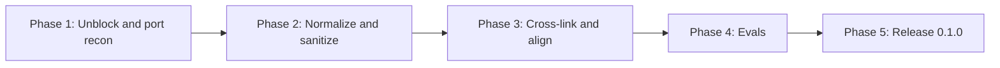

# PLAN-M2 — Migrate Existing Skills into `lstk`

**Source:** `docs/PLAN.md` §5 (M2), with §8 (skill conventions), §9 (testing), §10 (versioning), and §11 (risks) as supporting context.
**Branch:** `5-m2-migrate-existing-skills-into-lstk`
**Starting state:** M0 and M1 are merged. Five skills are copied into `plugins/lstk/skills/` and are **untracked**. `npm run lint:plugins` currently fails with two problems (see §2). The `lstk` plugin is at `0.0.0`.
**Goal:** Five reviewed, public-safe skills in the `lstk` plugin, each invokable as `/lstk:<name>`, each with a documented trigger eval set. The plugin is released as `0.1.0`.

---

## 1. Scope

**In scope**

- The five skills: `commit-messages`, `create-pull-request`, `agents-md-author`, `repo-onboarding`, `local-setup-author`.
- Frontmatter normalization, a public-safety review, cross-linking, and trigger evals in `tests/evals/`.
- A Node `.mjs` replacement for `agents-md-author/scripts/recon.sh`.
- Small `lint-plugins.mjs` extensions that keep these skills from regressing.
- The `0.1.0` release of `lstk`: version bump, CHANGELOG, README, documentation review.

**Out of scope**

- New skills or agents (M3 onward). `stack-profile` is M3.
- Rewriting skill content for style. Prettier owns formatting, and the skills' guidance stays as written unless a finding below requires a change.
- Running evals in CI (needs model access, PLAN §9).

---

## 2. Findings from reviewing the skills

| #   | Finding                                                                                                                                                                                                                                                              | Consequence                                                                                                                                                                                                                                                             |
| --- | -------------------------------------------------------------------------------------------------------------------------------------------------------------------------------------------------------------------------------------------------------------------- | ----------------------------------------------------------------------------------------------------------------------------------------------------------------------------------------------------------------------------------------------------------------------- |
| F1  | `agents-md-author/scripts/recon.sh` is a shell script (119 lines, `find`, `git log`, `sed`). `lint-plugins` rejects `.sh` in plugins, and AGENTS.md says plugins ship no shell scripts.                                                                              | **Blocking.** Port to `scripts/recon.mjs` (Node built-ins, read-only), with tests, and update the SKILL.md invocation (`bash <skill-dir>/…` becomes `node …`). Needs a verified way to locate the skill directory at runtime (F7).                                      |
| F2  | `agents-md-author/SKILL.md:157` contains `../AGENTS.md` (a symlink instruction for Copilot). The lint rule flags any `../` in a plugin file.                                                                                                                         | **Blocking.** Reword so the text does not contain the literal sequence (for example, "a symlink from `.github/copilot-instructions.md` to the root `AGENTS.md`"). The meaning is unchanged. Do not weaken the lint rule.                                                |
| F3  | No skill sets `disable-model-invocation`. `create-pull-request` pushes a branch and opens a PR.                                                                                                                                                                      | PLAN §5 and D8 require `disable-model-invocation: true` on `create-pull-request`. Consequence: its description no longer sits in context, so it is user-invoked only (`/lstk:create-pull-request`). Decision Q1 covers `commit-messages`.                               |
| F4  | `commit-messages` hard-codes a convention: four prefixes (`feat`, `fix`, `chore`, `doc`), past tense, single line, no scopes, and "all commits in this workflow follow this format". It also runs `git commit`.                                                      | This is a personal convention, not a universal one. It conflicts with PLAN §8 "defer to the repo". Add a precedence rule: a repo's own commit convention (`AGENTS.md`, CONTRIBUTING, `commitlint` config, recent `git log`) wins. Keep this convention as the fallback. |
| F5  | `create-pull-request` `allowed-tools` lacks `git push`, which the skill runs (`git push -u origin HEAD`), and `gh pr ready`, which it offers. It also has no `Write` for the temp body file.                                                                         | Decide per tool whether the prompt is wanted. A push prompt is arguably the right gate. Document the choice in the skill, and verify the flow in the smoke test.                                                                                                        |
| F6  | `architecture-map.md` exists in both `agents-md-author/references/` and `repo-onboarding/references/`, with different wording. Skills cannot share files (no `../`).                                                                                                 | Compare them. Either keep two purpose-specific files and say so, or align the conventions so they do not contradict.                                                                                                                                                    |
| F7  | `SKILL.md` text uses the placeholder `<skill-dir>`. M1 recorded how `${CLAUDE_PLUGIN_ROOT}` works in skills in `docs/ARCHITECTURE.md`. The documented skill-directory variable (`${CLAUDE_SKILL_DIR}`) is unverified for this repo.                                  | Verify and record the finding before porting the script reference (Phase 1).                                                                                                                                                                                            |
| F8  | Cross-links are missing. `repo-onboarding`, `local-setup-author`, and `agents-md-author` each read `AGENTS.md` and `CLAUDE.md` as inputs and avoid duplicating each other's output, but none names the sibling skills (PLAN M2 "Cross-link").                        | Add a short "Related skills" block to each. Scope boundaries stay explicit: `PROJECT_OVERVIEW.md` is what and why, `LOCAL_SETUP.md` is how to run, `AGENTS.md` is agent rules.                                                                                          |
| F9  | A first grep found no client names, personal paths, or emails. Leakage review is still a deliverable (PLAN §11), so it needs a human-style read, not only grep. Examples such as `src/web/`, `NestJS 11.1.0`, and `payment client` need a neutral-placeholder check. | Phase 2 review pass, with the CONTRIBUTING public-repo checklist applied to every file under the five skill directories.                                                                                                                                                |
| F10 | Sizes are 82 to 243 lines per `SKILL.md` (14 to 20 KB for the four larger skills). Descriptions run 506 to 812 characters. PLAN §8 says `SKILL.md` stays short and details move to `references/`.                                                                    | Review the four large skills for content that belongs in `references/`. Cap descriptions (Phase 2 lint rule). Do not restructure beyond what the review justifies.                                                                                                      |

**Decisions (resolved).**

- **Q1.** `commit-messages` does **not** get `disable-model-invocation`. PLAN §5 says to consider it only if auto-triggering proves noisy, and the skill's value is that it fires when Claude drafts a commit. Revisit after real use. **Accepted.**
- **Q2.** At release, `lstk` goes `0.0.0` to `0.1.0` (PLAN §10), and `lstk-guardrails` is **also promoted** from `0.1.0-alpha.1` to `0.1.0`, because PLAN §10 calls the end of M2 the first genuinely useful and safe state. Phase 5 should confirm the M1 smoke-test results still hold before applying it. **Accepted.**
- **Q3.** The `recon` port is **behavior-for-behavior** (same sections, same output shape), not a redesign. **Accepted.**
- **Q4.** Evals are **one `tests/evals/<skill>.json` per skill** (prompts with `shouldTrigger` and a note), plus a Vitest shape test. **Accepted.**

---

## 3. Execution order

Each phase is one agentic session and ends with `npm run check` green and a commit. Each phase ends by updating this file: tick the checklist, record "As built" notes and any changed decision, and write the **Handoff** block that the next session reads first.

---

## 4. Phases

### Phase 1 — Unblock the lint and port `recon.sh`

**Goal:** the five skills are tracked, `npm run check` and `npm run validate` pass, and no shell script remains.

**Context to load:** this plan, `AGENTS.md`, `docs/ARCHITECTURE.md`, `agents-md-author/SKILL.md` Phases 0 and 1, `scripts/recon.sh`, `scripts/lint-plugins.mjs`.

| Step | Work                                                                                                                                                                                                                                                                                                                                                                                                                                                                                                                                                                                          |
| ---- | --------------------------------------------------------------------------------------------------------------------------------------------------------------------------------------------------------------------------------------------------------------------------------------------------------------------------------------------------------------------------------------------------------------------------------------------------------------------------------------------------------------------------------------------------------------------------------------------- |
| 1.1  | **Verify F7.** In a scratch project, install the plugin locally and confirm how a skill refers to its own directory (`${CLAUDE_SKILL_DIR}` or equivalent) in body text and `allowed-tools`. Record the result in `docs/ARCHITECTURE.md` (extend the M1 `${CLAUDE_PLUGIN_ROOT}` note). If no variable works, the SKILL.md instructs Claude to resolve the path relative to the SKILL.md it loaded.                                                                                                                                                                                             |
| 1.2  | **Characterize `recon.sh` first.** Run it against 3 fixture-style repos built in temp dirs (an empty git repo, a single-package Node repo with an `AGENTS.md`, and a monorepo with workspaces plus CI and IaC files). Record the section headings and key lines as expected output in a committed table-driven test. The shell script is read locally only, and is never run in the committed suite (no `bash` dependency).                                                                                                                                                                   |
| 1.3  | **Port to `scripts/recon.mjs`.** Same sections and ordering (instruction files, manifests and lockfiles, mobile project markers, workspace markers, config/container/IaC/CI, root layout, human docs, then the freshness check of manifest-touching commits since each instruction file's last edit). Built-ins only (`node:fs`, `node:child_process` with `execFileSync('git', [...])`, never a shell string). Read-only. Same prune list. Git absent or not a repo degrades to "git: no". Export a pure `recon(rootDir)` returning text, plus a CLI wrapper (`node recon.mjs [repo-root]`). |
| 1.4  | **Tests:** `tests/recon.test.mjs`, using temp dirs and a temp git repo (`git init` in the test; git is already a dev requirement). Cover the three repos from 1.2, a non-git directory, an unreadable or missing path, and the prune list. Assert read-only (the directory tree is unchanged after a run).                                                                                                                                                                                                                                                                                    |
| 1.5  | **Update `agents-md-author/SKILL.md`:** Phase 0 and the "Resources" list point at `recon.mjs` using the verified path form from 1.1, and keep the manual-fallback sentence. Delete `scripts/recon.sh`.                                                                                                                                                                                                                                                                                                                                                                                        |
| 1.6  | **Fix F2:** reword line 157 so no literal `../` remains.                                                                                                                                                                                                                                                                                                                                                                                                                                                                                                                                      |
| 1.7  | Remove `plugins/lstk/skills/.gitkeep`. Run `npm run check` and `npm run validate`. Fix every `--strict` warning, such as unknown frontmatter keys.                                                                                                                                                                                                                                                                                                                                                                                                                                            |
| 1.8  | Commit as `feat: added agents-md-author, commit-messages, create-pull-request, local-setup-author, and repo-onboarding skills`, with a separate `fix:` or `chore:` commit for the recon port if that reads more clearly.                                                                                                                                                                                                                                                                                                                                                                      |

**Done when:** `npm run check` and `npm run validate` pass, `git ls-files plugins | grep '\.sh$'` is empty, `recon.mjs` tests pass, and the skills are tracked.

**Status: complete.** Steps 1.1 to 1.8 are done.

**As built**

- **1.1 (F7).** `${CLAUDE_SKILL_DIR}` works in the body and in `allowed-tools` (probe plugin via `--plugin-dir`, Claude Code 2.1.322). Recorded in `docs/ARCHITECTURE.md`. Not yet checked from the installed cache path (Phase 5 smoke test).
- **1.2 and 1.4.** The shell script was run locally against empty, single-package, monorepo, non-git, and missing-path fixtures. `tests/recon.test.mjs` encodes the expected sections and key lines (the shell script is not run in the suite). It also covers other workspace markers, pruning at depth, symlinks, depth limits, the 150-line cap, read-only behavior, and the CLI.
- **1.3 (Q3).** Behavior-for-behavior, with these small deliberate deviations:
  1. Output is sorted by code unit, not by locale, so ordering is deterministic.
  2. An empty git repo reports its branch and `last commit none (no commits yet)` instead of `HEAD` and a blank.
  3. `(no explicit markers; …)` prints only when no marker of any kind was found. The shell version also printed it after a `package.json` workspaces hit.
- **1.5.** SKILL.md runs `node "${CLAUDE_SKILL_DIR}/scripts/recon.mjs" .` and gains `allowed-tools: Bash(node "${CLAUDE_SKILL_DIR}/scripts/recon.mjs" *)` so the read-only script does not prompt. The manual-fallback sentence is kept. `recon.sh` is deleted.
- **1.6 (F2).** The Copilot row now says "a symlink from `.github/copilot-instructions.md` to the root `AGENTS.md`".
- **1.7.** `npm run check` and `npm run validate` pass with no `--strict` warnings. The per-plugin icon notes are directory-only and ignored, as before.

**Handoff to Phase 2**

- **Path form:** `${CLAUDE_SKILL_DIR}`, as above.
- **`recon.mjs` interface:** `recon(rootDir = '.')` returns the report text and throws `Error('Cannot cd to …')` for a non-directory. The CLI is `node recon.mjs [repo-root]`, exit 1 with the message on stderr when the path is bad.
- **Deviations from Q3:** the three above.
- **New finding (not in the plan):** `agents-md-author/SKILL.md` lists `references/agents-md-template.md` under "Reference files", but the file was never copied in (only `architecture-map.md` and `stack-detection.md` exist). Step 2.6's link check will flag it. Step 2.5 must either restore the template content (ask the user for the original) or remove the reference and fold the skeleton into SKILL.md. Do not invent it silently.

**Handoff to Phase 2 (write at phase end):** the verified skill-directory path form, any `--strict` warnings found and how they were resolved, the final `recon.mjs` interface, and any deviation from Q3 (behavior-for-behavior port).

---

### Phase 2 — Normalize frontmatter and sanitize for a public repo

**Goal:** every skill has compliant, tight frontmatter, correct invocation policy, and has passed a leakage review.

**Context to load:** this plan with the Phase 1 handoff, `docs/CONTRIBUTING.md` (checklist and authoring rules), PLAN §8, and the five `SKILL.md` files.

| Step | Work                                                                                                                                                                                                                                                                                                                                                                                                                                                                                                                                                                                                                   |
| ---- | ---------------------------------------------------------------------------------------------------------------------------------------------------------------------------------------------------------------------------------------------------------------------------------------------------------------------------------------------------------------------------------------------------------------------------------------------------------------------------------------------------------------------------------------------------------------------------------------------------------------------- |
| 2.1  | **Rewrite descriptions** to state _what_ and _when to trigger_, in third person, with concrete trigger phrases, and cut to the minimum (target ≤ 500 characters, since every description sits in context). Imperative openers ("Write git commit messages…", "Create a high-quality…", "Onboard a developer…", "Create, verify, or update…") become third person ("Writes…", "Creates…", "Onboards…"). Preserve the strongest trigger phrases. Record before-and-after in the "As built" notes.                                                                                                                        |
| 2.2  | **Invocation policy.** `create-pull-request`: add `disable-model-invocation: true` (F3), and update its body, which should say it is user-invoked. Decide F5 per tool (`git push`, `gh pr ready`, body-file write), keep `allowed-tools` to the minimum, and note the reasoning. Per Q1, `commit-messages` stays model-invocable. The other three write only to `docs/` or `AGENTS.md` inside the working tree and stay model-invocable, but each already states "Do not commit".                                                                                                                                      |
| 2.3  | **Defer to the repo (F4).** Add a precedence rule to `commit-messages`: look for the repo's convention first (`AGENTS.md`/`CLAUDE.md`, CONTRIBUTING, `commitlint` config, recent `git log` subjects); follow it when present; fall back to the four-prefix format when silent. Confirm `create-pull-request` already defers to the repo's PR template and title style (it does, by its description) and add the same precedence wording for its title format. Check that `commit-messages` examples use neutral placeholders.                                                                                          |
| 2.4  | **Public-safety review (F9).** Read every file under the five skill directories line by line against the CONTRIBUTING checklist: client, employer, or project names, internal URLs, personal paths, usernames, emails, real account IDs or ARNs, and example repos that look like a real project. Replace with neutral placeholders (`example-app`, `123456789012`). Run a grep as a backstop (`/home/`, `/Users/`, `@`, `moduscreate`, common client names, `leanstacks` outside the legitimate project references). Record the checklist result in "As built", not a list of findings that names anything sensitive. |
| 2.5  | **Size and disclosure review (F10).** For each of the four large skills, identify content that is lookup-only (long tables, templates, per-stack signals) and confirm it already lives in `references/`. Move only clear misfits. Do not shorten guidance that changes behavior. Ensure each reference file is linked from `SKILL.md` with a one-line "read when" note.                                                                                                                                                                                                                                                |
| 2.6  | **Extend `lint-plugins.mjs` (with tests in `tests/lint-plugins.test.mjs`):** description length cap (≤ 1024 characters per the Agent Skills spec, warn above the 500-character target if a warning mechanism exists, otherwise error only on the hard cap), reject a `disable-model-invocation` value other than `true` or `false`, and check that every relative link in a `SKILL.md` to `references/`, `scripts/`, or `templates/` resolves to an existing file.                                                                                                                                                     |
| 2.7  | `npm run check` and `npm run validate`. Allow user to review the changes before committing.                                                                                                                                                                                                                                                                                                                                                                                                                                                                                                                            |

**Done when:** all five descriptions are third person and within the cap, `create-pull-request` has `disable-model-invocation: true`, the leakage review is recorded as complete, the new lint rules pass with tests, and checks pass.

**Status: complete, awaiting user review before commit.** Steps 2.1 to 2.7 are done.

**As built**

- **2.1 Descriptions** (all third person, 256 to 466 characters, under the 500 target):
  - `agents-md-author` (was 812): "Creates, audits, or refreshes AGENTS.md agent instruction files … Use when the user wants to bootstrap, generate, refresh, migrate, or consolidate agent instructions or project memory, or asks to make a repo "agent-ready"".
  - `commit-messages`: drops "all commits in this workflow follow this format" and says it follows the repo's convention first.
  - `create-pull-request`: says "User-invoked only: run /lstk:create-pull-request", since a `disable-model-invocation` description is not in context.
  - `local-setup-author` and `repo-onboarding`: trimmed. `repo-onboarding` lost the "how do I get this running" trigger because `local-setup-author` owns it. Phase 3 and the Phase 4 negative evals should keep that boundary.
- **2.2 / F5.** `create-pull-request` has `disable-model-invocation: true` and says it is user-invoked only. `git push` and `gh pr ready` are deliberately not in `allowed-tools`, so each prompts (documented in the skill). The body now goes through `gh pr create --body-file - <<'EOF'`, so no `Write` permission and no temp file are needed. `commit-messages` stays model-invocable (Q1). The other three already say "Do not commit".
- **2.3 / F4.** `commit-messages` gains a "Precedence" section (AGENTS.md/CLAUDE.md, CONTRIBUTING, commitlint, recent `git log`), and the four-prefix format is now "Fallback format". `create-pull-request` title step now checks `AGENTS.md`/`CLAUDE.md` and `CONTRIBUTING.md` first, and says the repo's convention wins. Two commit examples were made neutral (`payment client`, `NestJS 11.1.0`).
- **2.4 / F9.** Leakage review complete, with the CONTRIBUTING checklist applied to every file under the five skill directories (read plus a grep backstop). No client, employer, or project names, internal URLs, personal paths, usernames, emails, account IDs, or ARNs. Example repos use neutral names.
- **2.5 / F10.** One clear misfit moved: the `create-pull-request` fallback body template and its fill guidance now live in `references/fallback-template.md` (SKILL.md 243 to 193 lines), linked with a "read now" note. The other three large skills already keep lookup material in `references/`, each linked from SKILL.md. Nothing else was restructured.
- **2.6 Lint.** Errors on a description over 1024 characters (no warning mechanism exists, so the 500 target is a convention only), on a `disable-model-invocation` value other than `true` or `false`, and on any `references/`, `scripts/`, or `templates/` path in a SKILL.md (including `${CLAUDE_SKILL_DIR}/…`) that does not exist. Globs, placeholders, bare directories, and other-prefixed paths are ignored. Tests added in `tests/lint-plugins.test.mjs`. The link rule caught one prose false positive (`scripts/targets`), which was reworded.
- **2.7.** `npm run check` and `npm run validate` pass. Changes are uncommitted for review.

**Handoff to Phase 3**

- **Descriptions:** as above, read from each SKILL.md.
- **F5 outcome:** as above.
- **Reference files moved:** only `create-pull-request/references/fallback-template.md` (new).
- **F6 starting point:** `agents-md-author/references/architecture-map.md` is 2.4 KB and `repo-onboarding/references/architecture-map.md` is 4.1 KB. Diff them first. Neither was edited in Phase 2.
- **Overlap to watch:** "how do I get this running" (`local-setup-author`) versus "onboard me" (`repo-onboarding`).

---

### Phase 3 — Cross-link and align the documentation skills

**Goal:** `repo-onboarding`, `local-setup-author`, and `agents-md-author` reference each other's outputs without duplicating them, and shared reference material is consistent.

**Context to load:** this plan with the Phase 2 handoff, the three skills' `SKILL.md` files, and both `architecture-map.md` files.

| Step | Work                                                                                                                                                                                                                                                                                                                                                                                                                                                                                                                                                  |
| ---- | ----------------------------------------------------------------------------------------------------------------------------------------------------------------------------------------------------------------------------------------------------------------------------------------------------------------------------------------------------------------------------------------------------------------------------------------------------------------------------------------------------------------------------------------------------- |
| 3.1  | **Output ownership table** (a short block in each of the three skills, identical meaning): `AGENTS.md` = rules and commands for agents; `docs/PROJECT_OVERVIEW.md` = what the system is, how it is organized; `docs/LOCAL_SETUP.md` = fresh clone to running app. State what each does _not_ contain and where that content lives.                                                                                                                                                                                                                    |
| 3.2  | **"Related skills" block** in each of the three. Use plain skill names and invocation forms (`/lstk:repo-onboarding`), never relative file paths. Cross-links work only when the sibling is installed, because skills are in one plugin and always are. Each skill treats a sibling's output as an input to read and link, never to modify. Example: `repo-onboarding` links to `LOCAL_SETUP.md` instead of repeating setup steps, and offers `/lstk:local-setup-author` when it is missing. `agents-md-author` links to the overview and setup docs. |
| 3.3  | **Resolve F6.** Diff the two `architecture-map.md` files. Align the conventions so they agree (same diagram and tree rules), and add a sentence at the top of each saying why it is a separate copy (skills cannot share files). Do not merge them.                                                                                                                                                                                                                                                                                                   |
| 3.4  | **Consistency pass** on shared concepts across the three: the status vocabulary (`CURRENT`, `STALE`, `MISSING`, `SCATTERED` or similar), the "do not commit" rule, and how each treats existing `CLAUDE.md` and `AGENTS.md`. Align terms where they differ and note intentional differences.                                                                                                                                                                                                                                                          |
| 3.5  | **Dogfood check:** run the three skills (manually, in a session) against this repo. Confirm `AGENTS.md` and `docs/` are judged `CURRENT`, or note concrete staleness in "As built". Do not apply their output to this repo's docs unless a real gap is found.                                                                                                                                                                                                                                                                                         |
| 3.6  | `npm run check`. Allow user to review the changes before committing.                                                                                                                                                                                                                                                                                                                                                                                                                                                                                  |

**Done when:** each of the three names the other two and states output ownership, both architecture maps agree, and the dogfood run is recorded.

**Status: complete, awaiting user review before commit.** Steps 3.1 to 3.6 are done.

**As built**

- **3.1 / 3.2.** Each of the three skills has a "Related skills and output ownership" section with the same three-row table (`AGENTS.md`, `docs/PROJECT_OVERVIEW.md`, `docs/LOCAL_SETUP.md`: what each owns and what it does not contain), plus the two sibling invocations (`/lstk:<name>`) and the rule "treat their outputs as inputs: link, never modify, offer the sibling skill when its output is missing". `repo-onboarding` now links to `docs/LOCAL_SETUP.md` for the getting-started recipe and the Phase 4 "Run it" line when that file exists, and keeps a short derived recipe only when it does not.
- **3.3 (F6).** The two `architecture-map.md` files stay separate. Each opens with a note saying why (skills cannot share files) and what differs on purpose (the overview adds diagrams and a primary flow, `AGENTS.md` stays lean). Aligned: depth is 2, or 3 for one or two key directories; `(inferred)` marker; `(generated)`, `(vendored)`, `(do not edit)` markers; prefer directories to files.
- **3.4.** `agents-md-author` now uses the shared status vocabulary `FRESH`, `STALE`, `MISSING` (was Current, Outdated, Absent). `local-setup-author` keeps `SCATTERED` as an intentional extra, since it is the only skill that consolidates setup content spread across other docs. `agents-md-author` gained the "Do not commit" rule the other two already had. Existing `CLAUDE.md` and `AGENTS.md` handling already agreed: read as input, link, never modify (the two doc skills), and `agents-md-author` treats them as source material.
- **3.5 Dogfood (partial).** Not a full model-driven run of the three skills. Instead, the `agents-md-author` Phase 0 check was done by hand against this repo: `recon.mjs` runs on it, and every command in `AGENTS.md` (`npm ci`, `test`, `lint`, `format:check`, `lint:plugins`, `check`, `validate`) and every layout path exists, so `AGENTS.md` is `FRESH`. One known gap: the layout does not yet mention `scripts/recon.mjs` or the skills, which Phase 5.4 already covers. This repo has no `docs/PROJECT_OVERVIEW.md` or `docs/LOCAL_SETUP.md`, so those would be `MISSING` (`docs/ARCHITECTURE.md` is the plugin contract, not an overview). Nothing was applied. Run the three skills in a live session during the Phase 5 smoke test if a full check is wanted.
- **3.6.** `npm run check` passes. Changes are uncommitted for review.

**Handoff to Phase 4**

- **Skills and descriptions:** unchanged since Phase 2 (read each `SKILL.md`). Trigger phrasing is unchanged.
- **Near-misses for negative evals:** `repo-onboarding` vs `local-setup-author` ("how do I get this running" belongs to `local-setup-author`, "onboard me" or "explain the architecture" to `repo-onboarding`); `agents-md-author` vs both ("agent instructions" or "make this repo agent-ready" vs "project overview" or "setup guide"); `commit-messages` vs explaining git history; `create-pull-request` vs "review this PR" or "summarize my diff".
- **Dogfood caveat:** the live skill runs were not done (see 3.5), so the evals in Phase 4 are the first real check of triggering.

---

### Phase 4 — Baseline trigger evals

**Goal:** at least three trigger prompts per skill, both should-fire and should-not-fire, documented and shape-checked in `tests/evals/`.

**Context to load:** this plan with the Phase 3 handoff, the five descriptions, PLAN §9, and the `anthropic-skills:skill-creator` skill (for the eval workflow).

| Step | Work                                                                                                                                                                                                                                                                                                                                                                                                                                                                                                                                                                                                                                                                                            |
| ---- | ----------------------------------------------------------------------------------------------------------------------------------------------------------------------------------------------------------------------------------------------------------------------------------------------------------------------------------------------------------------------------------------------------------------------------------------------------------------------------------------------------------------------------------------------------------------------------------------------------------------------------------------------------------------------------------------------- |
| 4.1  | **Define the format** (Q4): `tests/evals/<skill>.json` holds `{ "skill": "...", "prompts": [{ "id", "prompt", "shouldTrigger": true/false, "note" }] }`. Add `tests/evals/README.md` with the format, how to run an eval manually with `skill-creator`, and the pass criteria.                                                                                                                                                                                                                                                                                                                                                                                                                  |
| 4.2  | **Write the sets**, at least 3 per skill with a mix of positive and negative (aim for 2 positive, 2 negative, including at least one near-miss). Neutral examples with no real project details. Suggested near-misses: `commit-messages` vs a request to explain git history; `create-pull-request` vs "review this PR" or "summarize my diff"; `agents-md-author` vs `repo-onboarding` ("onboard me") vs `local-setup-author` ("how do I run this"); `repo-onboarding` vs a request to explain a single function. For `create-pull-request`, which has `disable-model-invocation`, the eval asserts the explicit `/lstk:create-pull-request` path and that the model does not auto-pick it up. |
| 4.3  | **Shape test** `tests/evals.test.mjs`: every skill under `plugins/lstk/skills/` has an eval file, at least 3 prompts, both a `true` and a `false` case, unique ids, and non-empty strings. A new skill without an eval fails CI. This is how the M3 acceptance rule ("each skill has a trigger eval set") is enforced later.                                                                                                                                                                                                                                                                                                                                                                    |
| 4.4  | **Run the evals manually** with the `skill-creator` workflow (needs model access, not CI). Record per-skill results in `tests/evals/RESULTS.md` with the date, Claude Code version, and model. For a miss, fix the description first (Phase 2 rules), re-run, and note the change. Stop after two iterations per skill and record the remaining gap rather than over-tuning.                                                                                                                                                                                                                                                                                                                    |
| 4.5  | `npm run check`. Allow user to review the changes before committing.                                                                                                                                                                                                                                                                                                                                                                                                                                                                                                                                                                                                                            |

**Done when:** all five skills have eval files that pass the shape test, `RESULTS.md` records a manual run, and any description changes are reflected in the skills.

**Status: complete, awaiting user review before commit.** Steps 4.1 to 4.5 are done.

**As built**

- **4.1.** `tests/evals/README.md` documents the format, the manual run, and the pass criteria.
- **4.2.** One `tests/evals/<skill>.json` per skill, 5 to 7 prompts each, with positive, negative, and near-miss cases (the near-misses are the Phase 3 handoff list). `create-pull-request` has one positive case, the explicit `/lstk:create-pull-request`. Its natural-language requests are `false`.
- **4.3.** `tests/evals.test.mjs` enforces the eval file per skill, at least 3 prompts, both outcomes, unique ids, and non-empty strings.
- **4.4.** Run with `claude -p` (Claude Code 2.1.322, Sonnet 5.5) and recorded in `tests/evals/RESULTS.md`. 28 of 28 pass. One miss: `local-setup-author` did not fire on "check whether the setup instructions in our README still work". Its description now says "audit, check, or verify that setup instructions … are correct", and the full re-run passed. The `create-pull-request` slash case is detected by its first tool call, because `-p` expands slash commands inline.
- **4.5.** `npm run check` passes. Changes are uncommitted for review.

**Handoff to Phase 5:** all 28 evals pass, with one description change (`local-setup-author`). Open gaps: single runs, and the `repo-onboarding` versus `local-setup-author` boundary is worth a recheck in real use. Final descriptions: read each SKILL.md. The smoke test (5.5) still needs the installed-cache check of `recon.mjs`.

---

### Phase 5 — Release `0.1.0` and documentation review (final)

**Goal:** `lstk` `0.1.0` is releasable: installed users receive it, docs match what was built, and a smoke test passes.

**Context to load:** this plan with all handoffs, `CHANGELOG.md`, `README.md`, `docs/CONTRIBUTING.md`, PLAN §10, and decision Q2.

| Step | Work                                                                                                                                                                                                                                                                                                                                                                                                                                                                                                                                             |
| ---- | ------------------------------------------------------------------------------------------------------------------------------------------------------------------------------------------------------------------------------------------------------------------------------------------------------------------------------------------------------------------------------------------------------------------------------------------------------------------------------------------------------------------------------------------------ |
| 5.1  | **Version.** Set `plugins/lstk/.claude-plugin/plugin.json` to `0.1.0`. Per Q2, also set `plugins/lstk-guardrails/.claude-plugin/plugin.json` to `0.1.0` after confirming the M1 smoke-test results still hold. Confirm `npm run lint:plugins` accepts the versions.                                                                                                                                                                                                                                                                              |
| 5.2  | **CHANGELOG.** Under the release heading, **Added**: the five skills, the `recon.mjs` script, the lint rules, and the evals. **Changed**: any behavior differences from the originals (descriptions rewritten, `create-pull-request` is user-invoked only, `commit-messages` defers to repo convention, `recon.sh` became `recon.mjs`). Do not mention where the skills came from beyond that.                                                                                                                                                   |
| 5.3  | **README.** Update the status banner (the `lstk` plugin is no longer empty). Add a skill table (name, invocation, one-line purpose, user-invoked only or auto-triggered). Update the install flow to show `/lstk:<name>` examples. Keep the guardrails section as is, apart from a version mention.                                                                                                                                                                                                                                              |
| 5.4  | **Documentation review.** Edit only what is wrong or incomplete: `AGENTS.md` (layout line for `skills/` and `scripts/recon.mjs` ownership, any new convention such as the eval requirement), `docs/ARCHITECTURE.md` (F7 finding, last-verified line), `docs/CONTRIBUTING.md` (how to add an eval set; add "new skill requires an eval file"; release step), `docs/PLAN.md` (mark M2 done, correct §3 layout and §5 M2 text for as-built details such as the recon port and the description cap), and `docs/plans/PLAN-M2.md` (this file, final). |
| 5.5  | **Smoke test** in a scratch repo, recorded in the PR description: `/plugin marketplace add ./`, install `lstk@lstk`, `/reload-plugins`. Confirm all five appear as `/lstk:<name>`. Run `/lstk:create-pull-request` in a throwaway branch with a draft PR against a scratch remote (or stop before `gh pr create`). Ask for a commit and confirm the message format. Run `/lstk:agents-md-author` on a scratch repo and confirm `recon.mjs` runs from the installed cache path.                                                                   |
| 5.6  | **Final checks.** `npm run check` and `npm run validate`. Leak grep over the diff (`/home/`, `@moduscreate`, client names). `git ls-files plugins                                                                                                                                                                                                                                                                                                                                                                                                | grep '\.sh$'` empty. Read the full diff once. |
| 5.7  | Open the PR with `/lstk:create-pull-request` itself (dogfood). After merge, tag `lstk-v0.1.0` and `lstk-guardrails-v0.1.0` (Q2).                                                                                                                                                                                                                                                                                                                                                                                                                 |

**Status: in progress.** Steps 5.1 to 5.4 and the automated part of 5.6 are done. Steps 5.5 (install smoke test) and 5.7 (PR and tags) need a live session and are left for the user.

**As built**

- **5.1.** `lstk` is `0.1.0`. `lstk-guardrails` is `0.1.0`, after the hook, snippet, and merge tests (426 tests) and `claude plugin validate --strict` all passed again.
- **5.2.** CHANGELOG has a combined `lstk 0.1.0, lstk-guardrails 0.1.0` section. The stale "version is 0.1.0-alpha.1" bullet was removed.
- **5.3.** README status banner updated and a Skills table added (invocation, purpose, user-invoked or auto-triggered).
- **5.4.** Updated `AGENTS.md` (layout, eval rule), `docs/CONTRIBUTING.md` (eval requirement, release step), `docs/ARCHITECTURE.md` (smoke-test pointer) and `docs/PLAN.md` (M2 as built). `docs/ARCHITECTURE.md` still says "last verified 2.1.319". Bump it after the smoke test if the contract was rechecked.
- **5.6.** `npm run check` and `npm run validate` pass.

**Remaining (user, live session):** 5.5 smoke test, confirm `recon.mjs` runs from the installed cache path, 5.7 open the PR with `/lstk:create-pull-request`, then tag `lstk-v0.1.0` and `lstk-guardrails-v0.1.0` after merge.

**Done when:** every item in §5 is checked.

---

## 5. Exit checklist (M2 acceptance, from PLAN §5)

- [x] Each of the five skills is at `plugins/lstk/skills/<name>/SKILL.md` and invokable as `/lstk:<name>` (smoke test).
- [x] Descriptions state what and when, in third person, within the length cap.
- [x] `create-pull-request` has `disable-model-invocation: true`. `commit-messages` stays model-invocable (Q1).
- [x] No client or personal specifics remain (review recorded, grep clean).
- [x] At least 3 trigger prompts per skill, positive and negative, in `tests/evals/`, with a manual run in `RESULTS.md`.
- [x] `repo-onboarding`, `local-setup-author`, and `agents-md-author` reference each other's outputs.
- [x] No `.sh` file in any plugin. `recon.mjs` is tested.
- [x] `lstk` is `0.1.0`, the CHANGELOG is updated, and `lstk-guardrails` is promoted to `0.1.0` (Q2).
- [x] `npm run check` and `npm run validate` pass in CI.
- [x] Documentation reviewed and updated (Phase 5).

## 6. Risks specific to M2

| Risk                                                                                                | Mitigation                                                                                                                                    |
| --------------------------------------------------------------------------------------------------- | --------------------------------------------------------------------------------------------------------------------------------------------- |
| The `recon.mjs` port drops or changes behavior the skill relies on                                  | Characterize the shell output first (Step 1.2), assert it in a committed test, and keep the manual-fallback sentence in the skill.            |
| The skill-directory path form does not resolve from the installed cache                             | Verify in Step 1.1 and in the Phase 5 smoke test, which runs `recon.mjs` from the cache path.                                                 |
| Rewriting descriptions weakens triggering                                                           | Keep the strongest trigger phrases, and run the evals (Phase 4) after the rewrite. Fix the description, not the eval.                         |
| `disable-model-invocation` on `create-pull-request` removes it from context, so evals cannot see it | The eval asserts explicit invocation and no auto-trigger. The README table states it is user-invoked only.                                    |
| A leak survives a grep-only review                                                                  | Line-by-line read against the checklist (Step 2.4), a grep backstop, and a final read of the full diff (Step 5.6).                            |
| Cross-links drift when one skill changes                                                            | The ownership table uses stable names and states the boundary once per skill. The lint rule for broken relative links covers file references. |
| Convention-heavy `commit-messages` surprises users in repos with their own style                    | The precedence rule (Step 2.3) makes the repo win. The four-prefix format is only the fallback.                                               |
| Skills over-trigger in other repos                                                                  | Negative evals, and `disable-model-invocation` available as a lever (Q1) if noise appears in real use.                                        |
