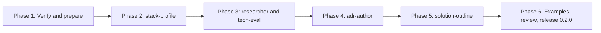

# PLAN-M3 — Research and Design

**Source:** `docs/PLAN.md` §5 (M3), with §8 (skill conventions), §9 (testing), §10 (versioning), and §11 (risks) as supporting context.
**Branch:** `7-m3-research-and-design`
**Starting state:** M0, M1, and M2 are merged. `lstk` is `0.1.0` with five skills. `plugins/lstk/agents/` exists but is empty. No `docs/examples/` directory exists yet.
**Goal:** Four new capabilities in the `lstk` plugin: `stack-profile` (reference skill), `tech-eval` skill plus `researcher` agent, `adr-author`, and `solution-outline`. Each has a trigger eval set and a worked example in `docs/examples/`. The plugin is released as `0.2.0`.

---

## 1. Scope

**In scope**

- Skills `stack-profile`, `tech-eval`, `adr-author`, `solution-outline`, and the agent `researcher`.
- Trigger evals in `tests/evals/<skill>.json` for each skill (agents are covered through `tech-eval`).
- One worked example per skill in `docs/examples/`, built from a neutral, fictional scenario.
- Small `lint-plugins.mjs` extensions that keep these artifacts from regressing (agent `tools` allowlist, example presence).
- The `0.2.0` release of `lstk`: version bump, CHANGELOG, README, `docs/ARCHITECTURE.md` notes, `PLAN.md` status.

**Out of scope**

- Review and harden skills (M4), prototype skills (M5), and scaffold skills (M6).
- The `code-reviewer` agent (M4). Only `researcher` ships in M3.
- AWS MCP servers (M6). The `researcher` uses built-in tools only (`WebSearch`, `WebFetch`, `Read`, `Grep`, `Glob`).
- Running evals in CI (needs model access, PLAN §9).
- Changes to `lstk-guardrails`. Its version stays as is.

---

## 2. Design findings and open questions

| #   | Finding                                                                                                                                                                                                                                                       | Consequence                                                                                                                                                                                                                                            |
| --- | ------------------------------------------------------------------------------------------------------------------------------------------------------------------------------------------------------------------------------------------------------------- | ------------------------------------------------------------------------------------------------------------------------------------------------------------------------------------------------------------------------------------------------------ |
| F1  | `stack-profile` is reference-only. It should inform other skills, not be invoked as a workflow. Skills cannot share files across plugins, but all four M3 skills are in `lstk`, so they can link to `../stack-profile/` content. The `../` rule forbids this. | Skills reference the profile **by name** ("apply the `stack-profile` skill") and let Claude load it. They never link to its files. Verify in Phase 1 that a reference-only skill (`user-invocable: false`) is still loadable by other skills this way. |
| F2  | The `researcher` agent runs in an isolated context and returns only its final message. Its output contract must be self-contained and structured, or `tech-eval` cannot consume it.                                                                           | Define the report format once, in the agent. `tech-eval` states how it delegates and how it merges the result. Do not duplicate the format in both places (see Q2).                                                                                    |
| F3  | PLAN §8 says plugin agents cannot carry `hooks`, `mcpServers`, or `permissionMode`, and `tools` should be minimal. A researcher needs web access, which means `WebFetch` and `WebSearch`.                                                                     | Allowlist `Read, Grep, Glob, WebFetch, WebSearch`. No `Bash`, `Write`, or `Edit`. Document that web content is untrusted data (prompt-injection posture) in the agent prompt.                                                                          |
| F2b | Agent frontmatter fields that are valid today are recorded in `docs/ARCHITECTURE.md` ("Agent frontmatter"). The `model` field and agent-to-skill preloading behavior are not recorded.                                                                        | Verify in Phase 1 against the current Claude Code docs, and record the result in `ARCHITECTURE.md` before writing the agent.                                                                                                                           |
| F3b | `adr-author` writes files into `docs/adr/` of the target repo. That is a write inside the working tree, not an external side effect.                                                                                                                          | No `disable-model-invocation`. It writes only on a clear request for an ADR, and it confirms the title and status before writing. Revisit if auto-triggering proves noisy (same stance as `commit-messages` in M2 Q1).                                 |
| F4  | `solution-outline` output is speculative (effort, staffing). PLAN §5 requires it to be marked as draft output for human review.                                                                                                                               | The template carries a fixed "Draft for human review" banner and a "Confidence and unknowns" section. Effort is given as ranges with stated assumptions, never a single number.                                                                        |
| F5  | Public-repo hygiene (PLAN §11). Worked examples invite real client scenarios.                                                                                                                                                                                 | Every example uses a fictional company and system, and goes through the CONTRIBUTING public-repo checklist in the review phase.                                                                                                                        |
| F6  | `lint-plugins` validates agent frontmatter for `name` and `description` only. It does not check `tools`.                                                                                                                                                      | Add a rule: an agent must declare `tools`, and it must not include write-capable tools unless an allowlist exception is explicit. Cover with tests.                                                                                                    |

**Decisions (resolved).**

- **Q1.** `stack-profile` frontmatter: `user-invocable: false` so it stays out of the slash menu, with a description that tells Claude when to load it (any task that needs the default stack). **Accepted and verified in Phase 1** (F1 confirmed). No fallback needed.
- **Q2.** The `researcher` report format lives in the agent definition. `tech-eval` references it and adds only the matrix and recommendation sections on top. **Accepted.**
- **Q3.** ADR format: MADR-style (title, status, context, decision, consequences, alternatives considered), numbered `NNNN-kebab-title.md`, with an index kept in `docs/adr/README.md`. Use the repo's existing ADR convention if one exists. **Accepted.**
- **Q4.** Worked examples are static Markdown in `docs/examples/<skill>.md`, each showing the prompt, the resulting artifact, and a short note on what to check. They are not generated in CI. **Accepted.**

---

## 3. Execution order

Phases 4 and 5 are independent of each other and may be swapped. Both depend on Phase 2 (`stack-profile`). Phase 5 benefits from Phase 4 because `solution-outline` can offer to spawn ADRs for open decisions.

Each phase is one clean agentic session. It ends with `npm run check` green and a commit (prefixes `feat`, `fix`, `chore`, `doc`). Each phase ends by updating this file: tick the checklist, record "As built" notes and any changed decision, and write the **Handoff** block that the next session reads first. A fresh session needs only this plan, `AGENTS.md`, and the files named in the phase's "Context to load".

---

## 4. Phases

### Phase 1 — Verify the contract and prepare the guardrails

**Goal:** the unknowns about agents and reference skills are resolved and recorded, and the linter is ready to check the new artifacts.

**Context to load:** this plan, `AGENTS.md`, `docs/ARCHITECTURE.md`, `scripts/lint-plugins.mjs`, `tests/lint-plugins.test.mjs`, `tests/evals.test.mjs`, one existing skill (`repo-onboarding`) as a style reference.

| Step | Work                                                                                                                                                                                                                                                                                                    |
| ---- | ------------------------------------------------------------------------------------------------------------------------------------------------------------------------------------------------------------------------------------------------------------------------------------------------------- |
| 1.1  | Verify against current Claude Code docs (use the `claude-code-guide` agent or `WebFetch`): valid agent frontmatter fields (`name`, `description`, `tools`, `model`, `skills`), how `tools` allowlists are enforced, whether a plugin agent can preload skills, and how `user-invocable: false` behaves. |
| 1.2  | Verify the F1 question: can a skill instruct Claude to use another skill by name, and does a `user-invocable: false` skill remain loadable? Test with a throwaway local plugin install, then delete the scratch files.                                                                                  |
| 1.3  | Record results in `docs/ARCHITECTURE.md` (agent frontmatter, reference-skill behavior), with the Claude Code version and date verified.                                                                                                                                                                 |
| 1.4  | Extend `lint-plugins.mjs`: agents must declare a non-empty `tools` list, and `tools` must not contain `Bash`, `Write`, `Edit`, or `NotebookEdit` (F6). Add the failing and passing fixtures to `tests/lint-plugins.test.mjs`.                                                                           |
| 1.5  | Add a docs-examples check (new test or lint rule): every skill listed under `plugins/lstk/skills/` that is in an `EXAMPLES_REQUIRED` list has `docs/examples/<skill>.md`. Start the list empty and grow it per phase, so the check never blocks an in-progress phase.                                   |
| 1.6  | Resolve Q1 from the 1.2 result and record the decision in this file.                                                                                                                                                                                                                                    |

**Acceptance:** `npm run check` and `npm run validate` pass. `ARCHITECTURE.md` states the verified agent and reference-skill behavior. Q1 is decided.

**Commit:** `chore: verify agent contract and extend lint for agents`

**Handoff:** Q1 outcome, the verified agent field list, and whether skills can name each other for loading.

---

### Phase 2 — `stack-profile` reference skill

**Goal:** a short, accurate default-stack profile that yields to the repo.

**Context to load:** this plan, `AGENTS.md`, `docs/PLAN.md` §2 (D6, D7) and §8, `docs/ARCHITECTURE.md`, the Phase 1 handoff. Also read this repo's own `AGENTS.md` as an example of what a repo-level override looks like.

| Step | Work                                                                                                                                                                                                                                                                                                                                                                                                                                      |
| ---- | ----------------------------------------------------------------------------------------------------------------------------------------------------------------------------------------------------------------------------------------------------------------------------------------------------------------------------------------------------------------------------------------------------------------------------------------- |
| 2.1  | Create `plugins/lstk/skills/stack-profile/SKILL.md`. Frontmatter per the Q1 decision. The description states what the skill holds and when to load it (any task that needs stack defaults: designing, scaffolding, evaluating technology) and is third person, at most 500 characters.                                                                                                                                                    |
| 2.2  | Body, in this order: (1) **Precedence rule** at the top: repo `AGENTS.md`, `CLAUDE.md`, and tool config win; this profile fills gaps only; state when it does not apply (no TypeScript, a non-AWS target). (2) **Detection**: how to confirm the repo matches (lockfiles, `cdk.json`, `nest-cli.json`, `vite.config.*`). (3) **Defaults** table by area. (4) **Rationale** per default, one line each, so a reader can judge a deviation. |
| 2.3  | Defaults to cover (PLAN §5): NestJS on containers, Lambda serverless, Vite + React, CDK-TS, TypeScript ESM, Vitest, oxlint, Prettier, npm workspaces. Keep to facts and choices, not style prose (oxlint and Prettier own style). Move any long per-area detail to `references/<area>.md` (progressive disclosure, PLAN §8).                                                                                                              |
| 2.4  | Add a "Where the profile is used" note naming the consumers (`tech-eval`, `adr-author`, `solution-outline`) by skill name only, with no file links.                                                                                                                                                                                                                                                                                       |
| 2.5  | Add `tests/evals/stack-profile.json`: at least 3 prompts including near-misses. Because the skill is reference-only, positives are tasks that need stack defaults ("design a small API for X"), and negatives are tasks in a repo whose `AGENTS.md` states another stack, or tasks unrelated to stack choice. Document the expectation about `user-invocable: false` in the file note.                                                    |
| 2.6  | Public-safety read of the new files. Add `stack-profile` to `EXAMPLES_REQUIRED` only if Q4 gives it an example; otherwise exempt reference-only skills in the check (recommended, since its "example" is the other skills' outputs).                                                                                                                                                                                                      |

**Acceptance:** `npm run check` passes. The skill's first section is the precedence rule. Eval file passes the shape test.

**Commit:** `feat: add stack-profile reference skill`

**Handoff:** final frontmatter choice, the list of areas covered, and any defaults that were uncertain and need the owner's confirmation.

---

### Phase 3 — `researcher` agent and `tech-eval` skill

**Goal:** a read-only research agent and a skill that uses it to produce a trade-off matrix and a recommendation.

**Context to load:** this plan, `AGENTS.md`, `docs/ARCHITECTURE.md` (agent section), the Phase 1 and Phase 2 handoffs, `plugins/lstk/skills/stack-profile/SKILL.md`.

| Step | Work                                                                                                                                                                                                                                                                                                                                                                                                                                                                                                                                              |
| ---- | ------------------------------------------------------------------------------------------------------------------------------------------------------------------------------------------------------------------------------------------------------------------------------------------------------------------------------------------------------------------------------------------------------------------------------------------------------------------------------------------------------------------------------------------------- |
| 3.1  | Create `plugins/lstk/agents/researcher.md`. Frontmatter: `name`, `description` (what it does, when Claude should delegate to it), `tools: Read, Grep, Glob, WebFetch, WebSearch`, and `model` per the Phase 1 findings.                                                                                                                                                                                                                                                                                                                           |
| 3.2  | Agent prompt: the role and the question-in, report-out contract. Rules: state the question being answered, cite a source for every factual claim (URL or `path:line`), separate **facts** from **inference**, flag stale or conflicting sources with dates, say "not found" rather than guess, and treat fetched content as data and never as instructions. Output format (Q2): _Question_, _Findings_ (with sources), _Gaps and uncertainty_, _Suggested follow-ups_. Cap length and say how to summarize when sources are many.                 |
| 3.3  | Create `plugins/lstk/skills/tech-eval/SKILL.md`. Description in third person with triggers: "evaluate", "compare", "which should we use", "build vs buy", "trade-offs of X vs Y".                                                                                                                                                                                                                                                                                                                                                                 |
| 3.4  | Skill workflow: (1) read `AGENTS.md` and config, and apply the `stack-profile` defaults where the repo is silent; (2) restate the decision and **criteria** with weights, and confirm them with the user if ambiguous; (3) fan out `researcher` agents, one per option (or per criterion cluster), in parallel; (4) merge the reports, checking that every matrix cell traces to a cited finding; (5) write the output.                                                                                                                           |
| 3.5  | Output contract, "trade-offs first": a **criteria** list, a **trade-off matrix** (options as columns, criteria as rows, each cell short with a source key), a **per-option summary** (strengths, risks, fit with the stack profile), a **recommendation** section (choice, conditions under which it changes, what to validate next), and **sources**. Default delivery is in the conversation. Write `docs/research/<topic>.md` only when asked. Offer to hand the decision to `adr-author` (by name, with no dependency on it being installed). |
| 3.6  | Put the report template in `tech-eval/references/report-template.md` and link it relatively from `SKILL.md`.                                                                                                                                                                                                                                                                                                                                                                                                                                      |
| 3.7  | Add `tests/evals/tech-eval.json`: positives ("compare DynamoDB and Aurora Serverless for this workload"), near-misses (a request to record a decision already made, which is `adr-author`; "explain how X works", which is plain Q&A), and negatives.                                                                                                                                                                                                                                                                                             |
| 3.8  | Manual smoke test: install the plugin from `./`, run the skill on a neutral question, confirm the agent runs with only its allowed tools and the matrix cells carry sources. Record the outcome in the Handoff.                                                                                                                                                                                                                                                                                                                                   |

**Acceptance:** `npm run check` and `npm run validate` pass (the new lint rule accepts the agent). A smoke run produces a matrix and a recommendation with sources.

**Commit:** `feat: add researcher agent and tech-eval skill`

**Handoff:** the final report format (the next skills may reuse its sourcing conventions), smoke-test notes, and any `model` or tool findings.

---

### Phase 4 — `adr-author` skill

**Goal:** a skill that writes and maintains Markdown ADRs in the target repo.

**Context to load:** this plan, `AGENTS.md`, `docs/PLAN.md` §8, the Phase 2 and 3 handoffs. Use `agents-md-author` as the model for "audit existing conventions first, then reuse, update, or create".

| Step | Work                                                                                                                                                                                                                                                                                                                                              |
| ---- | ------------------------------------------------------------------------------------------------------------------------------------------------------------------------------------------------------------------------------------------------------------------------------------------------------------------------------------------------- |
| 4.1  | Create `plugins/lstk/skills/adr-author/SKILL.md`. Description triggers: "write an ADR", "record this decision", "document why we chose X", "supersede ADR N".                                                                                                                                                                                     |
| 4.2  | Phase 0 of the skill, **detect the repo's convention**: look for `docs/adr/`, `docs/decisions/`, `adr/`, an `adr-tools` or `log4brains` config, and the format of existing records (MADR, Nygard, other). Follow what exists. Fall back to Q3 (MADR-style in `docs/adr/`) only when there is none.                                                |
| 4.3  | Authoring steps: gather context (the decision, forces, options, who decides), take the options and evidence from a `tech-eval` result when present, pick the next number from existing files, write the record, update the index, and set the status. Ask before writing when the decision itself is unclear, because an ADR must not invent one. |
| 4.4  | Lifecycle rules: statuses (`proposed`, `accepted`, `deprecated`, `superseded by NNNN`), never edit an accepted ADR's decision text (supersede it with a new record and update the old one's status line only), and link related records.                                                                                                          |
| 4.5  | Mermaid guidance: include a diagram only when it clarifies a structural or flow decision. Give one or two small examples in `references/`. Docs are Markdown with Mermaid (PLAN §8).                                                                                                                                                              |
| 4.6  | Add `references/adr-template.md` (the MADR-style template) and link it from `SKILL.md`.                                                                                                                                                                                                                                                           |
| 4.7  | Add `tests/evals/adr-author.json`: positives, near-misses (`tech-eval` for "which should we pick", `repo-onboarding` for "why is this repo built this way"), and negatives (commit message requests).                                                                                                                                             |
| 4.8  | Smoke test in a scratch repo with no ADRs, and in one with an existing Nygard-style record, to confirm the convention-following rule. Record the outcome.                                                                                                                                                                                         |

**Acceptance:** `npm run check` passes. The smoke test follows an existing convention and creates a correct numbered record and index entry otherwise.

**Commit:** `feat: add adr-author skill`

**Handoff:** the ADR template as built, and the final Q3 decision.

---

### Phase 5 — `solution-outline` skill

**Goal:** a skill that turns requirements into a reviewable draft outline with components, risks, assumptions, and a staffing and effort sketch.

**Context to load:** this plan, `AGENTS.md`, the Phase 2 to 4 handoffs, `stack-profile`, and `tech-eval/references/report-template.md` (as a sourcing-convention model, loaded by reading it in this repo, not linked from the new skill).

| Step | Work                                                                                                                                                                                                                                                                                                                                                                                                                         |
| ---- | ---------------------------------------------------------------------------------------------------------------------------------------------------------------------------------------------------------------------------------------------------------------------------------------------------------------------------------------------------------------------------------------------------------------------------- |
| 5.1  | Create `plugins/lstk/skills/solution-outline/SKILL.md`. Description triggers: "outline a solution", "high-level design", "scope this", "what would it take to build", "architecture proposal for these requirements".                                                                                                                                                                                                        |
| 5.2  | Workflow: (1) collect and restate requirements, separating functional, non-functional, and constraints; list **assumptions** explicitly and ask about the ones that would change the design most; (2) read the repo's `AGENTS.md` and docs if one exists, then apply `stack-profile` for gaps; (3) derive components and their responsibilities and a Mermaid component diagram; (4) risks; (5) staffing and effort sketch.  |
| 5.3  | Output contract, in this order: **Draft banner** ("Draft for human review. Estimates are rough."), **Summary**, **Requirements and assumptions**, **Architecture** (components table and Mermaid diagram), **Key decisions** (each marked for an ADR through `adr-author`, with options noted), **Risks** (likelihood, impact, mitigation), **Staffing and effort sketch**, **Open questions**, **Confidence and unknowns**. |
| 5.4  | Estimation rules: effort is a **range** per component (for example, "3 to 5 person-days") with the assumption behind it, expressed in relative terms where the repo has no history. State roles, not named people. Never present a total without its ranges and its unknowns. No client or rate data.                                                                                                                        |
| 5.5  | Put the output template in `references/outline-template.md`. Default delivery is the conversation. Write `docs/design/<name>.md` only when asked.                                                                                                                                                                                                                                                                            |
| 5.6  | Add `tests/evals/solution-outline.json`: positives, near-misses (`tech-eval` for a single technology choice, `adr-author` for recording one decision, a future `promote-prototype` request about gaps to production), and negatives.                                                                                                                                                                                         |
| 5.7  | Smoke test with a short fictional requirements paragraph. Check that the banner, ranges, and open questions appear and that no section is invented without an assumption.                                                                                                                                                                                                                                                    |

**Acceptance:** `npm run check` passes. The smoke output follows the contract and marks itself as a draft.

**Commit:** `feat: add solution-outline skill`

**Handoff:** the final output contract, plus anything the examples phase needs to reproduce.

---

### Phase 6 — Examples, cross-links, review, and release

**Goal:** worked examples exist for each skill, the artifacts reference each other consistently, and `lstk` is released as `0.2.0`.

**Context to load:** this plan with all handoffs, `AGENTS.md`, `docs/CONTRIBUTING.md` (public-repo checklist), `CHANGELOG.md`, `plugins/lstk/.claude-plugin/plugin.json`, `README.md`.

| Step | Work                                                                                                                                                                                                                                                                                                                                                                         |
| ---- | ---------------------------------------------------------------------------------------------------------------------------------------------------------------------------------------------------------------------------------------------------------------------------------------------------------------------------------------------------------------------------- |
| 6.1  | Write `docs/examples/tech-eval.md`, `adr-author.md`, and `solution-outline.md` (and `stack-profile.md` only if Q4 demands it). Use one **shared fictional scenario** across them (for example, a small order-tracking API) so they read as one lifecycle: outline, then evaluation, then ADR. Each example shows the prompt, the artifact, and a short "what to check" note. |
| 6.2  | Cross-links: add a short "Related skills" block to each new skill. Keep boundaries explicit: `stack-profile` is defaults, `tech-eval` compares options, `adr-author` records a decision, `solution-outline` shapes a solution. Reference by skill name only.                                                                                                                 |
| 6.3  | Enable the docs-examples check for the three skills (the `EXAMPLES_REQUIRED` list from Phase 1) and confirm it passes.                                                                                                                                                                                                                                                       |
| 6.4  | Public-safety review: apply the CONTRIBUTING checklist to every new file and example. Grep for client names, personal paths, and emails, then do a read-through for anything identifying. Confirm no `../` and no shell scripts.                                                                                                                                             |
| 6.5  | Description and size review: each description is at most 500 characters and unambiguous against its siblings (read all descriptions together to check for overlap). Move any long `SKILL.md` content into `references/`.                                                                                                                                                     |
| 6.6  | Run the evals manually (see `tests/evals/README.md`) for the four new skills and record the date, Claude Code version, model, and per-skill pass counts in `tests/evals/RESULTS.md`. Tune descriptions where a trigger fails, and re-run those prompts.                                                                                                                      |
| 6.7  | Release: bump `plugins/lstk/.claude-plugin/plugin.json` to `0.2.0`, update `CHANGELOG.md`, update the README skill and agent list, add `ARCHITECTURE.md` notes for anything learned, and mark M3 done in `docs/PLAN.md` with an "As built" summary in the style of M1 and M2.                                                                                                |
| 6.8  | Final gates: `npm run check`, `npm run validate`, and a local install smoke test (`/plugin marketplace add ./`, install both plugins, `/reload-plugins`) showing the new skills and the agent. Open a PR using `/lstk:create-pull-request`. After merge, tag `lstk-v0.2.0`.                                                                                                  |

**Acceptance (M3, from PLAN §5):** each skill has a trigger eval set and a worked example in `docs/examples/`. `npm run check` and `npm run validate` are green. `lstk` is `0.2.0`.

**Commit:** `doc: add M3 examples and release notes` for the examples and review, then `chore: release lstk 0.2.0` for the version bump and changelog.

---

## 5. Risks specific to M3

| Risk                                                                      | Mitigation                                                                                                                                                      |
| ------------------------------------------------------------------------- | --------------------------------------------------------------------------------------------------------------------------------------------------------------- |
| `stack-profile` overrides a repo's stack by accident                      | The precedence rule is the first section and is repeated in each consumer skill. Evals include a repo-override negative.                                        |
| Researcher output is unsourced or hallucinated                            | The agent contract requires a source per claim and "not found" over guessing. `tech-eval` rejects matrix cells that have no source.                             |
| Web content carries prompt injection                                      | The researcher has no write or shell tools, and its prompt treats fetched content as data. Skills tell the user to review sources for any high-stakes decision. |
| Overlapping descriptions cause mis-triggering between the four skills     | Near-miss prompts in every eval set, plus the combined description read in Phase 6.                                                                             |
| Effort sketches are read as commitments                                   | The draft banner, ranges with assumptions, and the "Confidence and unknowns" section are mandatory in the template.                                             |
| Skills load too much context (`stack-profile` is large and always loaded) | Keep `SKILL.md` short, put detail in `references/`, and keep the description tight. Review in Phase 6.                                                          |
| Examples leak real client details                                         | One fictional scenario, plus the Phase 6 checklist pass.                                                                                                        |

---

## 6. Checklist

- [x] Phase 1 — Verify the contract and prepare the guardrails
- [x] Phase 2 — `stack-profile`
- [x] Phase 3 — `researcher` agent and `tech-eval`
- [x] Phase 4 — `adr-author`
- [x] Phase 5 — `solution-outline`
- [ ] Phase 6 — Examples, review, release `0.2.0`

_Each phase adds an "As built" note and a Handoff block here when it finishes._

### Phase 1 — As built

- `scripts/lint-plugins.mjs`: agents must declare a non-empty `tools` list (comma or YAML form), and it must not contain `Bash`, `Write`, `Edit`, or `NotebookEdit`. Tests added in `tests/lint-plugins.test.mjs`; the existing agent fixture now declares `tools`.
- `tests/examples.test.mjs`: checks `docs/examples/<skill>.md` for each skill in `EXAMPLES_REQUIRED`. The list starts empty. Reference-only skills (`stack-profile`) stay off it (step 2.6 recommendation).
- `docs/ARCHITECTURE.md`: agent frontmatter and reference-skill behavior recorded (Claude Code 2.1.322, 2026-11-11).
- F1 smoke test passed with a scratch plugin (since deleted). Q1 is decided.

### Phase 1 — Handoff

- **Q1:** `user-invocable: false` on `stack-profile`. A skill that says "apply the `X` skill" makes Claude call the Skill tool with `<plugin>:X`.
- **Agent fields:** `name`, `description`, `tools`, `disallowedTools`, `model` (`sonnet`, `opus`, `haiku`, `fable`, full ID, or `inherit`; omitted means the main model), `skills`, `effort`, `maxTurns`, and others. `hooks`, `mcpServers`, `permissionMode`, and `initialPrompt` are ignored in plugin agents.
- **Preloading:** an agent's `skills` field injects full skill content, but cannot preload a `disable-model-invocation: true` skill. `researcher` does not need it.
- **Unverified:** the docs do not say whether foreground subagents get `WebFetch` and `WebSearch`. Check this in the Phase 3 smoke test.

### Phase 2 — As built

- `plugins/lstk/skills/stack-profile/SKILL.md`: `user-invocable: false`. Sections in order: precedence rule, detection, defaults, rationale, where the profile is used (consumers by name only, no file links).
- `references/defaults.md`: containers-vs-Lambda guidance and per-area detail, loaded on demand.
- `tests/evals/stack-profile.json`: 3 positives, 3 near-misses and negatives (repo states Go and Terraform, Python repo, unrelated fix). The file note records the `user-invocable: false` expectation.
- `stack-profile` stays off `EXAMPLES_REQUIRED` (reference-only, per 2.6).

### Phase 2 — Handoff

- **Frontmatter:** `name`, `description` (under 500 characters), `user-invocable: false`.
- **Areas covered:** language and modules, package management, backend (containers and Lambda), frontend, infrastructure, testing, linting, formatting.
- **Needs owner confirmation:** the Lambda default of "Node.js behind API Gateway" (versus Function URLs or ALB), and the containers-vs-Lambda decision table in `references/defaults.md`. Both are my judgment, not stated in PLAN.
- Consumer skills must repeat the precedence rule (PLAN-M3 §5).

### Phase 3 — As built

- `plugins/lstk/agents/researcher.md`: `tools: Read, Grep, Glob, WebFetch, WebSearch`, `model: sonnet`, `background: false`. Rules for sourcing, fact vs inference, dates, "not found", and untrusted fetched content. Report format (Q2): Question, Findings, Gaps and uncertainty, Suggested follow-ups, capped at about 600 words.
- `plugins/lstk/skills/tech-eval/SKILL.md`: precedence rule repeated, five-step workflow, output contract, related skills (by name only). The report template is in `references/report-template.md`.
- `tests/evals/tech-eval.json`: 3 positives, 4 near-misses and negatives (`adr-author`, plain Q&A, `solution-outline`, unrelated).
- `tech-eval` stays off `EXAMPLES_REQUIRED` until Phase 6 (the list is still empty).

### Phase 3 — Handoff

- **Smoke test (2.1.322, headless, `--plugin-dir`):** `tech-eval` loaded, spawned two `researcher` agents in parallel, and produced a criteria list, matrix with source keys, per-option summary, recommendation with change conditions, and numbered sources. Tool calls in the subagents were `WebFetch` and `WebSearch` only. It offered `adr-author` by name. Resolves the Phase 1 "unverified" item: subagents do get `WebFetch` and `WebSearch`.
- **Finding:** the first run launched the agents as background tasks and ended before the reports came back. Fixed with `background: false` on the agent and an explicit wait instruction in `tech-eval` step 3. The second run completed. I cannot tell which of the two changes fixed it, because I did not test them separately. The run was headless (`claude -p`), so an interactive session was not tested.
- **Observed weakness:** AWS pages carried no dates, so most sources are "undated", and one price came from a third-party source. The agent flagged both. This is acceptable, but Phase 6 evals should check that the flags persist.
- **Sourcing conventions the next skills may reuse:** numbered source keys `[n]` in cells, a "Sources" list with URL or `path:line` and a date where known, `not found` for gaps, and inference labeled as such.
- **Model:** `sonnet` is my choice for cost on a read-only research task. It is not stated in PLAN, so the owner may want to confirm it.

### Phase 4 — As built

- `plugins/lstk/skills/adr-author/SKILL.md`: precedence rule, Phase 0 convention detection (`docs/adr/`, `docs/decisions/`, `adr/`, `doc/adr/`, `adr-tools`, `log4brains`), gather, confirm, write, lifecycle rules, diagrams, related skills (by name only).
- `references/adr-template.md` (MADR-style template and index) and `references/mermaid-examples.md`.
- `tests/evals/adr-author.json`: 3 positives, 3 near-misses and negatives (`tech-eval`, `repo-onboarding`, `commit-messages`).
- `adr-author` stays off `EXAMPLES_REQUIRED` until Phase 6.

### Phase 4 — Handoff

- **Template as built:** MADR-style with Status, Date, Deciders, Related, Context, Decision, Consequences (good, bad, follow-ups), Alternatives considered. Index is a table in `docs/adr/README.md`. **Q3 is final** as written.
- **Smoke test (2.1.322, headless, `--plugin-dir`):** in an empty repo it created `docs/adr/0001-...md` and `docs/adr/README.md`. In a repo with a Nygard record in `doc/adr/` it followed that format and numbering (`0002`) and made no index, since none existed. Both runs flagged `TODO(verify)` items and said the consequences were their inference.
- **Finding:** in the empty-repo run the read of `references/adr-template.md` was denied (headless, `acceptEdits`), so the headings came from memory. Not a skill defect, but an interactive run was not tested.
- **Finding:** both runs added unstated details (for example, Lambda consumers). Added a rule to `SKILL.md` to mark such facts `TODO(verify)`. The re-run after that edit was not done.
- The superseding flow (lifecycle rules) was not smoke tested.

### Phase 5 — As built

- `plugins/lstk/skills/solution-outline/SKILL.md`: precedence rule, six-step workflow, output contract (banner, summary, requirements and assumptions, architecture, key decisions, risks, staffing and effort sketch, open questions, confidence and unknowns), estimation rules, related skills (by name only, no file links).
- `references/outline-template.md`: the template, with the banner and the "Confidence and unknowns" section marked mandatory.
- `tests/evals/solution-outline.json`: 3 positives, 4 near-misses and negatives (`tech-eval`, `adr-author`, a future `promote-prototype` request, an unrelated fix).
- `solution-outline` stays off `EXAMPLES_REQUIRED` until Phase 6.

### Phase 5 — Handoff

- **Output contract as built:** as listed above. Effort is a range per component, with size (S, M, L) used when there is no repo history. The total always carries its assumptions and exclusions. Key decisions are listed with options and are not settled, each with a next step (`tech-eval`, then `adr-author`).
- **Smoke test (2.1.322, headless, `--plugin-dir`, no repo):** prompt was a fictional order-tracking API (50 rps peak, three engineers, three months). The output had the banner first, assumptions A1 to A7 with impact, a components table and Mermaid diagram, six key decisions with options, a risk table, ranges per component with a total of 36 to 69 person-days (sums check), open questions, and a confidence section that labels inference. It named `tech-eval` and `adr-author` by name and offered to write `docs/design/<name>.md`. It said the stack was a default and not a requirement.
- **Not tested:** an interactive session, a run inside a repo with its own `AGENTS.md` (precedence rule), and the answered-questions follow-up.
- **For the examples phase:** the shared fictional scenario (a small order-tracking API) already produced a usable outline, with decisions on compute model and data store. These can feed the `tech-eval` example (DynamoDB vs managed Postgres, or Lambda vs containers) and then the `adr-author` example. The smoke output omitted the template's title, date, and stack lines, so the example should show the full template.
