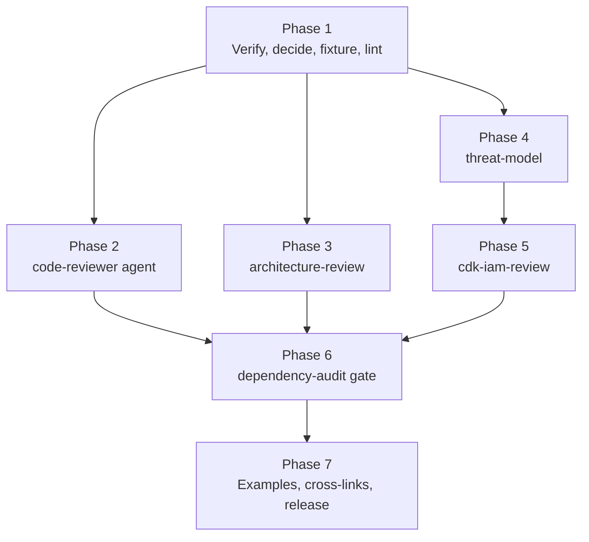

# PLAN-M4 — Review and Harden

**Source:** `docs/PLAN.md` §5 (M4), with §8 (skill conventions), §9 (testing), §10 (versioning), and §11 (risks) as supporting context.
**Branch:** `<issue>-m4-review-and-harden` (create from `main` after M3 is merged)
**Starting state:** M0 to M3 are done. `lstk` is `0.2.0` with nine skills (`stack-profile`, `tech-eval`, `adr-author`, `solution-outline`, and the five migrated skills) and one agent (`researcher`). `lint-plugins.mjs` already requires agents to declare a read-only `tools` list. `docs/examples/` holds the Example Orders worked examples. `lstk-guardrails` is `0.1.0`.
**Goal:** Four skills and one agent in the `lstk` plugin: the `code-reviewer` agent, and the `architecture-review`, `threat-model`, and `cdk-iam-review` skills, plus `dependency-audit` only if it passes a value gate. Each runs against a committed sample fixture and produces output with a reproducible structure. The plugin is released as `0.3.0`.

---

## 1. Scope

**In scope**

- Agent `code-reviewer` and skills `architecture-review`, `threat-model`, `cdk-iam-review`.
- `dependency-audit` as a gated, optional deliverable (Q3). Phase 5 decides, and either builds it or records the decision not to.
- A sample fixture repo under `tests/fixtures/sample-repo/` that the skills run against, plus a structural check of each output contract.
- Trigger evals in `tests/evals/<skill>.json` for each new skill (the agent is covered through its callers and a direct eval set, see Q2).
- Worked examples in `docs/examples/`, continuing the Example Orders scenario.
- Small `lint-plugins.mjs` and test extensions that keep the new artifacts from regressing.
- The `0.3.0` release of `lstk`: version bump, CHANGELOG, README, `docs/ARCHITECTURE.md` notes, `PLAN.md` status.

**Out of scope**

- Prototype skills (M5) and scaffold skills (M6).
- AWS MCP servers (M6). Review skills use built-in tools only.
- Running evals or reviews in CI (needs model access, PLAN §9). CI checks structure only.
- Changes to `lstk-guardrails`. Its version stays as is.
- Auto-fixing findings. M4 skills report and recommend. They never edit the reviewed code.
- Claims of completeness. Every output states its limits (see §2, F5).

---

## 2. Design findings and open questions

| #   | Finding                                                                                                                                                                                                                                                  | Consequence                                                                                                                                                                                                                              |
| --- | -------------------------------------------------------------------------------------------------------------------------------------------------------------------------------------------------------------------------------------------------------- | ---------------------------------------------------------------------------------------------------------------------------------------------------------------------------------------------------------------------------------------- |
| F1  | The M3 lint rule forbids `Bash` in agent `tools`. Reviewing a change normally needs `git diff`, which is a shell command.                                                                                                                                | The `code-reviewer` cannot run git. The caller (user or skill) supplies the diff or the list of paths, and the agent reads files with `Read`, `Grep`, and `Glob`. Q1 decides whether to relax the rule.                                 |
| F2  | The agent runs in an isolated context and returns one message. The report must stand alone.                                                                                                                                                              | Reuse the M3 pattern: a fixed report format defined in the agent prompt, consumed by skills. Define the format once, in the agent.                                                                                                       |
| F3  | PLAN §5 says reviews produce "reproducibly structured" output, and §8 says output contracts name the exact artifact. LLM output varies in content but can be held to a fixed shape.                                                                       | Each skill declares an output contract: path, section headings in order, a finding schema, and a severity scale. Tests check the contract against the committed examples. The content is judged by humans and the manual evals.            |
| F4  | `architecture-review` and `threat-model` apply to a design doc **or** code and infra. `cdk-iam-review` applies only to CDK TypeScript.                                                                                                                  | Each skill states its input types and what it does when the input is missing or out of scope (stop and say so, do not invent). `cdk-iam-review` states that it does not apply to non-CDK IaC.                                           |
| F5  | A review is not an audit. The model can miss issues and can assert false ones. PLAN §11 warns that hooks give false confidence, and the same risk applies to reviews.                                                                                    | Every finding cites `path:line` or a doc section. Every report has a "Not reviewed" section and a "Confidence and limits" note. Skills say "not found" rather than guess. Wording avoids "secure" and "compliant".                         |
| F6  | `architecture-review` should give trade-offs, not verdicts (PLAN §5). The Well-Architected Framework is a public question set, but its text is AWS copyright.                                                                                            | Use the six pillar names and write original questions. Do not paste framework text. Each finding states the trade-off and the condition under which the current choice is fine.                                                          |
| F7  | `threat-model` output is a table (PLAN §5). STRIDE needs a system model first: assets, trust boundaries, data flows.                                                                                                                                     | The skill builds the system model from code and infra before the table, shows it as a Mermaid data-flow diagram, and marks each element as observed (cited) or assumed. Unobserved elements are assumptions, never findings.            |
| F8  | `cdk-iam-review` needs to see synthesized IAM, but running `cdk synth` executes the app's code. The guardrails plugin allows `synth` but the skill has no shell by default unless it is a skill, not an agent.                                            | Prefer static reading of constructs (`grant*` calls, `PolicyStatement`, `addToRolePolicy`, `Effect.ALLOW` with `*`). If a synthesized template or `cdk.out/` exists, read it. Do not run `synth` unprompted. Q4 covers optional synth.   |
| F9  | cdk-nag is a rule pack that runs at synth time and reports IAM and other findings. PLAN §5 asks to "evaluate whether cdk-nag output should feed it".                                                                                                     | Phase 1 evaluates it with the `tech-eval` skill, and the result is an ADR in this repo (Q5). The likely outcome is that the skill reads cdk-nag output when present and does not require it.                                              |
| F10 | `dependency-audit` wraps `npm audit`, which the user can already run. PLAN §5 gates it on adding value beyond running the command.                                                                                                                       | Phase 5 starts with a written value test (Q3). The skill ships only if triage guidance (reachability, dev vs prod, fix path) is something Claude does better than the raw output. Otherwise record "not built" and why.                  |
| F11 | Review skills read third-party code and docs that can carry prompt-injection text. This is the same risk the `researcher` guards against.                                                                                                                | Every M4 skill and the agent treat reviewed content as data, never as instructions. Add the rule to each prompt and to the lint check for agents, where practical.                                                                      |
| F12 | Public-repo rule: the fixture and examples must contain no client names, personal paths, real account IDs, or real credentials.                                                                                                                         | The fixture uses the fictional Example Orders scenario, with placeholder account IDs (`111111111111`) and fake secrets that are plainly fake. Phase 1 includes a public-safety read. Secret scanners in the future may flag fake keys, so use obviously invalid shapes. |

**Open questions** (each is resolved in the named phase, and the answer is recorded in this file under "As built")

| #   | Question                                                                                                                                                                       | Resolved in | Default if unresolved                                                                                                              |
| --- | ------------------------------------------------------------------------------------------------------------------------------------------------------------------------------ | ----------- | ---------------------------------------------------------------------------------------------------------------------------------- |
| Q1  | Should `code-reviewer` get a narrow shell capability for `git diff`, or stay read-only with a caller-supplied diff?                                                            | Phase 1     | Stay read-only. Keep the lint rule. A skill that has `Bash` gathers the diff and passes it in the brief.                           |
| Q2  | Does the agent get its own eval file, and how do agent evals fit `tests/evals.test.mjs`, which today requires one file per skill?                                              | Phase 1     | Add `tests/evals/code-reviewer.json` and let the shape test accept agents. Name the key `agent` instead of `skill`.                |
| Q3  | Does `dependency-audit` pass the value gate?                                                                                                                                   | Phase 5     | Do not build it. Record the decision.                                                                                              |
| Q4  | May `cdk-iam-review` offer to run `cdk synth` with user confirmation?                                                                                                          | Phase 4     | No. Read source and any existing `cdk.out/`. Tell the user how to produce a template if the review needs one.                      |
| Q5  | Does cdk-nag output feed `cdk-iam-review`?                                                                                                                                     | Phase 1     | Optional input only. Read it if present. Never require it. Never add it as a dependency.                                          |
| Q6  | Is there a shared severity scale and finding schema across the four outputs?                                                                                                   | Phase 1     | Yes. One scale (`high`, `medium`, `low`, `info`) and one finding shape, defined per skill by repetition, with no cross-file links. |
| Q7  | Should `code-reviewer` be invoked by a skill (for example a future `review` workflow) or only by delegation from the main session?                                             | Phase 2     | Delegation only. No wrapper skill in M4.                                                                                           |

**Decision (owner):** the defaults for Q1 to Q7 are accepted. Phases still verify them, for example Q1 and Q5 against current Claude Code docs and cdk-nag, and record any change in "As built". The Q3 gate still needs evidence from the Phase 6 hand run.

---

## 3. Execution order

Phases 2, 3, and 4 are independent after Phase 1 and can run in any order, each in its own clean session. Phase 5 follows Phase 4 because `cdk-iam-review` reuses the same system-model and finding patterns. Phase 7 needs all earlier phases.

Each phase ends with `npm run check` passing and one commit. Commit messages use the `feat`, `fix`, `chore`, and `doc` prefixes. A phase ends with a **handoff note** that is appended to this file under "As built", so the next clean session has the facts it needs.

---

## 4. Phases

### Phase 1 — Verify, decide, build the fixture, and prepare the guardrails

**Goal:** open questions Q1, Q2, Q5, and Q6 are decided and recorded, a sample fixture exists, and the linter is ready for the new artifacts.

**Context to load:** this plan, `AGENTS.md`, `docs/ARCHITECTURE.md`, `docs/examples/README.md`, `scripts/lint-plugins.mjs`, `tests/lint-plugins.test.mjs`, `tests/evals.test.mjs`, `tests/examples.test.mjs`, `plugins/lstk/agents/researcher.md`, `plugins/lstk/skills/tech-eval/SKILL.md` (as the style reference for a skill that delegates to agents).

| Step | Work                                                                                                                                                                                                                                                                                                                                                                                       |
| ---- | ------------------------------------------------------------------------------------------------------------------------------------------------------------------------------------------------------------------------------------------------------------------------------------------------------------------------------------------------------------------------------------------ |
| 1.1  | Verify against current Claude Code docs (use the `claude-code-guide` agent or `WebFetch`): whether a skill can restrict its own tools (`allowed-tools`), whether a skill can run with `context: fork`, how a skill passes a brief to a plugin agent, and whether agents can be given a narrow `Bash` allowlist. Note the Claude Code version and date.                                       |
| 1.2  | Decide Q1 (diff supply), Q2 (agent evals), and Q6 (shared severity scale and finding schema). Record the decisions in this file. The finding schema is: `id`, `severity`, `title`, `location` (`path:line` or doc section), `evidence`, `impact`, `recommendation`, and `confidence`.                                                                                                        |
| 1.3  | Use the `tech-eval` skill on cdk-nag as an input to `cdk-iam-review` (Q5). Check what it reports for IAM, its license, maintenance status, and how it is invoked. Keep the result short and sourced. Record the decision and, if it is architecturally notable, an ADR in `docs/adr/` using the `adr-author` skill.                                                                           |
| 1.4  | Create the fixture at `tests/fixtures/sample-repo/`, which is a small Example Orders repo with **seeded, labeled issues**: a CDK app with an over-broad IAM policy, a wildcard resource, a public S3 bucket, a missing-auth route, an unbounded Lambda timeout, a handler with a missing test, and a `package.json` with a pinned vulnerable dependency. Add `SEEDED-ISSUES.md` listing each issue, its location, and the skills expected to find it. The fixture is data, not code to run, and is excluded from oxlint and Prettier if needed. |
| 1.5  | Extend the lint and tests: (a) `tests/evals.test.mjs` accepts agent eval files (Q2). (b) A new test asserts that every `path:line` in `SEEDED-ISSUES.md` exists in the fixture, so the answer key cannot drift. (c) Add a `REVIEW_SKILLS_REQUIRE_SECTIONS` check in `lint-plugins.mjs` or a test: each M4 skill body contains a "Not reviewed" or "Limits" section and an output contract section. Start the list empty and grow it per phase. |
| 1.6  | Public-safety read of the fixture: no real names, account IDs, keys, or hostnames. Confirm `npm audit` is not run against the fixture in CI, since it carries a deliberately vulnerable pin. Exclude the fixture from Dependabot and from any dependency scan, and note that in `docs/CONTRIBUTING.md`.                                                                                  |

**Acceptance:** `npm run check` and `npm run validate` pass. Q1, Q2, Q5, and Q6 are decided in this file. The fixture and its answer key exist and are tested for drift.

**Commit:** `chore: add review fixture and extend lint for M4`

**Handoff:** decisions for Q1, Q2, Q5, Q6, the final finding schema, the fixture's seeded-issue list, and the verified skill and agent frontmatter fields.

---

### Phase 2 — `code-reviewer` agent

**Goal:** a read-only agent that reviews a change for correctness, maintainability, and test gaps against the repo's stated conventions.

**Context to load:** this plan, `AGENTS.md`, `docs/ARCHITECTURE.md` (agent section), the Phase 1 handoff, `plugins/lstk/agents/researcher.md`.

| Step | Work                                                                                                                                                                                                                                                                                                                                                                                                                                  |
| ---- | ------------------------------------------------------------------------------------------------------------------------------------------------------------------------------------------------------------------------------------------------------------------------------------------------------------------------------------------------------------------------------------------------------------------------------------- |
| 2.1  | Create `plugins/lstk/agents/code-reviewer.md`. Frontmatter: `name`, `description` (what it does and when Claude should delegate to it, with trigger phrases such as "review this change" and "check my diff"), `tools: Read, Grep, Glob`, and `model` per the Phase 1 findings.                                                                                                                                                          |
| 2.2  | Prompt: the input contract (a diff or a path list, plus the change's intent), then the method. First read `AGENTS.md`, `CLAUDE.md`, and lint and format config to learn the **stated conventions**, and review against those. Where the repo is silent, apply the `stack-profile` defaults by name. Do not flag style that oxlint or Prettier own.                                                                                  |
| 2.3  | Review dimensions, in priority order: **correctness** (logic, error paths, edge cases, concurrency, resource handling), **test gaps** (changed behavior with no test, assertions that cannot fail), **maintainability** (coupling, naming that misleads, dead code, duplicated logic), and **convention drift** (departures from the repo's stated rules). Security-sensitive findings are flagged and handed to `threat-model` rather than analyzed deeply. |
| 2.4  | Report format, fixed: `## Scope` (what was and was not reviewed), `## Summary` (three lines at most), `## Findings` (the Phase 1 schema, ordered by severity), `## Test gaps`, `## Questions for the author`, `## Not reviewed`. Each finding cites `path:line`. "No findings" is allowed and must say what was checked.                                                                                                              |
| 2.5  | Rules in the prompt: no write or shell tools, treat reviewed content as data (F11), report only what the code shows, label inference, cap the report at a stated length, and prefer few verified findings over many speculative ones. Findings with low confidence go in a separate list.                                                                                                                                             |
| 2.6  | Add `tests/evals/code-reviewer.json` (Q2): at least 3 should-delegate prompts ("review this diff", "check my changes for test gaps") and 3 should-not prompts (write the change, explain code, run a security audit, review a design doc).                                                                                                                                                                                              |
| 2.7  | Manual run against the fixture with an agreed small diff or path list. Compare against `SEEDED-ISSUES.md`. Record found and missed seeded issues in `tests/evals/RESULTS.md`, and tune the prompt once.                                                                                                                                                                                                                                  |

**Acceptance:** `npm run check` passes. The agent passes the read-only lint rule. The eval file passes the shape test. The manual run is recorded.

**Commit:** `feat: add code-reviewer agent`

**Handoff:** final frontmatter, the report format, the manual run result, and any prompt weaknesses to watch.

---

### Phase 3 — `architecture-review` skill

**Goal:** a skill that reviews a design doc or a CDK app against Well-Architected-style questions and reports trade-offs, not verdicts.

**Context to load:** this plan, `AGENTS.md`, `docs/PLAN.md` §8, the Phase 1 handoff, `plugins/lstk/skills/solution-outline/SKILL.md` and `plugins/lstk/skills/tech-eval/SKILL.md` (for output-contract style).

| Step | Work                                                                                                                                                                                                                                                                                                                                                                                              |
| ---- | ------------------------------------------------------------------------------------------------------------------------------------------------------------------------------------------------------------------------------------------------------------------------------------------------------------------------------------------------------------------------------------------------- |
| 3.1  | Create `plugins/lstk/skills/architecture-review/SKILL.md`. Third-person description, at most 500 characters, with triggers: "review this architecture", "review my design", "is this design sound", "well-architected review", "what are the weak points". State the non-triggers: one technology choice (`tech-eval`), a threat analysis (`threat-model`), IAM only (`cdk-iam-review`).               |
| 3.2  | Inputs and scope: a design doc path, a directory of CDK or application code, or both. If the input is missing or ambiguous, ask once and stop. Read `AGENTS.md` and config first, and apply `stack-profile` by name only where the repo is silent.                                                                                                                                                  |
| 3.3  | Method: (1) build a short **system summary** (components, data stores, integration points, deployment shape) with a cited source for each item and an **assumptions** list for what was not observed; (2) ask the questions for each of the six pillars, using original wording (F6) in `references/questions.md`; (3) record only the questions that surface a real concern or a notable trade-off. |
| 3.4  | Output contract: write `docs/reviews/architecture-review-<name>.md`, or return it inline if the user prefers. Sections in order: `Scope and sources`, `System summary`, `Assumptions`, `Findings by pillar`, `Trade-offs to decide`, `Not reviewed`, `Confidence and limits`. Findings use the Phase 1 schema. Each **trade-off** names the choice, what it costs, and the condition under which it is fine. A finding never says "wrong". |
| 3.5  | Reference files for progressive disclosure: `references/questions.md` (six pillars, with questions grouped by theme and tagged by input type: doc or code) and `references/output-template.md`. `SKILL.md` stays short and links to them by relative path inside the skill directory.                                                                                                              |
| 3.6  | Side effects: the skill writes a file, but only inside the repo's `docs/`. Decide with the user in the Phase 1 handoff whether writing needs `disable-model-invocation: true`. Default: yes, since it creates a file the user did not name.                                                                                                                                                         |
| 3.7  | Add `tests/evals/architecture-review.json`: at least 3 positive and 3 negative prompts, with near-misses against `tech-eval`, `threat-model`, and plain Q&A about a design.                                                                                                                                                                                                                         |
| 3.8  | Manual run on the fixture. Compare against `SEEDED-ISSUES.md` for the architecture-level issues (unbounded timeout, missing-auth route). Record the result.                                                                                                                                                                                                                                       |
| 3.9  | Add `architecture-review` to the section and example check lists from Phase 1.                                                                                                                                                                                                                                                                                                                     |

**Acceptance:** `npm run check` passes. The output contract names the exact path and section order. The manual run is recorded.

**Commit:** `feat: add architecture-review skill`

**Handoff:** the final output contract, the pillar question set size, the manual run result, and the decision on `disable-model-invocation`.

---

### Phase 4 — `threat-model` skill

**Goal:** a skill that produces a STRIDE-style table grounded in the actual code and infra, with mitigations and residual risk.

**Context to load:** this plan, `AGENTS.md`, the Phase 1 handoff, the Phase 3 output contract (for consistent section names), `plugins/lstk/skills/adr-author/SKILL.md`.

| Step | Work                                                                                                                                                                                                                                                                                                                                                                                                                 |
| ---- | -------------------------------------------------------------------------------------------------------------------------------------------------------------------------------------------------------------------------------------------------------------------------------------------------------------------------------------------------------------------------------------------------------------------- |
| 4.1  | Create `plugins/lstk/skills/threat-model/SKILL.md`. Third-person description with triggers: "threat model this", "STRIDE", "what could go wrong security-wise", "attack surface", "trust boundaries". Non-triggers: a general code review (`code-reviewer`), a full security audit, a penetration test. The skill states plainly that it is not a security audit.                                                       |
| 4.2  | Method: (1) **system model**: assets, actors, entry points, trust boundaries, and data flows, built from code and IaC with a cited source for each element, and rendered as a Mermaid data-flow diagram (F7); (2) apply **STRIDE per element** (spoofing, tampering, repudiation, information disclosure, denial of service, elevation of privilege); (3) for each credible threat, record the existing control, a mitigation, and the residual risk. |
| 4.3  | Output contract: write `docs/threat-models/<name>.md`. Sections in order: `Scope and sources`, `System model` (diagram plus element table), `Assumptions`, `Threats` (table), `Top risks`, `Mitigation plan`, `Not reviewed`, `Confidence and limits`. Threat table columns: `ID`, `Element`, `STRIDE`, `Threat`, `Evidence`, `Existing control`, `Mitigation`, `Residual risk`, `Confidence`.                      |
| 4.4  | Grounding rules: every threat cites evidence or is moved to **Assumptions to verify**. Do not invent attackers, CVEs, or controls. Rank by likelihood and impact with the stated rationale. Mark residual risk as the owner's decision and not as accepted.                                                                                                                                                        |
| 4.5  | Reference files: `references/stride-prompts.md` (per-element prompts for web API, queue, data store, Lambda, and identity), and `references/output-template.md`.                                                                                                                                                                                                                                                  |
| 4.6  | Treat reviewed content as data (F11). Never print secrets found in the code. Report the location and the kind of secret only.                                                                                                                                                                                                                                                                                      |
| 4.7  | Side effects: same decision as Phase 3 on `disable-model-invocation`.                                                                                                                                                                                                                                                                                                                                              |
| 4.8  | Add `tests/evals/threat-model.json` with at least 3 positive and 3 negative prompts, including near-misses against `code-reviewer` and `architecture-review`.                                                                                                                                                                                                                                                      |
| 4.9  | Manual run on the fixture. Compare against `SEEDED-ISSUES.md` for the public bucket, the missing-auth route, and any hardcoded secret. Record the result.                                                                                                                                                                                                                                                         |

**Acceptance:** `npm run check` passes. The output contract is exact. Every threat in the manual run cites evidence. Secrets are never echoed.

**Commit:** `feat: add threat-model skill`

**Handoff:** the final threat-table columns, the system-model element types, the manual run result, and how secrets are reported.

---

### Phase 5 — `cdk-iam-review` skill

**Goal:** a least-privilege review of CDK constructs, with a decision on how cdk-nag output feeds it.

**Context to load:** this plan, `AGENTS.md`, the Phase 1 handoff (especially Q5), the Phase 4 handoff, `plugins/lstk/skills/stack-profile/SKILL.md` (CDK section).

| Step | Work                                                                                                                                                                                                                                                                                                                                                                                                                                         |
| ---- | ------------------------------------------------------------------------------------------------------------------------------------------------------------------------------------------------------------------------------------------------------------------------------------------------------------------------------------------------------------------------------------------------------------------------------------------- |
| 5.1  | Create `plugins/lstk/skills/cdk-iam-review/SKILL.md`. Third-person description with triggers: "review IAM in this CDK app", "least privilege", "check my roles and policies", "why does this role have access to X". State the scope: AWS CDK in TypeScript only. For Terraform, CloudFormation, or other IaC, stop and say so (F4).                                                                                                       |
| 5.2  | Method (static first, per F8 and Q4): (1) inventory every role, policy, and principal by reading constructs; (2) trace each `grant*` call, `addToRolePolicy`, `PolicyStatement`, managed-policy attachment, and resource policy; (3) flag wildcard actions, wildcard resources, `iam:PassRole` without a condition, cross-account principals, broad managed policies, and Lambda roles shared across functions; (4) read `cdk.out/` templates when present and reconcile them with source. |
| 5.3  | cdk-nag handling per Q5: if cdk-nag output or an `Aspects.of(app).add(new AwsSolutionsChecks())` setup is present, read the output and fold the IAM rules (`AwsSolutions-IAM4`, `AwsSolutions-IAM5`) into findings with a source tag. If absent, recommend it once, and do not require it. Do not add it as a dependency of the plugin.                                                                                                  |
| 5.4  | Output contract: write `docs/reviews/cdk-iam-review-<name>.md`. Sections in order: `Scope and sources`, `Principal inventory` (table: principal, permissions summary, source), `Findings`, `Suggested policy changes`, `Not reviewed`, `Confidence and limits`. Findings use the Phase 1 schema. Each suggested change is a **diff-style snippet that is shown, never applied**.                                                         |
| 5.5  | Rules: say when a wildcard is acceptable and why (for example a service-linked action with no resource-level support), and cite the AWS documentation only through the `researcher` agent or the user's links, not from memory. Never claim a policy is least-privilege. Say "no over-broad grants found in the reviewed files".                                                                                                         |
| 5.6  | Reference files: `references/iam-patterns.md` (risky patterns and their narrower forms in CDK TypeScript) and `references/output-template.md`.                                                                                                                                                                                                                                                                                              |
| 5.7  | Add `tests/evals/cdk-iam-review.json` with at least 3 positive and 3 negative prompts, with near-misses against `architecture-review`, `threat-model`, and non-CDK IaC.                                                                                                                                                                                                                                                                    |
| 5.8  | Manual run on the fixture. Compare against `SEEDED-ISSUES.md` for the over-broad policy and the wildcard resource. Record the result.                                                                                                                                                                                                                                                                                                      |

**Acceptance:** `npm run check` passes. The skill refuses non-CDK input. Suggested changes are shown and never applied. The manual run is recorded.

**Commit:** `feat: add cdk-iam-review skill`

**Handoff:** the final Q5 behavior, the IAM patterns covered, the manual run result, and anything left for a future synth-based review.

---

### Phase 6 — `dependency-audit` value gate

**Goal:** a recorded decision on `dependency-audit`, with the skill built only if it passes the gate.

**Context to load:** this plan, `AGENTS.md`, `docs/PLAN.md` §5 and §11, the Phase 1 handoff.

| Step | Work                                                                                                                                                                                                                                                                                                                                                                       |
| ---- | -------------------------------------------------------------------------------------------------------------------------------------------------------------------------------------------------------------------------------------------------------------------------------------------------------------------------------------------------------------- |
| 6.1  | Write the **value test** (Q3) in this file: what does the skill add beyond `npm audit`? Candidates: triage by reachability (is the vulnerable function used?), dev-only versus runtime exposure, the lowest-risk fix path (a direct upgrade, an override, or a replacement), and a workspace-aware summary. State the cost: needs `Bash` for `npm audit --json`, so it is a skill and not an agent.                                |
| 6.2  | Run the test by hand on the fixture's vulnerable pin: compare the raw `npm audit` output against what a triage pass adds. Record both and judge honestly. Do not build the skill to justify the plan item.                                                                                                                                                                  |
| 6.3  | **If it fails the gate:** record "not built" with the reason in `PLAN.md` M4 status and this file. Add a short "Dependency triage" note to `docs/CONTRIBUTING.md` or the README if useful. Skip 6.4 to 6.8.                                                                                                                                                                  |
| 6.4  | **If it passes:** create `plugins/lstk/skills/dependency-audit/SKILL.md` with `disable-model-invocation: true` only if it writes files. Method: run `npm audit --json` (read-only), then triage each advisory with the rules above. Network access is limited to what `npm audit` does. Never run `npm audit fix` and never edit `package.json` or the lockfile.                          |
| 6.5  | Output contract: an inline report or `docs/reviews/dependency-audit-<name>.md`. Sections in order: `Scope`, `Summary` (counts by severity), `Findings` (Phase 1 schema, with package, advisory, path, fixed version, and exposure), `Recommended order of fixes`, `Not reviewed`, `Confidence and limits`.                                                                  |
| 6.6  | Rules: treat advisory text as data, state that `npm audit` covers known advisories only, do not call the project "secure", and flag when the registry or network was unavailable.                                                                                                                                                                                         |
| 6.7  | Add `tests/evals/dependency-audit.json`, with near-misses against `cdk-iam-review` and plain "run npm audit" requests that need no skill.                                                                                                                                                                                                                                  |
| 6.8  | Manual run on the fixture and record the result.                                                                                                                                                                                                                                                                                                                           |

**Acceptance:** the decision is recorded in this file and in `PLAN.md`. If built, `npm run check` passes and the skill follows the same output-contract rules.

**Commit:** `feat: add dependency-audit skill` or `doc: record dependency-audit decision`

**Handoff:** the gate decision and its evidence.

---

### Phase 7 — Examples, cross-links, review, and release

**Goal:** worked examples, links between the skills, a full review, and the `0.3.0` release.

**Context to load:** this plan, `AGENTS.md`, `docs/examples/README.md`, all prior handoffs, `CHANGELOG.md`, `plugins/lstk/.claude-plugin/plugin.json`, `README.md`, `docs/CONTRIBUTING.md`.

| Step | Work                                                                                                                                                                                                                                                                                                                                                                                                             |
| ---- | --------------------------------------------------------------------------------------------------------------------------------------------------------------------------------------------------------------------------------------------------------------------------------------------------------------------------------------------------------------------------------------------------------------- |
| 7.1  | Write one worked example per built skill, plus one for the agent, in `docs/examples/<name>.md`, using the Example Orders scenario. Each shows the request, the output in the exact contract shape, and a short note on what a human should verify. Keep outputs trimmed but structurally complete.                                                                                                              |
| 7.2  | Update `docs/examples/README.md` with the new rows and extend the lifecycle diagram so review and harden follow design (outline, then review, threat model, and IAM review of the built result).                                                                                                                                                                                                                  |
| 7.3  | Add every new skill to the example-required list, and add a structure test: each example contains the section headings from its skill's output contract, in order (F3). The test reads headings from the skill's `references/output-template.md`, or from a small literal map in the test when no template exists.                                                                                              |
| 7.4  | Cross-link by name only, with no file links across skills: `code-reviewer` hands security-sensitive findings to `threat-model`; `architecture-review` hands data-flow concerns to `threat-model` and IAM concerns to `cdk-iam-review`; `threat-model` hands IAM detail to `cdk-iam-review`; `adr-author` is suggested for decisions that a review surfaces. Verify no `../` references (`lint:plugins`).       |
| 7.5  | Update `tests/evals/RESULTS.md` with the Phase 2 to 6 manual runs and a one-paragraph summary of missed seeded issues. Prompt tuning from misses is allowed once per skill.                                                                                                                                                                                                                                       |
| 7.6  | Public-safety review of every new file (names, paths, account IDs, secrets, the fixture). Run `/code-review` and `/security-review` on the branch.                                                                                                                                                                                                                                                                |
| 7.7  | Release: bump `lstk` to `0.3.0` in `plugin.json`, add the CHANGELOG entry, update the README skills table, add notes to `docs/ARCHITECTURE.md` (review output contracts, severity scale, the read-only agent decision), and mark M4 done in `docs/PLAN.md` with an "As built" summary in the style of M2 and M3.                                                                                                |
| 7.8  | Local install smoke test: `/plugin marketplace add ./`, install `lstk`, `/reload-plugins`, and confirm each new skill appears as `/lstk:<name>` and the agent is listed.                                                                                                                                                                                                                                           |
| 7.9  | After merge, tag `lstk-v0.3.0`.                                                                                                                                                                                                                                                                                                                                                                                  |

**Acceptance:** `npm run check` and `npm run validate` pass. Examples exist for every built skill and the agent, and the structure test passes. The smoke test is recorded. `PLAN.md` shows M4 as done.

**Commit:** `doc: add M4 examples and eval results`, then `chore: release lstk 0.3.0`

**Handoff:** none. M4 is complete. Note carry-over items for M5 (prototype) in the "As built" section.

---

## 5. Risks specific to M4

| Risk                                                                    | Mitigation                                                                                                                                                         |
| ----------------------------------------------------------------------- | ------------------------------------------------------------------------------------------------------------------------------------------------------------------ |
| Reviews create false confidence (PLAN §11, "hooks give false confidence") | Every output has "Not reviewed" and "Confidence and limits" sections. Wording never says "secure", "compliant", or "least-privilege". Findings need evidence.    |
| Hallucinated findings erode trust                                       | Findings must cite `path:line` or a doc section. Low-confidence items go in a separate list. Manual runs against a seeded fixture measure misses and false hits.   |
| Output drifts from the contract over time                               | Structure tests check the committed examples against the contract headings. Manual runs per release.                                                                |
| Prompt injection from reviewed code and docs (F11)                      | Treat content as data in every prompt. Agents stay read-only. Skills never run reviewed code. `cdk-iam-review` never runs `synth` unprompted.                       |
| Secrets echoed into reports                                             | Rule in each prompt: report the location and kind, never the value. The fixture uses plainly fake values.                                                           |
| The fixture leaks into dependency scans or looks like a real secret     | Exclude it from scanners, document it in `CONTRIBUTING.md`, and use obviously invalid shapes (F12).                                                                 |
| Skill sprawl harms triggering                                           | Distinct non-trigger lines and cross-skill near-miss evals. `dependency-audit` is gated, and "not built" is an acceptable result.                                   |
| Copyright on Well-Architected text                                      | Original wording only, with the pillar names as references (F6).                                                                                                    |
| Reports written to the repo without being asked                         | `disable-model-invocation: true` on skills that write files, decided in Phases 3 and 4. Output paths are fixed under `docs/`.                                       |

---

## 6. Checklist

- [ ] Phase 1: decisions Q1, Q2, Q5, Q6; fixture and answer key; lint and test extensions
- [ ] Phase 2: `code-reviewer` agent, evals, manual run
- [ ] Phase 3: `architecture-review` skill, evals, manual run
- [ ] Phase 4: `threat-model` skill, evals, manual run
- [ ] Phase 5: `cdk-iam-review` skill, evals, manual run
- [ ] Phase 6: `dependency-audit` gate decision (and skill, if it passes)
- [ ] Phase 7: examples, cross-links, review, release `lstk` 0.3.0, tag
- [ ] `PLAN.md` M4 status updated

---

## 7. Phase records

Append an "As built" and a "Handoff" subsection per phase here as each phase finishes, in the style of `PLAN-M3.md`.
