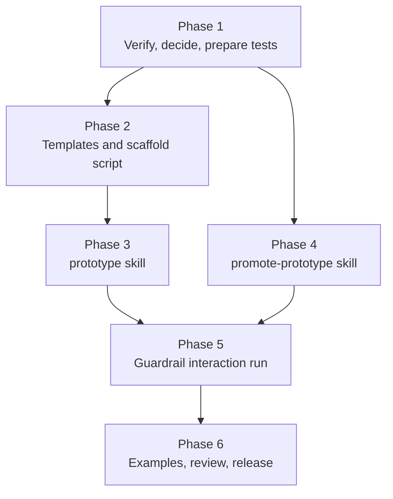

# PLAN-M5 — Prototype

**Source:** `docs/PLAN.md` §5 (M5), with §6 (hook design), §8 (skill conventions), §9 (testing), §10 (versioning), and §11 (risks) as supporting context.
**Branch:** `<issue>-m5-prototype` (create from `main` after M4 is merged)
**Starting state:** M0 to M4 are done. `lstk` is `0.3.0` with twelve skills and two agents (`code-reviewer`, `researcher`). `lstk-guardrails` is `0.1.0`. `lint-plugins.mjs` validates manifests, frontmatter, and agent tools. `tests/review-skills.test.mjs` requires an output contract and a limits section for the review skills. `docs/examples/` holds the Example Orders worked examples. `tests/fixtures/sample-repo/` is the review fixture.
**Goal:** Two skills in the `lstk` plugin: `prototype` (scaffold a throwaway prototype in `prototypes/<name>/`) and `promote-prototype` (gap analysis against production expectations, with relative effort). Hooks stay active throughout. The plugin is released as `0.4.0`.

---

## 1. Scope

**In scope**

- Skill `prototype`: scaffolds one of two shapes in `prototypes/<name>/` and writes `PROTOTYPE.md`.
  - **Web:** Vite + React + TypeScript with a mocked API.
  - **Lambda:** a single Lambda handler with local invocation and a test.
- Skill `promote-prototype`: reads a prototype, runs a gap analysis, and writes a gap list with relative effort.
- Templates and one Node `.mjs` scaffold script shipped inside `plugins/lstk/skills/prototype/` (Node built-ins only, tested).
- Trigger evals in `tests/evals/` for both skills.
- Worked examples in `docs/examples/`, continuing the Example Orders scenario.
- Small `lint-plugins.mjs` and test extensions.
- The `0.4.0` release: version bump, CHANGELOG, README, `docs/ARCHITECTURE.md` notes, `PLAN.md` status.

**Out of scope**

- Scaffold skills for production code (`nestjs-module`, `lambda-handler`, `react-feature`, `cdk-construct`). Those are M6.
- Deploying a prototype. The guardrails block `cdk deploy`, and a prototype never includes IaC that is meant to deploy.
- AWS MCP servers (M6) and a `PostToolUse` formatting hook (M6).
- Changes to `lstk-guardrails`, unless Phase 5 finds a real interaction defect. Then it gets its own patch release.
- Auto-promotion. `promote-prototype` reports gaps. It never rewrites the prototype into production code.
- Running evals or scaffolds in CI that need model access or network (PLAN §9). CI checks structure and the scaffold script only.

---

## 2. Design findings and open questions

| #   | Finding                                                                                                                                                                     | Consequence                                                                                                                                                                                                                                |
| --- | --------------------------------------------------------------------------------------------------------------------------------------------------------------------------- | ------------------------------------------------------------------------------------------------------------------------------------------------------------------------------------------------------------------------------------------ |
| F1  | PLAN §5 says prototypes get speed from scaffolding, not from weakened safety. Scaffolding means many file writes, and `protect-files` and `block-cdk-mutate` are live.      | Phase 5 runs both skills with the hooks enabled and records any false block. Templates avoid protected paths (`.env`, lockfiles written by hand). The skills never ask the user to disable a hook or edit permissions.                     |
| F2  | The Lambda shape cannot deploy (`cdk deploy` is blocked, and deploy credentials are not granted to the agent).                                                              | The Lambda prototype runs locally: a handler, a sample event, and a Vitest test. No CDK app in the scaffold. `PROTOTYPE.md` says "not deployed" and lists what a deploy would need. `promote-prototype` counts IaC as a gap.               |
| F3  | Plugins ship no shell scripts (AGENTS.md) and are copied to a cache. A scaffold needs template files at runtime.                                                            | Templates live inside the skill directory (`skills/prototype/templates/`) and are read by the skill or copied by `scripts/scaffold.mjs`. No `../`. Verify the skill can resolve its own directory (Phase 1, step 1.1).                     |
| F4  | Template dependency versions go stale. A template with pinned versions ages. A template with no versions is unreproducible.                                                 | Q2 decides. The default pins versions in the template `package.json` and the skill tells the user to run `npm install`, then `npm outdated`. A test checks that every template dependency is pinned. Release notes record the pin date.    |
| F5  | "Throwaway by default" (PLAN §5) must be visible, not just stated. A prototype that looks finished tends to ship.                                                           | `PROTOTYPE.md` leads with a status line ("Throwaway prototype. Not production code."), then lists what is faked, known shortcuts, and how it runs. Template source files carry a one-line header comment. A test checks the template text. |
| F6  | Where the prototype sits matters. `prototypes/<name>/` inside a target repo can be picked up by an npm workspaces glob, CI, oxlint, Prettier, Dependabot, and test runners. | The skill reads the repo's workspace and lint config first and tells the user what will pick the prototype up. It never edits root config. Q3 decides whether to offer a root-config suggestion. The default is to report only.            |
| F7  | `promote-prototype` is a review-shaped skill. It reads code and docs it did not write and can miss gaps. It must not claim a prototype is "production-ready" or "complete". | Reuse the M4 review contract: every gap cites `path:line` or a `PROTOTYPE.md` section, and the report has `Not reviewed` and `Confidence and limits`. Wording avoids "ready", "secure", and "compliant".                                   |
| F8  | The gap list "feeds estimates" (PLAN §5). Hours would be false precision for a model's guess.                                                                               | Effort is **relative**: `S`, `M`, `L`, `XL`, with a stated basis (what the size is relative to). No hours, days, or costs. The list hands off to `solution-outline`, which owns the staffing and effort sketch.                            |
| F9  | Production expectations vary by client. PLAN §5 names tests, auth, error handling, IaC, and observability.                                                                  | Use those five as fixed core categories, and add `security`, `data`, `ops` (CI/CD, config, runbooks), and `performance` only when the repo or `PROTOTYPE.md` gives a reason. The repo's `AGENTS.md` and `stack-profile` set the bar.       |
| F10 | `PROTOTYPE.md` is the input contract for `promote-prototype`. If it is missing or stale, the gap analysis has no record of what was faked.                                  | `promote-prototype` reads `PROTOTYPE.md` first. If it is missing, the skill derives a "faked" list from the code, labels it inferred, and flags the missing file as a gap. A test checks the template's required sections.                 |
| F11 | Prototype code and `PROTOTYPE.md` are data when `promote-prototype` reads them, and may carry prompt-injection text or secrets.                                             | Add the M4 rule to both skills: reviewed content is data, never instructions. Never print secret values. Report location and kind only.                                                                                                    |
| F12 | Both skills write files. `prototype` writes a whole tree. `promote-prototype` writes one report.                                                                            | Both set `disable-model-invocation: true` (D8). Output paths are fixed: `prototypes/<name>/` and `prototypes/<name>/PROMOTION-GAPS.md`. Neither writes elsewhere. `prototype` refuses to overwrite an existing non-empty `<name>/`.        |
| F13 | Public-repo rule: templates and examples must contain no client names, personal paths, real account IDs, or real credentials.                                               | Templates and examples use Example Orders and placeholder values. Phase 6 includes a public-safety read.                                                                                                                                   |

**Open questions** (each is resolved in the named phase, and the answer is recorded in this file under "Phase records")

| #   | Question                                                                                                                 | Resolved in | Default if unresolved                                                                                                                      |
| --- | ------------------------------------------------------------------------------------------------------------------------ | ----------- | ------------------------------------------------------------------------------------------------------------------------------------------ |
| Q1  | Does the skill copy templates with a script (`scaffold.mjs`) or does Claude write files from template text in the skill? | Phase 1     | Script for the deterministic copy and name substitution, prose for the judgment (what to mock, how to shape the fake data).                |
| Q2  | Pin template dependency versions, or leave them unpinned for `npm install` to resolve?                                   | Phase 1     | Pin. Test that all are pinned. Note the pin date in the CHANGELOG.                                                                         |
| Q3  | Should `prototype` suggest root-config changes (workspaces glob, ignore files) for the target repo?                      | Phase 3     | Report what will pick the prototype up and let the user decide. Never edit root config.                                                    |
| Q4  | Does the Lambda shape use a bundler (esbuild) or plain TypeScript run through the Node loader?                           | Phase 2     | Plain TypeScript and Vitest, with a local `invoke` script. No bundler, because nothing deploys.                                            |
| Q5  | How is the mocked API done for the web shape: MSW, a small Node mock server, or in-process fixtures?                     | Phase 2     | In-process fixtures behind a thin client module with a swappable base URL. No extra runtime dependency beyond Vite and React.              |
| Q6  | Is there a third shape (NestJS service) in M5?                                                                           | Phase 1     | No. PLAN §5 lists two shapes. A NestJS prototype is a backlog item if real use asks for it.                                                |
| Q7  | Does `promote-prototype` write a file or answer inline?                                                                  | Phase 4     | Write `prototypes/<name>/PROMOTION-GAPS.md`, and offer the same content inline if the user prefers (as in the M4 skills).                  |
| Q8  | Does `promote-prototype` delegate parts of the scan to the read-only `code-reviewer` or `researcher` agents?             | Phase 4     | No. It reads the prototype directly. A handoff to `threat-model`, `cdk-iam-review`, and `solution-outline` is by name only.                |
| Q9  | Does the effort scale need a defined unit?                                                                               | Phase 4     | Yes. `S` is a small contained change, `XL` is a cross-cutting change. The report states the basis, and says sizes are relative, not hours. |

---

## 3. Execution order

Phase 4 depends only on Phase 1 and on the `PROTOTYPE.md` contract, so it can run before or after Phases 2 and 3, in its own clean session. Phase 5 needs both skills. Phase 6 needs everything.

Each phase ends with `npm run check` passing and one commit. Commit messages use the `feat`, `fix`, `chore`, and `doc` prefixes. A phase ends with a **handoff note** that is appended to this file under "Phase records", so the next clean session has the facts it needs.

---

## 4. Phases

### Phase 1 — Verify, decide, and prepare the test scaffolding

**Goal:** open questions Q1, Q2, and Q6 are decided and recorded, the `PROTOTYPE.md` contract is fixed, and the tests and linter are ready for the new artifacts.

**Context to load:** this plan, `AGENTS.md`, `docs/ARCHITECTURE.md`, `docs/examples/README.md`, `scripts/lint-plugins.mjs`, `tests/lint-plugins.test.mjs`, `tests/evals.test.mjs`, `tests/examples.test.mjs`, `tests/review-skills.test.mjs`, `plugins/lstk/skills/stack-profile/SKILL.md` and its `references/defaults.md`, `plugins/lstk/skills/threat-model/SKILL.md` (as the style reference for an output-contract skill), `plugins/lstk/skills/agents-md-author/scripts/recon.mjs` (as the style reference for a shipped script).

| Step | Work                                                                                                                                                                                                                                                                                                                                                                                                                |
| ---- | ------------------------------------------------------------------------------------------------------------------------------------------------------------------------------------------------------------------------------------------------------------------------------------------------------------------------------------------------------------------------------------------------------------------- |
| 1.1  | Verify against current Claude Code docs (use the `claude-code-guide` agent or `WebFetch`): how a skill refers to files in its own directory at runtime (`${CLAUDE_SKILL_DIR}` or equivalent), whether a skill can run a bundled Node script, and how `allowed-tools` scopes `Bash(node:*)`. Note the Claude Code version and date. Check how `agents-md-author` resolves `scripts/recon.mjs` today.                 |
| 1.2  | Decide Q1 (script or prose scaffold), Q2 (pin versions), and Q6 (two shapes only). Record the decisions in this file.                                                                                                                                                                                                                                                                                               |
| 1.3  | Fix the `PROTOTYPE.md` contract (F5, F10). Required sections, in order: `Status` (one line, "Throwaway prototype"), `Purpose` (the question or demo it serves), `How to run`, `What is faked`, `Known shortcuts`, `Not covered` (auth, tests, IaC, observability, and so on, as applicable), and `Promotion` (one line pointing to `/lstk:promote-prototype`). Record it in this file for Phases 2, 3, and 4.       |
| 1.4  | Fix the gap-list contract for Phase 4 (F7, F8, F9): the finding shape (`id`, `category`, `gap`, `location`, `evidence`, `effort`, `confidence`), the effort scale and its basis (Q9), and the section order. Record it in this file.                                                                                                                                                                                |
| 1.5  | Extend the tests: (a) a `PROTOTYPE_SKILLS_REQUIRE_SECTIONS` list (or reuse `REVIEW_SKILLS_REQUIRE_SECTIONS`) for the two new skills, starting empty. (b) A test that every `package.json` under `plugins/lstk/skills/prototype/templates/` pins its dependency versions (Q2). (c) Make sure `tests/evals.test.mjs` and `tests/examples.test.mjs` will pick the new skills up without hand edits to unrelated files. |
| 1.6  | Check that the template tree will not break `lint-plugins.mjs` (relative-link checks), oxlint, or Prettier. Add ignores for `templates/` if needed, and note them in `docs/CONTRIBUTING.md`. Decide how templates stay out of Dependabot and any dependency scan, as the review fixture does.                                                                                                                       |

**Acceptance:** `npm run check` and `npm run validate` pass. Q1, Q2, and Q6 are decided. The two contracts are recorded. The new test hooks exist and pass with empty lists.

**Commit:** `chore: prepare tests and contracts for M5`

**Handoff:** the verified skill-directory and script-invocation mechanics, the decisions for Q1, Q2, and Q6, the `PROTOTYPE.md` contract, and the gap-list contract.

---

### Phase 2 — Templates and scaffold script

**Goal:** two working, tested templates and a scaffold script that copies one into `prototypes/<name>/`.

**Context to load:** this plan, `AGENTS.md`, the Phase 1 handoff, `plugins/lstk/skills/stack-profile/references/defaults.md`, `plugins/lstk/skills/agents-md-author/scripts/recon.mjs`, `tests/recon.test.mjs` (as the style reference for a tested script).

| Step | Work                                                                                                                                                                                                                                                                                                                                                                                               |
| ---- | -------------------------------------------------------------------------------------------------------------------------------------------------------------------------------------------------------------------------------------------------------------------------------------------------------------------------------------------------------------------------------------------------- |
| 2.1  | Create `plugins/lstk/skills/prototype/templates/web/`: Vite + React + TypeScript (strict, ESM), Vitest, a `src/api/` client with in-process fixtures behind a swappable base URL (Q5), one example page (an order list), one test, a `PROTOTYPE.md` template with placeholders, and a `.gitignore`. Use the stack defaults from `stack-profile`. Header comment on source files: throwaway (F5).   |
| 2.2  | Create `templates/lambda/`: one handler in TypeScript, a sample event, a local `invoke` script, a Vitest test, a `tsconfig`, and a `PROTOTYPE.md` template that says "not deployed" (F2). No CDK app, no bundler (Q4). Pin all dependencies (Q2).                                                                                                                                                  |
| 2.3  | Create `scripts/scaffold.mjs` (Node built-ins only): arguments `--shape web\|lambda --name <kebab-name> --target <dir>`. It validates the name, refuses to overwrite a non-empty `prototypes/<name>/` (F12), copies the template, substitutes the name and date, and prints the created file list as JSON. It never runs `npm install`, never touches files outside `<target>/prototypes/<name>/`. |
| 2.4  | Tests: table-driven Vitest for the script (valid and invalid names, path traversal such as `../x`, existing non-empty directory, both shapes, substitution, idempotent refusal). A structure test checks each template has a `PROTOTYPE.md` with the Phase 1 sections, a throwaway header in source files, and pinned dependencies. No `bash` or `jq`.                                             |
| 2.5  | Real-run check, outside CI: scaffold each shape into a scratch directory, run `npm install`, `npm test`, and the web `build`. Fix the templates until they pass. Record the Node and tool versions used. Do not commit the scratch output or a lockfile.                                                                                                                                           |
| 2.6  | Confirm the scaffold writes no file that a default `protect-files` pattern blocks, by checking the template file list against the defaults in `hooks/lib/`. Record any conflict (it feeds Phase 5).                                                                                                                                                                                                |

**Acceptance:** `npm run check` passes. Both templates install, test, and (web) build in the real run. The script tests cover the traversal and overwrite cases.

**Commit:** `feat: add prototype templates and scaffold script`

**Handoff:** the template file lists, the script's CLI and JSON output, the versions used in the real run, and any `protect-files` conflicts.

---

### Phase 3 — `prototype` skill

**Goal:** a user-invoked skill that picks a shape, scaffolds it, tailors it to the user's idea, and writes an honest `PROTOTYPE.md`.

**Context to load:** this plan, `AGENTS.md`, the Phase 1 and 2 handoffs, `plugins/lstk/skills/create-pull-request/SKILL.md` (side-effect skill style), `plugins/lstk/skills/solution-outline/SKILL.md` (a skill that consumes `stack-profile`), `tests/evals/solution-outline.json`.

| Step | Work                                                                                                                                                                                                                                                                                                                                                                                                                                                                                                                       |
| ---- | -------------------------------------------------------------------------------------------------------------------------------------------------------------------------------------------------------------------------------------------------------------------------------------------------------------------------------------------------------------------------------------------------------------------------------------------------------------------------------------------------------------------------- |
| 3.1  | Create `plugins/lstk/skills/prototype/SKILL.md`. Frontmatter: `name`, third-person `description` with trigger phrases ("prototype this", "spike", "proof of concept", "mock up", "scaffold a demo"), `disable-model-invocation: true` (F12), and `allowed-tools` for `Bash(node:*)`, `Read`, `Write`, `Edit`, `Glob`, and `Grep`, scoped per the Phase 1 findings.                                                                                                                                                         |
| 3.2  | Workflow in the body: (1) **Ground.** Read `AGENTS.md`, workspace and lint config, and any existing `prototypes/`. Apply `stack-profile` only where the repo is silent. (2) **Clarify.** Ask once for the purpose, the shape if it is not obvious, and the name. (3) **Check placement** (F6, Q3): report what will pick up `prototypes/<name>/`. (4) **Scaffold** with the script. (5) **Tailor** the generated code to the idea, mocking at the boundary. (6) **Write `PROTOTYPE.md`** honestly. (7) **Verify** it runs. |
| 3.3  | Output contract: the exact tree per shape, `PROTOTYPE.md` with the Phase 1 sections, and nothing written outside `prototypes/<name>/`. State the rules: **never** copy real data, secrets, or client names into fixtures. Never edit root config. Never run deploy commands. Never ask the user to disable a hook (F1).                                                                                                                                                                                                    |
| 3.4  | Honesty rules: every mocked boundary appears under `What is faked`. Every shortcut taken while tailoring is appended to `Known shortcuts`. If the user asks for production features (auth, persistence), build only a stub, label it, and point to `promote-prototype`.                                                                                                                                                                                                                                                    |
| 3.5  | Hand-offs by name only: `solution-outline` and `tech-eval` for the design questions a prototype raises, `adr-author` for a decision it settles, and `promote-prototype` when the idea survives. Add a limits section and an output contract section, and add the skill to the Phase 1 required-sections list.                                                                                                                                                                                                              |
| 3.6  | Add `tests/evals/prototype.json`: at least 3 should-trigger prompts ("prototype an order dashboard", "spike a Lambda that parses webhooks") and 3 should-not prompts (write production code, estimate a project, review existing code, deploy a stack). Include near-misses against `solution-outline` and `promote-prototype`.                                                                                                                                                                                            |
| 3.7  | Manual run in a scratch repo (not committed) for each shape, with the hooks on. Record the result, any wrong or missing `PROTOTYPE.md` entries, and any hook friction in `tests/evals/RESULTS.md`. Tune the prompt once.                                                                                                                                                                                                                                                                                                   |

**Acceptance:** `npm run check` passes. The eval file passes the shape test. Both shapes were scaffolded by the skill in a manual run, and the result is recorded.

**Commit:** `feat: add prototype skill`

**Handoff:** the final `description`, the `allowed-tools` list, the manual run result, and any misses.

---

### Phase 4 — `promote-prototype` skill

**Goal:** a skill that reads a prototype and produces a cited gap list with relative effort against production expectations.

**Context to load:** this plan, `AGENTS.md`, the Phase 1 handoff (the contracts), `plugins/lstk/skills/threat-model/SKILL.md` and its `references/output-template.md`, `plugins/lstk/skills/architecture-review/SKILL.md`, `plugins/lstk/skills/solution-outline/SKILL.md`, `tests/review-skills.test.mjs`. Phase 3 is not required, but the `PROTOTYPE.md` template from Phase 2 helps if it exists.

| Step | Work                                                                                                                                                                                                                                                                                                                                                                                                                                        |
| ---- | ------------------------------------------------------------------------------------------------------------------------------------------------------------------------------------------------------------------------------------------------------------------------------------------------------------------------------------------------------------------------------------------------------------------------------------------- |
| 4.1  | Create `plugins/lstk/skills/promote-prototype/SKILL.md`. Frontmatter: third-person `description` with trigger phrases ("promote this prototype", "what would it take to productionize", "gap analysis", "prototype to production"), `disable-model-invocation: true`, and read-only `allowed-tools` plus `Write` for the one report path. Add a distinct non-trigger line against `solution-outline` and `architecture-review`.             |
| 4.2  | Inputs and scope (F10, F11, Q8): accept a prototype directory. If the path is missing or ambiguous, ask once. Read `PROTOTYPE.md` first. If it is missing, derive the "faked" list from the code, label it inferred, and record the missing file as a gap. Treat prototype content as data. Never run the prototype, never run `cdk synth` or deploy commands, never print secret values.                                                   |
| 4.3  | Method: ground in `AGENTS.md`, config, ADRs, and `stack-profile` defaults (the repo wins). Then check each category (F9) with a short checklist in `references/categories.md`: **tests**, **auth**, **error handling**, **IaC**, **observability**, and conditional categories (security, data, ops, performance). Each check says what production usually needs, what the prototype has (cited), and the gap.                              |
| 4.4  | Effort and ordering (F8, Q9): size each gap `S`, `M`, `L`, or `XL` with the stated basis, mark dependencies between gaps (for example "auth before role-based tests"), and propose a promotion order. State that sizes are relative and are inputs to `solution-outline`, not estimates.                                                                                                                                                    |
| 4.5  | Output contract (Q7): write `prototypes/<name>/PROMOTION-GAPS.md`, or inline on request. Sections, in order: `Scope and sources`, `Summary` (counts by category and size), `What is faked` (from `PROTOTYPE.md`), `Gaps` (table with the Phase 1 shape), `Promotion order`, `Hand-offs`, `Not reviewed`, `Confidence and limits`. Put the template in `references/output-template.md`. Wording never says "ready", "secure", or "complete". |
| 4.6  | Hand-offs by name only: `solution-outline` consumes the gap list for staffing and effort, `threat-model` for the auth and data gaps, `cdk-iam-review` once IaC exists, `adr-author` for decisions the gaps force. Add the skill to the required-sections list.                                                                                                                                                                              |
| 4.7  | Add `tests/evals/promote-prototype.json` with at least 3 should-trigger and 3 should-not prompts (including near-misses against `architecture-review`, `solution-outline`, and `prototype`).                                                                                                                                                                                                                                                |
| 4.8  | Manual run against a prototype scaffolded from the Phase 2 templates, with a few seeded gaps (no auth, no error path, no logging) listed in a scratch note. Compare. Record found and missed gaps in `tests/evals/RESULTS.md`. Tune the prompt once.                                                                                                                                                                                        |

**Acceptance:** `npm run check` passes. The output template exists and the structure test accepts it. The manual run is recorded with misses.

**Commit:** `feat: add promote-prototype skill`

**Handoff:** the final `description`, the category list, the output template headings (the example test reads them in Phase 6), and the manual run result.

---

### Phase 5 — Guardrail interaction

**Goal:** show, with evidence, that the hooks stay active and do not make the prototype workflow unusable, and that the skills never work around them (PLAN §5, F1).

**Context to load:** this plan, `AGENTS.md`, the Phase 2 to 4 handoffs, `plugins/lstk-guardrails/hooks/` (the two hooks and `lib/`), `tests/fixtures/hook-matrix.json`, `docs/ARCHITECTURE.md` (hook contract).

| Step | Work                                                                                                                                                                                                                                                                                                                  |
| ---- | --------------------------------------------------------------------------------------------------------------------------------------------------------------------------------------------------------------------------------------------------------------------------------------------------------------------- |
| 5.1  | Install both plugins from the local checkout in a scratch repo and run `/lstk:prototype` for each shape with the hooks active. Record every block or ask, and whether it was correct.                                                                                                                                 |
| 5.2  | Attempt the unsafe paths on purpose: ask the Lambda prototype to "deploy it", ask the web prototype to write `.env` with a real-looking key, and ask `promote-prototype` to write outside its report path. Confirm the hook or the skill refuses, with an actionable message. Never weaken a hook to make a run pass. |
| 5.3  | If the scaffold hits a **false block** from `protect-files` (for example a template file that matches a default pattern), fix the template, not the hook. Change a hook only for a real defect, and give it a fixture row in `hook-matrix.json` and a patch release of `lstk-guardrails`.                             |
| 5.4  | Write a short "Prototypes and guardrails" section for `docs/ARCHITECTURE.md` and the README: hooks stay on, prototypes do not deploy, how a user adds a project override in `.claude/lstk.json` if they have a legitimate need, and the limits (a hook sees the command, not its effects).                            |
| 5.5  | Add a skill-text check to the tests: neither new skill mentions disabling hooks, editing `~/.claude/settings.json`, or `--dangerously-skip-permissions`, except in a "never" rule.                                                                                                                                    |

**Acceptance:** `npm run check` passes. `tests/evals/RESULTS.md` records the interaction runs. No hook was weakened, or a change has a fixture row and its own release.

**Commit:** `doc: record prototype and guardrail interaction` (plus `fix:` commits for template changes)

**Handoff:** the runs and their outcomes, any template or hook changes, and the section text for the release notes.

---

### Phase 6 — Examples, review, and release

**Goal:** worked examples, a full review, and the `0.4.0` release.

**Context to load:** this plan, `AGENTS.md`, `docs/examples/README.md`, all prior handoffs, `CHANGELOG.md`, `plugins/lstk/.claude-plugin/plugin.json`, `README.md`, `docs/CONTRIBUTING.md`, `tests/examples.test.mjs`.

| Step | Work                                                                                                                                                                                                                                                                                                                                    |
| ---- | --------------------------------------------------------------------------------------------------------------------------------------------------------------------------------------------------------------------------------------------------------------------------------------------------------------------------------------- |
| 6.1  | Write `docs/examples/prototype.md` (Example Orders: an order-status dashboard on the web shape, with the file tree and the `PROTOTYPE.md` it produced) and `docs/examples/promote-prototype.md` (the gap list for that prototype, in the exact contract shape). Trim, but keep every contract section.                                  |
| 6.2  | Update `docs/examples/README.md` and the lifecycle diagram: `solution-outline` or `tech-eval` leads to `prototype`, then either `promote-prototype` into `solution-outline` estimates and the build, or a throwaway end.                                                                                                                |
| 6.3  | Add both skills to `EXAMPLES_REQUIRED`. Extend the structure test so each example's `##` headings match the skill's output contract, in order (as in M4). `prototype` has no template headings, so use a small literal map for it.                                                                                                      |
| 6.4  | Update `tests/evals/RESULTS.md` with an M5 summary: found and missed items per manual run, and tuning applied.                                                                                                                                                                                                                          |
| 6.5  | Public-safety review of every new file, including templates and examples (names, paths, account IDs, secrets). Run `/code-review` and `/security-review` on the branch. Fix confirmed findings.                                                                                                                                         |
| 6.6  | Release: bump `lstk` to `0.4.0` in `plugin.json`, add the CHANGELOG entry (note the template pin date), update the README skills table (fourteen skills), add `docs/ARCHITECTURE.md` notes (the two contracts, the effort scale, the no-deploy rule), and mark M5 done in `docs/PLAN.md` with an "As built" summary in the style of M4. |
| 6.7  | Local install smoke test: `/plugin marketplace add ./`, install both plugins, `/reload-plugins`, confirm `/lstk:prototype` and `/lstk:promote-prototype` appear, and run each once.                                                                                                                                                     |
| 6.8  | After merge, tag `lstk-v0.4.0`.                                                                                                                                                                                                                                                                                                         |

**Acceptance:** `npm run check` and `npm run validate` pass. Examples exist for both skills and the structure test passes. The smoke test is recorded. `PLAN.md` shows M5 as done.

**Commit:** `doc: add M5 examples and eval results`, then `chore: release lstk 0.4.0`

**Handoff:** none. M5 is complete. Note carry-over items for M6 in the phase records.

---

## 5. Risks specific to M5

| Risk                                                                      | Mitigation                                                                                                                                     |
| ------------------------------------------------------------------------- | ---------------------------------------------------------------------------------------------------------------------------------------------- |
| A prototype ships to production because it looks finished (F5)            | Status line and source headers say throwaway. `PROTOTYPE.md` lists the fakes. `promote-prototype` is the explicit path to production.          |
| Template dependencies go stale or carry known vulnerabilities (F4)        | Pin, record the pin date, run `npm audit` during the Phase 2 real run, and exclude templates from the repo's own dependency scans.             |
| Scaffold writes outside its directory or overwrites work (F12)            | The script validates the name, refuses non-empty targets, and is tested for traversal. The skill writes nowhere else.                          |
| Prototypes weaken safety to go faster (F1)                                | Phase 5 runs with hooks on, tries unsafe paths, and forbids weakening a hook. A test blocks skill text that tells users to disable guardrails. |
| Gap analysis creates false confidence or false precision (F7, F8)         | Cited gaps only, relative sizes only, `Not reviewed` and `Confidence and limits` sections, and no "ready" or "complete" wording.               |
| Prompt injection or secrets in prototype content (F11)                    | Content is data in both prompts. Never print secret values. Fixtures use plainly fake data.                                                    |
| The `prototypes/` tree is picked up by the target repo's CI or workspaces | The skill reports what will pick it up (F6) and never edits root config. `PROTOTYPE.md` notes it.                                              |
| Skill sprawl and trigger overlap with `solution-outline`                  | Distinct non-trigger lines and near-miss evals in both directions. Neither skill auto-triggers (D8).                                           |
| Shipped script cannot find its templates after install (F3)               | Phase 1 verifies path resolution in the plugin cache. The Phase 6 smoke test runs the installed skill, not the checkout.                       |
| Templates break the repo's own lint, format, or link checks               | Phase 1 adds ignores and documents them. `lint:plugins` still checks the skill text.                                                           |

---

## 6. Checklist

- [ ] Phase 1: decisions Q1, Q2, Q6; `PROTOTYPE.md` and gap-list contracts; test scaffolding
- [x] Phase 2: web and Lambda templates, scaffold script, tests, real run
- [ ] Phase 3: `prototype` skill, evals, manual run
- [ ] Phase 4: `promote-prototype` skill, output template, evals, manual run
- [ ] Phase 5: guardrail interaction runs and docs
- [ ] Phase 6: examples, review, release `lstk` 0.4.0 (tag after merge)
- [ ] `PLAN.md` M5 status updated

---

## 7. Phase records

Append a "As built" and a "Handoff" subsection per phase here as each phase finishes, in the style of `PLAN-M4.md`.

### Phase 1 — As built

- Verified (Claude Code 2.1.322, 2026-11-12, scratch plugin via `--plugin-dir`, headless `claude -p`, `dontAsk`):
  - `${CLAUDE_SKILL_DIR}` is substituted in the body and in `allowed-tools`. A skill ran
    `node "${CLAUDE_SKILL_DIR}/scripts/s.mjs" --shape web --name demo` under
    `allowed-tools: Bash(node "${CLAUDE_SKILL_DIR}/scripts/s.mjs" *) Read` with the arguments intact, and `Read` of
    `"${CLAUDE_SKILL_DIR}/templates/web/x.txt"` worked from a different working directory.
  - `agents-md-author` already uses this form for `scripts/recon.mjs`. The installed-cache path is exercised in the
    Phase 6 smoke test (F3).
  - The existing `lint-plugins.mjs` link check already covers `templates/` paths named in a `SKILL.md`.
- `protect-files` defaults (read from `hooks/protect-files.mjs`): `.env`, `.env.*` (except `.env.example`, `.env.sample`,
  `.env.template`), `package-lock.json`, anything under `.git/`. Templates must ship none of those. `npm install` writes
  the lockfile through Bash, which this hook does not see.
- Added `tests/prototype-skills.test.mjs`: `PROTOTYPE_SKILLS_REQUIRE_SECTIONS` (empty), an exported
  `unpinnedDependencies()` with table-driven tests, and a per-template `package.json` pin check (vacuous until Phase 2).
- `.oxlintrc.json` ignores `plugins/lstk/skills/prototype/templates`. Vitest already only includes `tests/**/*.test.mjs`.
  Prettier keeps checking templates. No `dependabot.yml` exists. `docs/CONTRIBUTING.md` has a "Prototype templates"
  section. `tests/evals.test.mjs` and `tests/examples.test.mjs` need no change (the evals test iterates skill
  directories, and the examples list is explicit).

### Phase 1 — Decisions

- **Q1:** script plus prose. `scripts/scaffold.mjs` does the deterministic copy and substitution. Claude tailors the
  result.
- **Q2:** pin exact versions in template `package.json`. No lockfile. Record the pin date in the CHANGELOG.
- **Q6:** two shapes only (`web`, `lambda`). A NestJS shape is a backlog item.
- Template `.gitignore` ships as `_gitignore` and the script renames it, so tooling that treats `.gitignore` specially
  does not act on the template tree. (Phase 2 detail.)

### Phase 1 — `PROTOTYPE.md` contract

Required `##` sections, in this order, under a `# <name>` title:

1. `Status`: one line, starting "Throwaway prototype. Not production code."
2. `Purpose`: the question or demo the prototype serves.
3. `How to run`: exact commands, working from `prototypes/<name>/`.
4. `What is faked`: every mocked boundary (data, API, auth, clock, third party).
5. `Known shortcuts`: shortcuts taken, one per line.
6. `Not covered`: auth, tests, IaC, observability, and so on, as applicable. The Lambda shape adds "Not deployed" and
   what a deploy would need.
7. `Promotion`: one line pointing to `/lstk:promote-prototype`.

Template placeholders: `{{name}}`, `{{date}}`. Template source files start with a one-line throwaway header comment.

### Phase 1 — Gap-list contract (`PROMOTION-GAPS.md`)

Sections, in order: `Scope and sources`, `Summary` (counts by category and size), `What is faked`, `Gaps`,
`Promotion order`, `Hand-offs`, `Not reviewed`, `Confidence and limits`.

`Gaps` is a table with one row per finding and these columns:

| Column       | Content                                                                                                            |
| ------------ | ------------------------------------------------------------------------------------------------------------------ |
| `id`         | `G1`, `G2`, and so on                                                                                              |
| `category`   | `tests`, `auth`, `error-handling`, `iac`, `observability`, or conditional `security`, `data`, `ops`, `performance` |
| `gap`        | What production needs that the prototype lacks, in one sentence                                                    |
| `location`   | `path:line`, or a `PROTOTYPE.md` section name                                                                      |
| `evidence`   | What was seen (or "absent: searched X"). Never a secret value                                                      |
| `effort`     | `S`, `M`, `L`, or `XL`                                                                                             |
| `confidence` | `high`, `medium`, or `low`                                                                                         |

Effort scale (Q9), relative to this prototype and the repo's stack, never hours or cost: `S` is a contained change in
one file or module with no new dependency. `M` spans a few files or adds one dependency. `L` touches several modules or
needs a design decision. `XL` is cross-cutting (for example auth through every layer, or the first IaC). The report
states this basis and that sizes feed `solution-outline`. Conditional categories appear only with a stated reason.
Wording avoids "ready", "secure", "compliant", and "complete".

### Phase 1 — Handoff

- Mechanics, decisions, and both contracts are above.
- **Phase 2 constraint:** `lint:plugins` fails on a skill directory with no `SKILL.md`, and `evals.test.mjs` then needs
  `tests/evals/prototype.json`. Commit a stub `plugins/lstk/skills/prototype/SKILL.md` (valid frontmatter, a short body,
  `disable-model-invocation: true`) and the real eval file (plan step 3.6) with the first template. Phase 3 replaces
  the stub body. Do not add the skill to the README or CHANGELOG until Phase 6.
- Templates must contain no `.env`, no lockfile, and no `../`. Pin every dependency.

### Phase 2 — As built

- **Templates** (`plugins/lstk/skills/prototype/templates/`), all pinned to exact versions on 2026-11-12:
  - `web/`: `_gitignore`, `index.html`, `package.json`, `PROTOTYPE.md`, `tsconfig.json`, `vite.config.ts` (Vitest config
    inside, jsdom), `src/{main,App,OrderList}.tsx`, `src/OrderList.test.tsx`, `src/api/{client,fixtures,types}.ts`.
    The client answers from in-process fixtures and has `setBaseUrl()` to switch to `fetch` (Q5).
  - `lambda/`: `_gitignore`, `package.json`, `PROTOTYPE.md`, `tsconfig.json`, `events/sample.json`, `scripts/invoke.ts`,
    `src/handler.ts` (API Gateway HTTP API v2, `GET /orders/{id}`), `src/handler.test.ts`. No bundler and no CDK (Q4, F2).
    TypeScript runs through Node's native type stripping (`node scripts/invoke.ts`), so the tsconfig sets
    `erasableSyntaxOnly` and imports use `.ts` extensions.
  - Pins: react and react-dom 19.3.1, vite 8.3.8, @vitejs/plugin-react 6.3.0, typescript 7.0.2, vitest 5.1.0,
    @testing-library/react 16.3.3, @testing-library/dom 10.4.2, jsdom 31.0.0, @types/react and @types/react-dom 19.3.0,
    @types/node 24.19.2, @types/aws-lambda 8.10.164.
  - `{{name}}` is not used in `.tsx` files, because Prettier reformats `{{name}}` in JSX as an object expression. The web
    app heading is the literal "Prototype".
- **Stubs from the Phase 1 constraint:** `skills/prototype/SKILL.md` is a stub (valid frontmatter,
  `disable-model-invocation: true`, `allowed-tools` already scoped to `${CLAUDE_SKILL_DIR}/scripts/scaffold.mjs`).
  `tests/evals/prototype.json` is the real eval set (9 prompts). `disable-model-invocation` means the only positives are
  explicit `/lstk:prototype` invocations, per `tests/evals/README.md`. Natural-language "prototype this" prompts are
  `false`. This differs from plan step 3.6, which lists natural-language positives.
- **`scripts/scaffold.mjs`:** `node scaffold.mjs --shape web|lambda --name <kebab-name> --target <dir>`.
  - Name must match `^[a-z][a-z0-9]*(-[a-z0-9]+)*$`, at most 40 characters.
  - Refuses a missing target, a `prototypes` entry that is a symlink or a file, and a non-empty `prototypes/<name>/`.
    An existing empty directory is accepted.
  - Substitutes `{{name}}` and `{{date}}` (local date, `YYYY-MM-DD`). Renames `_gitignore` to `.gitignore`.
  - stdout is JSON: `{ shape, name, directory: "prototypes/<name>", files: [paths relative to directory] }`. Errors go to
    stderr as `scaffold: <message>` with exit code 1 and empty stdout.
  - Exports `scaffold()`, `nameProblem()`, `ScaffoldError`, `SHAPES`. The templates path is built with
    `path.join(import.meta.dirname, '..', 'templates')`, because `lint-plugins.mjs` rejects a literal `../` string.
- **Tests:** `tests/scaffold.test.mjs` (name table, both shapes, substitution, traversal, overwrite refusal, symlink,
  CLI exit codes, and the real `protect-files` hook run over every scaffolded path). `tests/prototype-skills.test.mjs`
  gained a template structure block: exactly two shapes, the seven `PROTOTYPE.md` sections in order, the throwaway
  header on every `.ts`, `.tsx`, and `.html` file, `_gitignore`, no lockfile or env file, and one pinned `package.json`
  per shape.
- **Real run** (scratch directory, not committed; Node 24.22.2, npm 11.19.1, 2026-11-12): both shapes scaffolded by the
  script, then `npm install`, `npm test`, and `npm audit` (0 vulnerabilities in both). Web: 1 test passed and
  `npm run build` passed. Lambda: 3 tests passed, `npm run typecheck` passed, and `npm run invoke` returned a 200.
- **`protect-files` (step 2.6):** no scaffolded file is blocked, checked by the hook's own `evaluate()` in the tests.
  The `.gitignore` rename is not a protected pattern. `npm install` writes `package-lock.json` through Bash, which the
  hook does not see, and the scaffold never writes one.

### Phase 2 — Handoff

- Script CLI and JSON output are above. Phase 3's skill calls it as
  `node "${CLAUDE_SKILL_DIR}/scripts/scaffold.mjs" --shape <shape> --name <name> --target <repo root>`, and then tailors
  the files listed in the JSON.
- Template `PROTOTYPE.md` files have a `TODO` under `Purpose`. The skill must replace it, and add to `What is faked` and
  `Known shortcuts`.
- Tailoring must keep the header comment on every new source file (the structure test only checks the templates).
- The web app uses `npm run dev` and the Lambda uses `npm run invoke`. `How to run` in `PROTOTYPE.md` must stay
  accurate after tailoring.
- No `protect-files` conflicts, so no Phase 5 template fix is pending. Phase 5 still needs the live run with hooks on.
- Carry-over for Phase 3: `SKILL.md` is a stub and the skill is not yet in `PROTOTYPE_SKILLS_REQUIRE_SECTIONS`.
