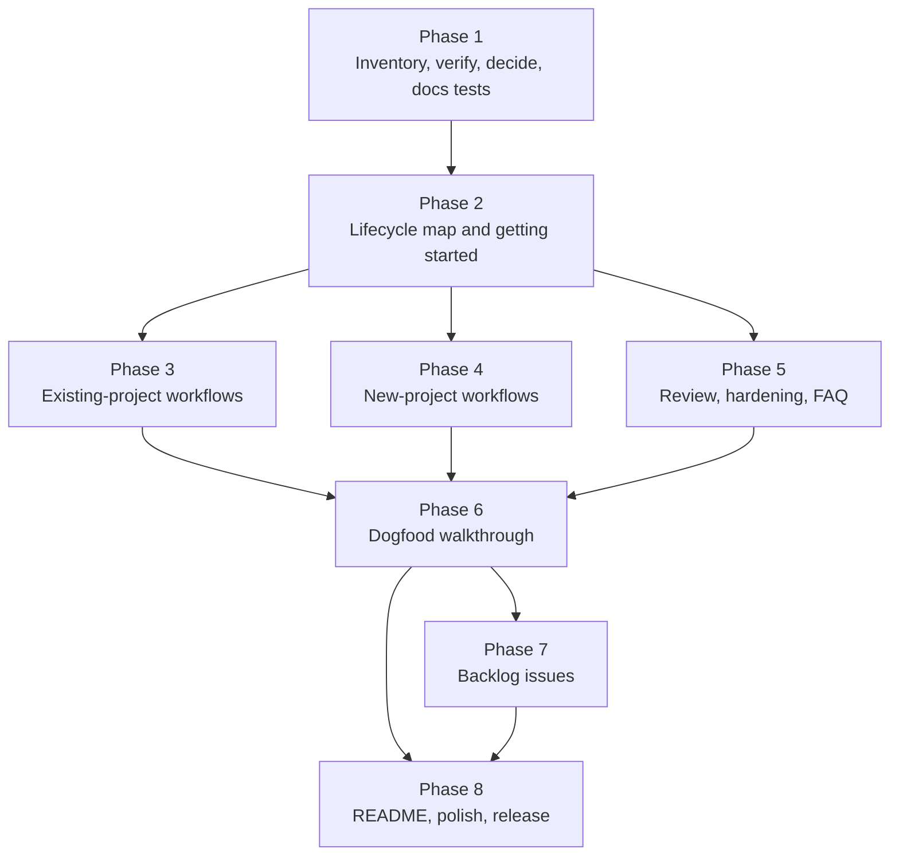

# PLAN-M6 — Marketplace polish and user documentation (backlog triaged)

**Source:** `docs/PLAN.md` §5 (M6), with §8 (skill conventions), §9 (testing), §10 (versioning), and §11 (risks) as supporting context. Work issue: #10 ("M6 — Backlog"). It tracks this milestone's implementation only and closes when the pull request merges. Deferred work is tracked in new issues created in Phase 7.
**Branch:** `10-m6-docs-and-polish` (create from `main`)
**Starting state:** M0 to M5 are done. `lstk` is `0.4.0` with fourteen skills and two agents. `lstk-guardrails` is `0.1.0`. The README documents every skill and the guardrail model but has no task-oriented guidance. `docs/examples/` holds worked examples of the design, review, and prototype skills. There are no user guides.
**Goal:** A new or existing user can open the repo and learn which skill or agent to use for each everyday workflow, and in what order. Marketplace polish is done. The remaining M6 backlog items are triaged into GitHub issues with explicit promotion criteria, not built.

---

## 1. Scope

**In scope**

- User guides in `docs/guides/`: getting started, a lifecycle map, and task-first workflow recipes for existing projects, new projects, and review and hardening.
- A README restructure: a short landing page that routes to the guides.
- Marketplace polish: README top section, plugin manifest metadata, a demo, and a "how it was built" document.
- Docs tests that keep the guides honest as skills change (links resolve, every skill and agent is mapped, every `/lstk:<name>` reference exists).
- A dogfood walkthrough that runs each documented workflow once and records the friction.
- Triage of the four backlog items (scaffold skills, AWS MCP servers, `PostToolUse` hook, polish) into GitHub issues with promotion criteria.

**Out of scope**

- New skills, agents, or hooks. M6 adds none. Any skill gap the guides expose becomes an issue (Phase 7).
- AWS MCP servers, the `PostToolUse` formatting hook, and production scaffold skills. They are triaged, not built (see §3).
- Rewriting skills to fit the guides. If a skill's own text is wrong, fix it in a small `fix:` commit and bump the version. Do not redesign it.
- Multi-agent portability and Windows support (PLAN §1).

---

## 2. Where the documentation belongs

**Decision: both, with a strict split.** The README stays a landing page. The workflow guidance lives in `docs/guides/`.

| Option                          | For                                                                                                          | Against                                                                                                          |
| ------------------------------- | ------------------------------------------------------------------------------------------------------------ | ---------------------------------------------------------------------------------------------------------------- |
| Everything in the README        | One file, easy to find                                                                                       | The README is already 156 lines. Workflows would triple it. Install and reference content drowns under recipes.  |
| Everything in `docs/guides/`    | Room to grow, one topic per file                                                                             | A visitor who lands on the repo sees no workflow guidance and no reason to read further.                         |
| **README routes to the guides** | The README answers "what is it, how do I install it, where do I start" in one screen. Guides hold the depth. | Two places to keep in sync. Mitigated by a docs test (Phase 1) and by keeping the skill table in one place only. |

Rules that follow:

1. **README owns:** the pitch, install, the skill and agent reference tables, the guardrail model, and a "Start here" block that links to the guides. It gets one new section, "Workflows at a glance", with the lifecycle diagram and a six-line table.
2. **`docs/guides/` owns:** all task-first recipes. Guides link to skills by name and never copy a skill's description. The skill table exists only in the README, so there is one place to update.
3. **Maintainer docs stay separate.** `docs/PLAN.md`, `docs/plans/`, `docs/ARCHITECTURE.md`, and `docs/CONTRIBUTING.md` are for contributors. `docs/guides/` is for plugin users. The README links to both, in separate sections.
4. **Each guide is a recipe set, not prose.** Each recipe has: when to use it, the ordered steps (skill, agent, or native Claude Code), a copy-paste prompt for each step, the artifact it produces, and when to skip a step.

**Guide set** (each is a clean-session unit in Phases 2 to 5)

| File                                  | Audience and content                                                                                                                                             |
| ------------------------------------- | ---------------------------------------------------------------------------------------------------------------------------------------------------------------- |
| `docs/guides/README.md`               | Index. "I want to..." routing table to the recipes below.                                                                                                        |
| `docs/guides/getting-started.md`      | Install, `init`, first five minutes on an existing repo (`agents-md-author`, `repo-onboarding`, `local-setup-author`), and how skills, agents, and hooks differ. |
| `docs/guides/lifecycle.md`            | The build loop (discover, plan, implement, review, commit, pull request, harden) mapped to skills, agents, and native Claude Code, with a Mermaid diagram.       |
| `docs/guides/existing-projects.md`    | Recipes: add a feature, enhance a feature, fix a bug, improve test coverage.                                                                                     |
| `docs/guides/new-projects.md`         | Recipes: solution design, choose technology, record decisions, prototype, scaffold (with the honest current limit), then the shared implementation loop.         |
| `docs/guides/review-and-hardening.md` | Recipes: review a change, review a design, threat-model, review CDK IAM, dependency triage by hand, periodic hardening.                                          |
| `docs/guides/faq.md`                  | Slash-only skills, why a skill did not trigger, hooks that blocked a call, repo conventions winning over defaults, what lstk does not do.                        |

**Content principle (the main finding).** `lstk` has strong _discover, plan, review, harden, commit, and PR_ skills, and none for _implement_, _fix a bug_, or _improve test coverage_. Those steps are native Claude Code, made safer by `lstk-guardrails` and better grounded by `AGENTS.md`, `stack-profile`, and `code-reviewer`. The guides must say so plainly, per recipe, with a "What lstk adds here" and a "What is plain Claude Code here" line. Overselling a skill that does not exist is the main way this documentation would fail a user.

**Existing versus new projects.** The implementation loop is the same in both. What differs is the front of the loop. An existing project starts from discovery (`repo-onboarding`, `agents-md-author`), a new project from design (`solution-outline`, `tech-eval`, `adr-author`). `new-projects.md` therefore ends by pointing back to the loop in `existing-projects.md` rather than repeating it. Greenfield scaffolding with a prescribed stack is **not covered today**: `prototype` is deliberately throwaway. The guide says that, and shows the closest honest path (prototype for a spike, then `stack-profile` plus native Claude Code for the real repo). This gap is the first backlog candidate (§3).

---

## 3. Backlog triage: build now or file an issue

PLAN §11 names skill sprawl as a risk and gates new skills on "a real recurring workflow and an eval set". M0 to M5 shipped without real-use evidence about which new capability matters most. The guides in this milestone are the first structured way to find out.

| Item                                                                                  | Build now                                                                                                                                                               | File an issue                                                                                                                                           | Recommendation                                                                                                                  |
| ------------------------------------------------------------------------------------- | ----------------------------------------------------------------------------------------------------------------------------------------------------------------------- | ------------------------------------------------------------------------------------------------------------------------------------------------------- | ------------------------------------------------------------------------------------------------------------------------------- |
| Scaffold skills (`nestjs-module`, `lambda-handler`, `react-feature`, `cdk-construct`) | Four skills, templates, scripts, evals, examples. Large. Each encodes stack opinions and template versions that age (M5 F4).                                            | Wait for the guides and dogfooding to show which of the four is asked for repeatedly, and whether Claude plus `stack-profile` already does well enough. | **Issue.** The most likely first promotion, via the greenfield gap. One issue per skill, so each is judged on its own evidence. |
| AWS docs and CDK MCP servers                                                          | Adds a credential and network surface. Server maintenance and tool names must be verified at the time of the work.                                                      | Verification is cheap later and stale if done now. No user has asked.                                                                                   | **Issue.** Keep off by default. Needs a security review and a `researcher` check when promoted.                                 |
| `PostToolUse` Prettier and oxlint hook                                                | Real value, but must detect tool presence, fail soft, and avoid fighting the repo's own formatter. Touches `lstk-guardrails`, whose posture is safety, not convenience. | A user can already add this in their own settings. The design questions (which tools, which files, failure handling) need real use.                     | **Issue.** Second candidate. If promoted, it belongs in a third plugin or an opt-in snippet, not in `lstk-guardrails` defaults. |
| Marketplace polish (demo, "how it was built")                                         | Cheap, high visibility, and the user's stated priority.                                                                                                                 | None.                                                                                                                                                   | **Build now** (Phase 8).                                                                                                        |

**Why not build the rest now:** each is a commitment (tests, evals, examples, version churn) made without evidence, and the plugin's value rests on skills that earn their place. Filing issues costs little and keeps the idea. **What deferral costs:** a visible "not yet" in the guides for greenfield scaffolding. That is acceptable if the guide is honest about it.

**Promotion criteria** (written into every backlog issue, Phase 7):

1. The workflow has recurred in at least three real tasks, recorded in the friction log (Phase 6) or the issue.
2. Plain Claude Code plus existing skills was tried first, and the issue says what fell short.
3. A trigger eval set and a worked example can be written.
4. It does not weaken a guardrail (D8, and PLAN §5 guardrail interaction).

**Review checkpoint:** reassess the backlog after four weeks of real use, or after the third `friction` issue on one theme, whichever comes first. The checkpoint date goes in the backlog tracking issue created in Phase 7, not in #10, which closes with the pull request.

---

## 4. Design findings and open questions

| #   | Finding                                                                                                                                                     | Consequence                                                                                                                                                                                         |
| --- | ----------------------------------------------------------------------------------------------------------------------------------------------------------- | --------------------------------------------------------------------------------------------------------------------------------------------------------------------------------------------------- |
| F1  | Many skills set `disable-model-invocation: true`, so they run only when the user types the slash command. A user who expects auto-triggering gets nothing.  | Every recipe step names its invocation mode. The lifecycle guide has a legend: **type it** (slash-only), **say it** (auto-triggers), **delegate it** (agent). The FAQ has "why did nothing happen". |
| F2  | Agents (`code-reviewer`, `researcher`) are read-only and need the caller to supply the diff or paths.                                                       | Recipes show the exact hand-off prompt ("review the diff of this branch against `main`, intent: ..."). The guide states agents never fix code.                                                      |
| F3  | The documented workflows will be copied by users as written. A prompt that no longer matches a skill is worse than none.                                    | Phase 6 runs each recipe once on a real or fixture repo. A docs test (Phase 1) checks that referenced skills and agents exist and that every skill appears in the lifecycle map.                    |
| F4  | The skill table in the README and a skill list in the guides would drift.                                                                                   | One table, in the README. Guides reference skills by name. The docs test requires every skill in the README table and in `lifecycle.md`.                                                            |
| F5  | Outputs written by skills (`docs/adr/`, `docs/reviews/`, `docs/threat-models/`, `prototypes/<name>/`) are artifacts a user should know to commit or ignore. | Each recipe lists the artifact path and says whether to commit it. The guides do not tell users to weaken a guardrail (existing M5 test extended to `docs/guides/`).                                |
| F6  | `docs/examples/` already shows outputs for the design, review, and prototype skills. Guides should link to them, not duplicate them.                        | Each recipe links the matching example when one exists. Examples stay the single source for sample output.                                                                                          |
| F7  | Public-repo rule: guides must not carry client names, personal paths, or real account IDs.                                                                  | Use Example Orders and placeholders. Phase 8 includes a public-safety read of all new docs.                                                                                                         |
| F8  | A repo-level `docs/guides/` is not shipped to plugin users. Plugins are copied to a cache, and the guides are read on GitHub.                               | The marketplace listing description and the `homepage` field point to the README. Do not rely on in-session discovery of guides. Q4 checks whether a pointer inside a skill is worthwhile.          |

**Open questions** (each is resolved in the named phase and recorded under "Phase records")

| #   | Question                                                                                                            | Resolved in | Default if unresolved                                                                                                            |
| --- | ------------------------------------------------------------------------------------------------------------------- | ----------- | -------------------------------------------------------------------------------------------------------------------------------- |
| Q1  | Do `docs/guides/` files carry front matter or a standard header (audience, last verified version)?                  | Phase 1     | A standard header: one-line purpose, "Last verified against `lstk` X and Claude Code Y". No YAML front matter.                   |
| Q2  | Are native Claude Code features (plan mode, subagents) described in the guides, and how deeply?                     | Phase 1     | Name them and link Claude Code docs. Do not re-document them. Verify names and behavior against current docs first.              |
| Q3  | Can a skill recommend the next skill (for example `solution-outline` suggests `adr-author`)?                        | Phase 1     | Guides carry the sequencing. Skills keep their existing by-name handoffs. No skill edits in M6 unless Phase 6 finds a wrong one. |
| Q4  | Should `plugin.json` carry `homepage`, `repository`, and `keywords`, and does `claude plugin validate` accept them? | Phase 1     | Yes, if the validator accepts them. That is a plugin change, so a patch bump (`lstk` `0.4.1`, `lstk-guardrails` `0.1.1`).        |
| Q5  | Demo format: asciinema, screenshots, or an annotated transcript?                                                    | Phase 8     | Annotated transcript in `docs/guides/` generated from the Phase 6 walkthrough. Asciinema is an optional human step.              |
| Q6  | Does the Phase 6 friction log live in the repo or in GitHub issues?                                                 | Phase 6     | GitHub issues labeled `friction`, one per finding. Nothing personal goes in the repo.                                            |

---

## 5. Execution order

Phases 3, 4, and 5 depend only on Phase 2 and can run in separate clean sessions, in any order. Phase 6 needs all three. Phase 7 needs the Phase 6 friction findings. Phase 8 needs everything.

Each phase ends with `npm run check` passing and one commit. Commit messages use the `feat`, `fix`, `chore`, and `doc` prefixes. A phase ends with a **handoff note** appended to this file under "Phase records", so the next clean session has the facts it needs.

---

## 6. Phases

### Phase 1 — Inventory, verify, decide, and prepare the docs tests

**Goal:** the skill and agent facts the guides depend on are written down once, Q1 to Q4 are decided, and tests exist that will catch guide drift.

**Context to load:** this plan, `AGENTS.md`, `README.md`, `docs/PLAN.md`, `docs/ARCHITECTURE.md`, `docs/examples/README.md`, `docs/CONTRIBUTING.md`, every `plugins/lstk/skills/*/SKILL.md` frontmatter and its "Use when" and "Not for" lines, both agent files, `plugins/lstk-guardrails/skills/init/SKILL.md`, `scripts/lint-plugins.mjs`, `tests/examples.test.mjs`.

| Step | Work                                                                                                                                                                                                                                                                                                                                                                                                                                                                                                         |
| ---- | ------------------------------------------------------------------------------------------------------------------------------------------------------------------------------------------------------------------------------------------------------------------------------------------------------------------------------------------------------------------------------------------------------------------------------------------------------------------------------------------------------------ |
| 1.1  | Build a **capability matrix** and record it in this file: for each skill and agent, its invocation mode (type it, say it, delegate it), its inputs, its output artifact and path, whether the artifact is committed, and its stated "not for" boundaries. The matrix is the source for every guide.                                                                                                                                                                                                          |
| 1.2  | Verify against current Claude Code docs (use the `claude-code-guide` agent or `WebFetch`): plan mode, subagent delegation by name, how a plugin skill is invoked (`/lstk:<name>`), and how to tell which skills are loaded. Note the Claude Code version and date. This answers Q2.                                                                                                                                                                                                                          |
| 1.3  | Check whether `claude plugin validate --strict` accepts `homepage`, `repository`, `license`, and `keywords` in both `plugin.json` files and the marketplace entry (Q4). Record the result. Do not change the manifests yet.                                                                                                                                                                                                                                                                                  |
| 1.4  | Decide Q1 to Q3 and record them. Fix the **recipe template** (when to use, steps with invocation mode, copy-paste prompt, artifact and commit guidance, skip conditions, "What lstk adds here", "What is plain Claude Code here", link to an example). Record it here for Phases 2 to 5.                                                                                                                                                                                                                     |
| 1.5  | Add `tests/guides.test.mjs`, passing on an empty `docs/guides/`: (a) every relative link in `README.md` and `docs/guides/*.md` resolves; (b) every `/lstk:<name>` and `/lstk-guardrails:<name>` mentioned exists as a skill; (c) every agent named in a guide exists; (d) once `lifecycle.md` exists, it mentions every user-invocable skill and agent; (e) guide text never tells users to disable a hook, edit permissions to bypass a guardrail, or skip permission prompts (extend the M5 wording test). |
| 1.6  | Check that Prettier and oxlint cover `docs/guides/`. Add Mermaid fence handling to the link test if needed.                                                                                                                                                                                                                                                                                                                                                                                                  |

**Acceptance:** `npm run check` and `npm run validate` pass. The matrix and recipe template are recorded. Q1 to Q4 are decided. The docs tests pass on the current tree.

**Commit:** `chore: add docs tests and recipe contract for M6`

**Handoff:** the capability matrix, the verified Claude Code facts with version and date, the recipe template, and the Q1 to Q4 decisions.

---

### Phase 2 — Lifecycle map and getting started

**Goal:** `docs/guides/lifecycle.md`, `docs/guides/getting-started.md`, and `docs/guides/README.md` exist. Together they let a user place any task on the build loop.

**Context to load:** this plan, `AGENTS.md`, the Phase 1 handoff, `README.md`, `docs/guides/` (empty), `docs/examples/README.md`.

| Step | Work                                                                                                                                                                                                                                                                                                                   |
| ---- | ---------------------------------------------------------------------------------------------------------------------------------------------------------------------------------------------------------------------------------------------------------------------------------------------------------------------- |
| 2.1  | Write `lifecycle.md`: a Mermaid flow of **discover, plan, implement, review, commit, pull request, harden**, and a table mapping each stage to lstk skills, agents, and native Claude Code, using the invocation legend (F1). State where lstk has no skill (implement, fix, test coverage) and why.                   |
| 2.2  | In `lifecycle.md`, add the **loop variants**: small change (plan mode, implement, `code-reviewer`, commit, PR), larger change (`solution-outline` and `adr-author` first), and spike (`prototype`, then `promote-prototype`). Keep each to a short ordered list and link the recipe guides (written in Phases 3 to 5). |
| 2.3  | Write `getting-started.md`: install, `/lstk-guardrails:init` and its scope choice, the first five minutes in an existing repo (`agents-md-author`, `repo-onboarding`, `local-setup-author`), and a short "skills, agents, hooks: what each is" section. Link, never repeat, the README guardrail model.                |
| 2.4  | Write `docs/guides/README.md`: an "I want to..." routing table to every recipe. Link targets for Phases 3 to 5 may be stubs that this phase creates with the recipe-template headings and a "Planned" line, so links resolve.                                                                                          |
| 2.5  | Run the Phase 1 docs tests and adjust. Read the three files as a first-time user. Every term (skill, agent, hook, ADR) is explained on first use or linked.                                                                                                                                                            |

**Acceptance:** `npm run check` passes. `lifecycle.md` mentions every user-invocable skill and both agents (test 1.5d). All links resolve.

**Commit:** `doc: add lifecycle map and getting-started guide`

**Handoff:** the final legend wording, the stage names, and the list of stub files for Phases 3 to 5.

---

### Phase 3 — Existing-project workflows

**Goal:** `docs/guides/existing-projects.md` has four complete recipes plus the shared implementation loop.

**Context to load:** this plan, `AGENTS.md`, the Phase 1 and 2 handoffs, `docs/guides/lifecycle.md`, `plugins/lstk/agents/code-reviewer.md`, `plugins/lstk/skills/commit-messages/SKILL.md`, `plugins/lstk/skills/create-pull-request/SKILL.md`, `plugins/lstk/skills/stack-profile/SKILL.md`, `docs/examples/code-reviewer.md`.

| Step | Work                                                                                                                                                                                                                                                                                                                                         |
| ---- | -------------------------------------------------------------------------------------------------------------------------------------------------------------------------------------------------------------------------------------------------------------------------------------------------------------------------------------------- |
| 3.1  | Write the **shared implementation loop** once: ground (`AGENTS.md`, `repo-onboarding` if unfamiliar), plan (plan mode), implement in small steps with the hooks on, run `npm run check` or the repo's equivalent, review (`code-reviewer`), commit (`commit-messages`), open a PR (`create-pull-request`). Every recipe below references it. |
| 3.2  | Recipe **add a feature**: for a small feature, the loop. For a larger one, add `solution-outline` and `adr-author` for any real decision, and `threat-model` if it adds a trust boundary. State where to stop and ask a human.                                                                                                               |
| 3.3  | Recipe **enhance an existing feature**: start by understanding current behavior (`repo-onboarding`, then read the code), pin it with a characterization test first (plain Claude Code), then the loop. Note the `code-reviewer` "drift from conventions" check.                                                                              |
| 3.4  | Recipe **fix a bug**: reproduce with a failing test, find the cause, fix, confirm, then review, commit as `fix`, and PR. State clearly that lstk adds the review, commit, and PR steps and that diagnosis is plain Claude Code. Include when to escalate to `threat-model` (a security bug).                                                 |
| 3.5  | Recipe **improve test coverage**: ask Claude to find untested behavior from the repo's coverage output (plain Claude Code), write tests, then `code-reviewer` with the explicit prompt "check my changes for test gaps" and a reminder that coverage is a signal, not the goal. Commit as `chore` or `feat` per the repo's convention.       |
| 3.6  | Each recipe follows the Phase 1 template and links an example where one exists (F6). Add an "if the repo has no `AGENTS.md`" note that points to `agents-md-author` (precedence rule: the repo wins over `stack-profile`).                                                                                                                   |

**Acceptance:** `npm run check` passes. The file has the shared loop and four recipes, each with every template heading. No recipe claims an lstk skill that does not exist.

**Commit:** `doc: add existing-project workflow recipes`

**Handoff:** the shared loop's step names and the exact copy-paste prompts, so Phase 4 can reuse them.

---

### Phase 4 — New-project workflows

**Goal:** `docs/guides/new-projects.md` covers design, technology choice, decisions, prototyping, and the honest scaffolding story, and hands off to the shared loop.

**Context to load:** this plan, `AGENTS.md`, the Phase 1 to 3 handoffs, `plugins/lstk/skills/solution-outline/SKILL.md`, `plugins/lstk/skills/tech-eval/SKILL.md`, `plugins/lstk/skills/adr-author/SKILL.md`, `plugins/lstk/skills/prototype/SKILL.md`, `plugins/lstk/skills/promote-prototype/SKILL.md`, `plugins/lstk/skills/stack-profile/references/defaults.md`, `docs/examples/solution-outline.md`, `docs/examples/tech-eval.md`, `docs/examples/adr-author.md`.

| Step | Work                                                                                                                                                                                                                                                                                                                                     |
| ---- | ---------------------------------------------------------------------------------------------------------------------------------------------------------------------------------------------------------------------------------------------------------------------------------------------------------------------------------------- |
| 4.1  | Recipe **create a solution design**: requirements, then `solution-outline`, then `tech-eval` for each open choice, then `adr-author` for each decision taken, then `architecture-review` on the draft. Mark the outline as draft output for human review.                                                                                |
| 4.2  | Recipe **start a repo with the default stack**: the current honest path. `stack-profile` supplies the defaults, native Claude Code writes the skeleton, `agents-md-author` then documents it, and `local-setup-author` verifies setup. State plainly that no skill scaffolds a production repo yet and link the backlog issue (Phase 7). |
| 4.3  | Recipe **prototype first, then promote**: `prototype` for a throwaway spike, `promote-prototype` for the gap list, and `solution-outline` to turn the gaps into an estimate. State "throwaway by default" and that prototypes never deploy.                                                                                              |
| 4.4  | Recipe **implement features in a new project**: do not repeat the loop. Point to the shared loop in `existing-projects.md` and list the three differences: no history to learn from (so write `AGENTS.md` early), decisions are fresh (so use `adr-author` more), and there is no CI baseline yet (so set up `npm run check` first).     |
| 4.5  | Add "who does what" guidance for architects versus engineers: architects mostly use the design recipes, engineers the loop, and both use the review recipes. Keep it to a short table.                                                                                                                                                   |

**Acceptance:** `npm run check` passes. All claims about skills match the capability matrix. The scaffolding limit is stated once, plainly, and links the backlog issue slot (filled in Phase 7).

**Commit:** `doc: add new-project workflow recipes`

**Handoff:** the wording of the scaffolding limit, and the issue slot that Phase 7 must fill.

---

### Phase 5 — Review, hardening, and FAQ

**Goal:** `docs/guides/review-and-hardening.md` and `docs/guides/faq.md` are complete.

**Context to load:** this plan, `AGENTS.md`, the Phase 1 and 2 handoffs, `plugins/lstk/skills/architecture-review/SKILL.md`, `plugins/lstk/skills/threat-model/SKILL.md`, `plugins/lstk/skills/cdk-iam-review/SKILL.md`, `plugins/lstk/agents/code-reviewer.md`, `docs/CONTRIBUTING.md` (the "Dependency triage" section), `docs/examples/architecture-review.md`, `docs/examples/threat-model.md`, `docs/examples/cdk-iam-review.md`.

| Step | Work                                                                                                                                                                                                                                                                                                                                |
| ---- | ----------------------------------------------------------------------------------------------------------------------------------------------------------------------------------------------------------------------------------------------------------------------------------------------------------------------------------- |
| 5.1  | Recipe **review a change**: `code-reviewer` with the diff and intent. How to read the fixed-format report, what "not reviewed" means, and what to do with each finding. Say that it never fixes code.                                                                                                                               |
| 5.2  | Recipe **review a design**: `architecture-review` on a design doc or CDK app. Explain that it returns trade-offs to decide, not verdicts, and where it writes (`docs/reviews/`).                                                                                                                                                    |
| 5.3  | Recipe **harden a service**: a sequence for a periodic pass: `threat-model` for the trust boundaries, `cdk-iam-review` for IAM, `architecture-review` for resilience and cost, then a hand-run dependency triage (`dependency-audit` was deliberately not built, so explain the manual steps and why). Link the guardrails section. |
| 5.4  | Recipe **before a release or client handoff**: a short checklist composed from the above, with the "limits" caveat (static review, not a penetration test, not a compliance statement).                                                                                                                                             |
| 5.5  | Write `faq.md` from F1 and F2: why a skill did not trigger, how to invoke slash-only skills, how to delegate to an agent, what to do when a hook blocks a call (read the message, and ask the human; never disable the hook), how repo conventions beat `stack-profile`, and what lstk does not do (deploy, fix code in review).    |
| 5.6  | Cross-check: every skill named in the three guides exists, and every output path and "commit or ignore" note matches the capability matrix.                                                                                                                                                                                         |

**Acceptance:** `npm run check` passes. Each recipe states its limits. The FAQ answers the top five "nothing happened" and "it blocked me" questions.

**Commit:** `doc: add review, hardening, and FAQ guides`

**Handoff:** the list of statements in the guides that depend on model behavior (these are what Phase 6 must test).

---

### Phase 6 — Dogfood walkthrough

**Goal:** each documented recipe has been run once, the guides are corrected where reality differed, and the friction findings are recorded as evidence for Phase 7.

**Context to load:** this plan, `AGENTS.md`, all Phase handoffs, `docs/guides/`, `tests/fixtures/sample-repo/`, and a real repo the maintainer chooses (chosen by the user, not by the model).

| Step | Work                                                                                                                                                                                                                                                                               |
| ---- | ---------------------------------------------------------------------------------------------------------------------------------------------------------------------------------------------------------------------------------------------------------------------------------- |
| 6.1  | Install the plugins from the local checkout in a scratch project (`/plugin marketplace add ./`). Follow `getting-started.md` literally, from a clean state. Fix any step that does not work.                                                                                       |
| 6.2  | Run each recipe once, as written, copying the prompts. Use the sample fixture for the design and review recipes. For the feature, bug, and coverage recipes, use a small real or throwaway repo. Record for each step: it worked, it needed a different prompt, or it did not fit. |
| 6.3  | Correct the guides: fix prompts, reorder steps, delete steps that added nothing. A step that no skill supports and plain Claude Code does equally well is kept as plain Claude Code, not hidden.                                                                                   |
| 6.4  | Record friction as GitHub issues labeled `friction` (Q6), one per finding, each with the recipe, the step, what was expected, and what happened. The user approves each issue before it is created, because issues are public. No client names, paths, or secrets.                 |
| 6.5  | Produce the annotated transcript for the demo (Q5): a trimmed, public-safe record of one end-to-end flow (for example, bug fix through pull request), kept for Phase 8.                                                                                                            |

**Acceptance:** `npm run check` passes. Every recipe is marked "verified on `<date>` against `lstk` `<version>`" in its header. All friction findings are issues or fixed. The transcript contains no private data.

**Commit:** `doc: correct guides from dogfood walkthrough`

**Handoff:** the friction issue list grouped by theme, which skills or gaps were requested twice or more, and the transcript path.

---

### Phase 7 — Backlog issues

**Goal:** every deferred M6 item is a new GitHub issue with promotion criteria, all linked from one new backlog tracking issue that carries the dated review checkpoint. Issue #10 is not used for deferred work.

**Context to load:** this plan (§3), the Phase 6 handoff, `docs/PLAN.md` §5 (M6) and §11, `docs/guides/new-projects.md` (the scaffolding limit).

| Step | Work                                                                                                                                                                                                                                                                                                                         |
| ---- | ---------------------------------------------------------------------------------------------------------------------------------------------------------------------------------------------------------------------------------------------------------------------------------------------------------------------------- |
| 7.1  | Add `.github/ISSUE_TEMPLATE/skill-proposal.md`: workflow description, evidence of recurrence, what plain Claude Code lacked, proposed trigger phrases, guardrail impact, and the four promotion criteria from §3.                                                                                                            |
| 7.2  | Draft the issues: `nestjs-module`, `lambda-handler`, `react-feature`, `cdk-construct` (one each), AWS MCP servers, and the `PostToolUse` formatting hook. Each states the §3 reasoning, the open design questions, and, for scaffold skills, the Phase 6 evidence if any. Order them by that evidence, not by the PLAN list. |
| 7.3  | **Show the drafts to the user and get approval before creating anything.** Issues are public. Then create them, label them `backlog`, and create one new "Backlog review" tracking issue that lists them as a checklist. Do not reuse #10.                                                                                   |
| 7.4  | Fill the issue slot referenced in `new-projects.md` (Phase 4) and add backlog links to the FAQ's "what lstk does not do" entry.                                                                                                                                                                                              |
| 7.5  | Set the review checkpoint in the new "Backlog review" issue (four weeks from the release date, or the third `friction` issue on one theme).                                                                                                                                                                                  |

**Acceptance:** `npm run check` passes. Each deferred item has its own new issue, linked from the "Backlog review" tracking issue. The guides link the right issue. No issue was created without user approval.

**Commit:** `chore: add skill proposal template and link backlog issues`

**Handoff:** the issue numbers and the review checkpoint date.

---

### Phase 8 — README, marketplace polish, and release

**Goal:** the repo reads well to a first-time visitor, the marketplace metadata is complete, and the milestone is released.

**Context to load:** this plan, `AGENTS.md`, all handoffs, `README.md`, both `plugin.json` files, `.claude-plugin/marketplace.json`, `docs/PLAN.md`, `docs/ARCHITECTURE.md`, `docs/plans/PLAN-M0.md` to `PLAN-M5.md` (skim headings and "Phase records").

| Step | Work                                                                                                                                                                                                                                                                                                                                                                                                                  |
| ---- | --------------------------------------------------------------------------------------------------------------------------------------------------------------------------------------------------------------------------------------------------------------------------------------------------------------------------------------------------------------------------------------------------------------------- |
| 8.1  | Restructure `README.md` per §2: pitch, a "Start here" block linking `getting-started.md` and the guides index, install, the lifecycle diagram with a six-line "Workflows at a glance" table, the skill and agent tables (unchanged, single source), the guardrail model, and a maintainers section. Fix the stale status line ("`lstk-guardrails` is `0.1.0`" and counts). Keep it near one screen before the tables. |
| 8.2  | Add manifest metadata decided in Q4 (`homepage`, `repository`, `license`, `keywords`) to both `plugin.json` files and the marketplace entry if `claude plugin validate --strict` accepts them. Bump `lstk` to `0.4.1` and `lstk-guardrails` to `0.1.1` only if their `plugin.json` changed. Update `CHANGELOG.md`.                                                                                                    |
| 8.3  | Write `docs/HOW-IT-WAS-BUILT.md`: the milestone-by-milestone story (M0 to M6), the decisions that mattered (D1 to D8), what was verified instead of assumed, what was cut (`dependency-audit`) and why, and how the plan-then-phase method kept each session clean. Source it from the plan files and their phase records. Link it from the README.                                                                   |
| 8.4  | Add the demo from Phase 6 (Q5) to `docs/guides/` or the README as an annotated transcript. If the maintainer wants an asciinema recording, list the exact commands to record as a **human step**. Do not claim one exists unless it does.                                                                                                                                                                             |
| 8.5  | Public-safety read of every new file (F7): no client names, personal paths, real account IDs, credentials, or emails. Run `npm run check` and `npm run validate`.                                                                                                                                                                                                                                                     |
| 8.6  | Update `docs/PLAN.md`: M6 status (done: polish and guides; the rest triaged to issues, with links), the §12 deferred list, and the repo layout (§3) to show `docs/guides/`. Update `docs/ARCHITECTURE.md` with the docs-tests note and the "last verified" versions. Update `AGENTS.md` layout and commands if they changed.                                                                                          |
| 8.7  | Tag the release only if a plugin version changed (`lstk-v0.4.1`, `lstk-guardrails-v0.1.1`). Docs-only changes need no tag and no version bump (`AGENTS.md`: bump only for a released change to a plugin).                                                                                                                                                                                                             |

**Acceptance:** `npm run check` and `npm run validate` pass. A reader who has never seen the repo can, from the README alone, install the plugins and reach the right recipe in two clicks. `docs/PLAN.md` M6 status matches reality.

**Commit:** `doc: restructure README and add marketplace polish` (and `chore: release lstk 0.4.1` if versions changed)

**Handoff:** none. This is the last phase. The pull request description says `Closes #10`. The "Backlog review" issue stays open until the checkpoint review.

---

## 7. Risks

| Risk                                                                   | Mitigation                                                                                                                                                          |
| ---------------------------------------------------------------------- | ------------------------------------------------------------------------------------------------------------------------------------------------------------------- |
| Guides overstate what skills do (especially for implement and bug fix) | Per-recipe "What lstk adds" and "What is plain Claude Code" lines, the capability matrix as source, and the Phase 6 run.                                            |
| Guides drift as skills change                                          | `tests/guides.test.mjs` (links, skill and agent existence, lifecycle coverage), a "verified against" header, and a CONTRIBUTING note to update guides with a skill. |
| Docs are read on GitHub, not in-session (F8)                           | README and manifest `homepage` point to the guides. Do not add guide content to skills.                                                                             |
| Documentation volume without use                                       | Seven short guides, each task-first. Cut a recipe in Phase 6 if no one would run it.                                                                                |
| Public leakage from the dogfood transcript or issues                   | Phase 6 and 8 safety reads, and user approval before any issue is created.                                                                                          |
| Deferring the backlog stalls the project                               | A dated review checkpoint, and promotion criteria that make promotion mechanical, not a debate.                                                                     |

---

## Phase records

_Each phase appends its handoff note here._

### Phase 1 record — inventory, decisions, and docs tests

**Done:** `tests/guides.test.mjs` added (passes on an empty `docs/guides/`). Prettier already covers `docs/guides/` (`prettier --check .`, no ignore rule). oxlint covers JS only, so no change. Mermaid and other fenced blocks are stripped before the link check (step 1.6).

#### Capability matrix (source for every guide)

Invocation modes: **type it** = slash-only (`disable-model-invocation: true`), **say it** = Claude may auto-trigger from the description, also callable as `/lstk:<name>`, **delegate it** = agent, run by Claude on request, never by slash.

| Name                   | Kind                                                   | Mode                                 | Input                                            | Output and path                                                                                                    | Commit?                       | Not for                                                                |
| ---------------------- | ------------------------------------------------------ | ------------------------------------ | ------------------------------------------------ | ------------------------------------------------------------------------------------------------------------------ | ----------------------------- | ---------------------------------------------------------------------- |
| `agents-md-author`     | skill                                                  | say it                               | the repo                                         | `AGENTS.md` (root or nested); runs read-only `scripts/recon.mjs`                                                   | Yes                           | Overwriting without judging existing instruction files first           |
| `repo-onboarding`      | skill                                                  | say it                               | the repo                                         | `docs/PROJECT_OVERVIEW.md` (reuse, update, or create)                                                              | Yes (team doc)                | Setup steps (`local-setup-author`)                                     |
| `local-setup-author`   | skill                                                  | say it                               | the repo                                         | `docs/LOCAL_SETUP.md`                                                                                              | Yes                           | Code overview (`repo-onboarding`)                                      |
| `solution-outline`     | skill                                                  | say it                               | requirements                                     | In conversation; `docs/design/<name>.md` only when asked                                                           | Yes if written; mark as draft | One tech choice (`tech-eval`), one decision (`adr-author`)             |
| `tech-eval`            | skill                                                  | say it                               | the options to compare                           | In conversation; `docs/research/<topic>.md` only when asked. Spawns `researcher` agents                            | Yes if written                | A decision already made (`adr-author`)                                 |
| `adr-author`           | skill                                                  | say it                               | a decision already made                          | `docs/adr/NNNN-kebab-title.md` plus `docs/adr/README.md` index, or the repo's own convention                       | Yes                           | Comparing options (`tech-eval`), explaining a repo                     |
| `architecture-review`  | skill                                                  | type it                              | a design doc, or a CDK and app codebase          | `docs/reviews/architecture-review-<name>.md`, or inline                                                            | Team choice (a review record) | One tech choice, threat analysis, IAM only                             |
| `threat-model`         | skill                                                  | type it                              | code and infra, or a design doc                  | `docs/threat-models/<name>.md`, or inline                                                                          | Team choice; usually yes      | Security audit, pen test, code review, IAM only                        |
| `cdk-iam-review`       | skill                                                  | type it                              | an AWS CDK TypeScript app                        | `docs/reviews/cdk-iam-review-<name>.md`, or inline; diffs shown, never applied                                     | Team choice                   | Other IaC, design review, threat analysis                              |
| `prototype`            | skill                                                  | type it                              | an idea                                          | `prototypes/<name>/` (Vite + React mock or one Lambda), `PROTOTYPE.md`; scaffolds with `scripts/scaffold.mjs`      | Team choice; throwaway        | Production code, estimating, gap analysis                              |
| `promote-prototype`    | skill                                                  | type it                              | a `prototypes/<name>/`                           | `prototypes/<name>/PROMOTION-GAPS.md`, or inline; never edits the prototype                                        | Team choice                   | Scoping new work, design review                                        |
| `commit-messages`      | skill                                                  | say it                               | the staged change                                | A commit message (the repo's convention, else `feat`/`fix`/`chore`/`doc`)                                          | n/a                           | n/a                                                                    |
| `create-pull-request`  | skill                                                  | type it                              | the current branch                               | A draft GitHub PR using the repo's template; `gh` required                                                         | n/a                           | n/a                                                                    |
| `stack-profile`        | skill                                                  | background (`user-invocable: false`) | n/a                                              | None. Default stack for use only where the repo is silent                                                          | n/a                           | Not listed in menus; the repo's `AGENTS.md` always wins                |
| `code-reviewer`        | agent (`tools: Read, Grep, Glob`)                      | delegate it                          | the diff or paths, plus the intent of the change | A fixed-format report: Scope, Summary, Findings, Test gaps, Questions for the author, Not reviewed. Writes no file | n/a                           | Writing or fixing code, explaining code, design review, security audit |
| `researcher`           | agent (`tools: Read, Grep, Glob, WebFetch, WebSearch`) | delegate it                          | one focused question                             | A sourced report: Question, Findings, Gaps and uncertainty, Suggested follow-ups. Writes no file                   | n/a                           | Changing files                                                         |
| `lstk-guardrails:init` | skill (guardrails plugin)                              | type it                              | a scope choice: user or project                  | Merges deny and ask rules (optional allow) into Claude Code settings via `scripts/merge-settings.mjs`              | n/a (settings file)           | n/a                                                                    |

The `agents-md-author`, `repo-onboarding`, and `local-setup-author` skills treat each other's outputs as inputs. They link, never copy, and never modify the others' files.

**Gaps the matrix confirms (content principle):** no skill implements a feature, fixes a bug, or improves test coverage. Those steps are native Claude Code.

**Counts:** fourteen lstk skills (thirteen user-invocable, plus background `stack-profile`), two agents, one guardrails skill (`init`).

#### Verified Claude Code facts (step 1.2)

Verified 2026-11-13 against the official docs (code.claude.com) for Claude Code `2.1.323`. Guides carry "Last verified against `lstk` 0.4.0 and Claude Code 2.1.323".

- **Plan mode (Q2).** `Shift+Tab` cycles permission modes until the status bar shows plan mode, or prefix one prompt with `/plan`, or start with `claude --permission-mode plan`. Claude reads and proposes a plan, and edits stay blocked until the user approves. At the approval prompt press `Esc` before `Shift+Tab`, because `Shift+Tab` there approves the plan. `Ctrl+G` opens the plan in an editor. Doc: `permission-modes`, `common-workflows`.
- **Delegating to an agent.** Natural language ("have the code-reviewer subagent review...") usually delegates. `@agent-lstk:code-reviewer` guarantees it. The scoped name is `lstk:code-reviewer`. **A subagent does not see the conversation, prior skills, or files already read.** It gets its own prompt, the delegation message, the `CLAUDE.md` hierarchy, and a git status snapshot. So every hand-off prompt must carry the diff or paths and the intent (F2). Doc: `sub-agents`.
- **Skill invocation.** Plugin skills are `/<plugin>:<skill>`, for example `/lstk:adr-author`. A bare `/<skill>` also works unless the name collides. `disable-model-invocation: true` means Claude never loads the skill on its own, and only the slash command runs it. `user-invocable: false` hides it from the `/` menu and Claude loads it automatically (`stack-profile`). Doc: `skills`.
- **What is loaded.** `/` menu and `/skills` list skills. `/plugin` Installed and Errors tabs, and `claude plugin list`, list plugins. **Not confirmed:** an in-session command that lists loaded agents (`/agents` is documented as a reminder to ask Claude to manage subagents). The guides must not promise one.
- **Install.** `/plugin marketplace add <owner/repo | ./local/path>` (a local path needs the `./` prefix), then `/plugin install <plugin>@<marketplace>` and choose a scope. After a local change: `/plugin marketplace update lstk`, update the plugin, then `/reload-plugins`. Local marketplaces do not auto-update. Doc: `plugins/install`.
- **Hooks.** A `PreToolUse` hook returning `permissionDecision` `deny` cancels the call and sends the reason to Claude. `ask` shows the normal prompt. A `deny` holds in every permission mode. **Not confirmed:** that the JSON reason text is shown to the user as well as to Claude. The FAQ says "ask Claude what was blocked and why" instead of promising a visible message. Hooks do not run for `@`-referenced files. Doc: `hooks`, `hooks-guide`.

#### Manifest check (Q4, step 1.3)

On a scratch copy, `claude plugin validate --strict` passed for the marketplace and both plugins with `keywords` added to both `plugin.json` files and `homepage`, `repository`, `license`, and `keywords` added to both marketplace entries. Both `plugin.json` files **already** carry `license`, `repository`, and `homepage`, so only `keywords` is new. Manifests were not changed in Phase 1. The plugin-directory profile (`--profile directory`, not used by `npm run validate`) flags `README.md` missing in each plugin folder (`README_MISSING`). A root README counts per its own note, but a copy outside git did not see it. Not a blocker. Phase 8 may add a short `README.md` to each plugin if the directory profile matters for listing.

#### Decisions

- **Q1 (header).** Standard header, no YAML front matter. Under the H1: one-line purpose, then `> Last verified against lstk X and Claude Code Y on YYYY-MM-DD.` Phase 6 sets the real date per recipe.
- **Q2 (native features).** Name them, link the Claude Code docs, do not re-document. Plan mode is `Shift+Tab` or `/plan`. Agents are delegated by name or `@agent-lstk:<name>`. Never claim a command lists agents.
- **Q3 (next-skill handoffs).** Guides carry the sequencing. Skills keep their existing by-name handoffs. No skill edits in M6 unless Phase 6 finds a wrong one.
- **Q4 (manifest metadata).** Yes. `keywords` is accepted. Add it in Phase 8, with a patch bump of each plugin whose `plugin.json` changes. Marketplace-entry metadata (`homepage`, `repository`, `license`, `keywords`) is also accepted, and marketplace-only edits need no plugin bump.

#### Recipe template (Phases 2 to 5)

Each recipe is an H3 or H2 section with these headings in order, as bold lead-ins or H4s:

1. **When to use it.** One or two sentences.
2. **Steps.** A numbered list. Each step names the tool and the invocation mode in brackets: `[type it]`, `[say it]`, `[delegate it]`, or `[plain Claude Code]`.
3. **Prompt.** A copy-paste prompt per step, in a fenced block. Agent prompts carry the diff or paths and the intent.
4. **Produces.** The artifact path and whether to commit it (from the matrix).
5. **Skip it when.** Conditions under which a step is unnecessary.
6. **What lstk adds here.** The skills and agents the recipe uses and what each contributes.
7. **What is plain Claude Code here.** Steps that no skill supports.
8. **Example.** A link into `docs/examples/` when one exists.

Rules: reference skills by name only, never copy a description (the README table is the single source). Use `/lstk:<name>` for slash invocation. Use Example Orders and placeholders. Never tell a user to disable a hook, edit permissions to bypass a guardrail, or skip permission prompts.

#### Test notes for later phases

`tests/guides.test.mjs` checks: relative links in `README.md` and `docs/guides/*.md` (fenced and inline code ignored), every `/lstk:<name>` or `lstk:<name>` and `/lstk-guardrails:<name>` exists as a skill (or, for `lstk:`, an agent), the README mentions every user-invocable skill and agent, `lifecycle.md` (once it exists) mentions every user-invocable skill and agent, `getting-started.md` (once it exists) names `/lstk-guardrails:init`, and guides never mention guardrail-weakening steps outside a "never" rule. Link anchors (`#section`) are not checked. Agent mentions are checked only in `lstk:<agent>` form; the lifecycle test covers bare agent names.

**Handoff to Phase 2:** the matrix, the verified facts, the template, and the Q1 to Q4 decisions above. Legend wording to use: **type it** (slash-only), **say it** (auto-triggers; also callable by slash), **delegate it** (agent), **plain Claude Code** (no lstk skill).

### Phase 2 record — lifecycle map and getting started

**Done:** `docs/guides/lifecycle.md`, `getting-started.md`, and `README.md` (the guides index) are written. `existing-projects.md`, `new-projects.md`, `review-and-hardening.md`, and `faq.md` exist as stubs so index links resolve. `npm run check` passes, and the lifecycle and getting-started tests run (not skipped).

**Legend (final wording, in `lifecycle.md#how-to-invoke-each-piece`):** **type it** (slash-only), **say it** (Claude may load it; also callable by slash), **delegate it** (agent; ask Claude, or `@agent-lstk:<name>`), **plain Claude Code** (no lstk skill). Steps are tagged in brackets: `[type it]`, `[say it]`, `[delegate it]`, `[plain Claude Code]`.

**Stage names:** Discover, Plan, Implement, Review, Commit, Pull request, Harden.

**Stubs to fill (each has an H2 per recipe and a `_Planned._` line; replace it with the recipe-template sections):**

- `existing-projects.md`: Shared implementation loop, Add a feature, Enhance an existing feature, Fix a bug, Improve test coverage (Phase 3).
- `new-projects.md`: Create a solution design, Start a repo with the default stack, Prototype first, then promote, Implement features in a new project (Phase 4; add the architect-versus-engineer table).
- `review-and-hardening.md`: Review a change, Review a design, Harden a service, Before a release or client handoff (Phase 5).
- `faq.md`: whole file (Phase 5).

**Notes for later phases:**

- `guides/README.md` links use anchors (`#add-a-feature`, `#review-a-change`, and so on). The link test does not check anchors, so keep the H2 titles above unchanged or update the index.
- The wording test flags any line naming `settings.json`, `unprotectPatterns`, or "disable a hook" unless it says never, not, or do not. Write "your Claude Code settings" instead.
- Guides carry the header `> Last verified against lstk 0.4.0 and Claude Code 2.1.323 on 2026-11-13.` Phase 6 sets the real per-recipe date.
- `getting-started.md` says to check the install with `/` and `/skills`, not an agent-listing command (not confirmed to exist).
- `lifecycle.md` links the loop variants to the four recipe files, and the `Guardrails apply throughout` section links the README guardrail model.

### Phase 3 record — existing-project workflows

**Done:** `docs/guides/existing-projects.md` has the shared implementation loop and four recipes (add a feature, enhance an existing feature, fix a bug, improve test coverage), each with every template heading. All H2 titles are unchanged, so the guides index anchors still resolve. `npm run check` passes.

**Shared loop step names (reuse in Phase 4):** Ground, Plan, Implement, Check, Review, Commit, Pull request. The loop lives at `existing-projects.md#shared-implementation-loop`. Recipes enter it at step 2 (Plan) once their front steps are done.

**Copy-paste prompts to reuse:**

- Plan (plan mode): `Plan this change: <what and why>. Read the code that is involved first. List the files you expect to touch, the tests you will add, and anything you are unsure about. Do not edit anything yet.`
- Review hand-off: `Run git diff main...HEAD, then delegate the diff to the lstk:code-reviewer agent. Intent: <...>. Show me its report as it is, and do not fix anything yet.`
- Commit: `Commit the staged changes with the commit-messages skill.`
- PR: `/lstk:create-pull-request`

**Statements that depend on model behavior (Phase 6 must test):**

- Delegating with a pasted `git diff main...HEAD` makes Claude run git and pass the diff to `code-reviewer` (the agent has no shell).
- `commit-messages` picks `fix` for a bug-fix commit and `chore` for a tests-only change.
- `repo-onboarding` and `agents-md-author` trigger from the plain-words prompts shown.
- `threat-model` asks for the design doc or code to model after `/lstk:threat-model`.
- Plan mode (`Shift+Tab` or `/plan`) blocks edits as described.

**Notes:** The branch in use is `10-m6-backlog` (the plan names `10-m6-docs-and-polish`). No skill text was changed.

### Phase 4 record — new-project workflows

**Done:** `docs/guides/new-projects.md` has four recipes (create a solution design, start a repo with the default stack, prototype first then promote, implement features in a new project) plus a "Who does what" table (architect, engineer, both). Every recipe has each template heading. H2 titles are unchanged, so the guides index anchors still resolve. The file links back to the shared loop in `existing-projects.md` and repeats none of it. `npm run check` passes. No skill text was changed.

**Scaffolding limit wording (intro and recipe 2):** "lstk has **no skill that scaffolds a production repo**. `prototype` builds a throwaway spike, and that is all." Recipe 2 adds that a scaffold skill would encode stack opinions and template versions that age, so it is deferred until real use shows which is worth maintaining.

**Issue slot Phase 7 must fill (step 7.4):** in `new-projects.md`, recipe "Start a repo with the default stack", paragraph "The limit.", the HTML comment `<!-- ISSUE-SLOT: scaffold skills and backlog tracking issue, filled in Phase 7 -->` and the clause after it ("the issue links are added when the backlog is filed. Until then, ..."). Replace both with links to the four scaffold-skill issues and the "Backlog review" issue, and reword the sentence to read cleanly.

**Statements that depend on model behavior (Phase 6 must test, in addition to the Phase 3 list):**

- `solution-outline` writes `docs/design/<name>.md` when the prompt asks for it, and asks about the highest-impact assumptions first.
- `tech-eval` spawns `researcher` agents in parallel from the plain prompt shown.
- `adr-author` refuses to write an ADR when no decision has been made.
- `prototype` asks its one clarifying question, and `promote-prototype` accepts `prototypes/<name>/` and writes `PROMOTION-GAPS.md`.
- `stack-profile` loads on the prompt "Use the stack-profile defaults" (background skill, no slash command).
- `solution-outline` accepts `PROMOTION-GAPS.md` as an input when named in the prompt.
