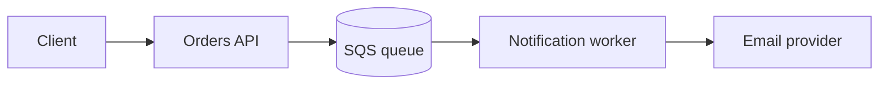
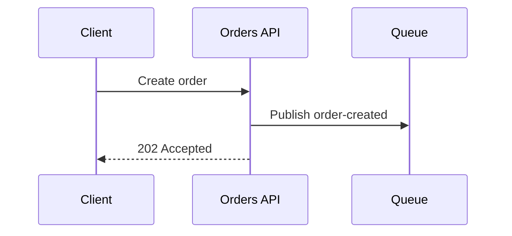

# Mermaid examples for ADRs

Use a diagram only when it makes a structural or flow decision clearer than prose. Keep it under about ten nodes.

## Structure: where a new component sits

````markdown

````

## Flow: the sequence a decision changes

````markdown

````

Label nodes with roles and components, not people or client names.
