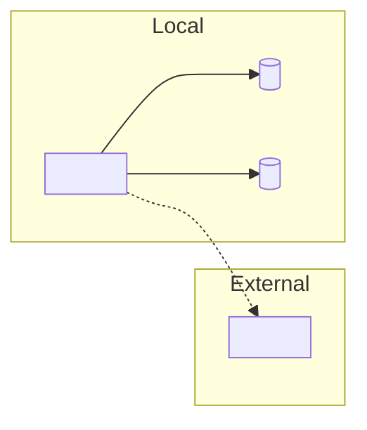

# Local Setup Template

Structure for `docs/LOCAL_SETUP.md`. Section order follows the reader's journey: what you need, how it fits together, configure, start dependencies, build, run, test, fix problems.

Include **required** sections always. Include **optional** sections only when the repo gives evidence for them. Replace every `<...>` placeholder and delete guidance comments. Prefer the repo's own section names when updating an existing document.

This template is a starting point, not a form. Merge, reorder, or drop sections when the repo's shape calls for it (for example, drop "Supporting services" for a stateless CLI; add per-unit subsections for a monorepo).

## Contents

1. Template
2. Writing guidance
3. Per-section evidence checklist

---

## 1. Template

````markdown
# Local Setup Guide: <Project / Component Name>

> **Last verified:** <YYYY-MM-DD> · commit `<short-sha>`
> _Derived from <files read>; not executed during generation._ <!-- remove the italic line only if you ran the steps -->
> Maintainers: update this file when prerequisites, scripts, services, or environment variables change.

<One sentence: what this guide gets you (a running <thing> on your machine, plus how to build and test it). Link the project overview and README if they exist.>

**Time to first run:** <estimate only if known, otherwise omit>
**Recommended path:** <devcontainer | `make setup` | compose + native | manual> (<why, one line>)

## 1. Prerequisites

<!-- Required. Table: Tool | Version | Source of pin | Notes. Include runtimes, package manager, container runtime,
     CLIs, system libraries, git config (LFS, submodules). Include access: registries, VPN, cloud profile/roles.
     Cite the pin file so a reader can re-verify. -->

| Tool | Version | Pinned in | Notes |
| :--- | :------ | :-------- | :---- |
|      |         |           |       |

**Access needed:** <registries, VPN, cloud roles, repo permissions: only as the repo evidences>

## 2. Get the code

<!-- Required, short. Clone, submodules/LFS, branch convention if documented. -->

```sh
git clone <repo-url>
cd <repo>
```

## 3. Local architecture

<!-- Required for apps with any dependency; skip for self-contained libraries/CLIs.
     One Mermaid diagram: the app(s), what runs in local containers, what is mocked/emulated,
     what connects to shared dev/staging/cloud. Only verified edges. External = distinct style. -->



## 4. Environment configuration

<!-- Required if any env/config is needed. Steps to create config files from templates, then a table of
     variables grouped by: Non-secret defaults | Secrets (must obtain) | Environment-specific.
     Names and purpose only, never values. State where each secret comes from ONLY if the repo says;
     otherwise "Source: unknown, see Open questions". -->

```sh
cp .env.example .env
```

| Variable | Purpose | Required | Kind (default / secret / env-specific) | Where to get it |
| :------- | :------ | :------- | :------------------------------------- | :-------------- |
|          |         |          |                                        |                 |

**Verify:** <how to confirm config is picked up, if the repo offers a way>

## 5. Supporting services

<!-- Optional. Start dependencies; list each service, port, and how to verify. Mention seed data and how to reset. -->

```sh
<start command, e.g. docker compose up -d>
```

**Verify:**

```sh
<e.g. docker compose ps>
```

| Service | Port | Purpose | Data persists? |
| :------ | :--- | :------ | :------------- |
|         |      |         |                |

## 6. Install and build

<!-- Required. Ordered: install dependencies, codegen, migrations, seed, build. Each with its verify. -->

```sh
<install command>
```

```sh
<pre-build: migrate / generate / seed>
```

**Verify:** <expected outcome, e.g. exit code 0, files created>

## 7. Run the application

<!-- Required. Dev-mode start command per runnable unit (hot reload noted), URL/port, and a verify command with
     expected output when known. Monorepos: one subsection per unit. -->

```sh
<run command>
```

**Verify:**

```sh
<e.g. curl http://localhost:<port>/health>
```

_Expected:_ <status or output, as stated by code or docs>

## 8. Develop and test

<!-- Required. Table: Task | Command | Defined in. Unit, integration, e2e, lint/format, type-check, codegen.
     Note prerequisites for tests (DB up, Docker running). Note git hooks installed on setup and what they run.
     Note what CI runs, so local checks match. -->

| Task | Command | Defined in |
| :--- | :------ | :--------- |
|      |         |            |

## 9. Editor and tooling (optional)

<!-- Optional. Only items the repo configures: .editorconfig, recommended extensions, debugger launch configs,
     pre-commit/husky. -->

## 10. Troubleshooting

<!-- Required if any evidence exists. Symptom | Likely cause | Fix. Source each from repo evidence (README notes,
     script comments, CI workarounds, version pins). Mark derived-but-unobserved items "(anticipated)".
     Do not invent error text. -->

| Symptom | Likely cause | Resolution |
| :------ | :----------- | :--------- |
|         |              |            |

## 11. Where to go next

<!-- Required. Link only what exists: project overview, README, CONTRIBUTING, CLAUDE.md/AGENTS.md, ADRs, runbooks. -->

## 12. Open questions

<!-- Required (may be "None identified"). What could not be determined and what would resolve it,
     e.g. "Where do developers obtain the `<X>_API_KEY`? Not documented; ask <owner role>." -->
````

---

## 2. Writing guidance

**Tone.** Direct, peer-to-peer, scannable. Tables and short lists over paragraphs. No "simply" or "just".

**Specificity.** `npm run test -w packages/api` beats "run the tests". State the working directory when it is not the repo root.

**Dependency order.** A step may only rely on things set up in an earlier step. If step 6 needs the database from step 5, say so and order accordingly.

**Verify lines.** Each step that can fail silently gets a verify. A verify is a command with an expected outcome the repo supports (a health route, an exit code, a listed container), not a vague "make sure it works".

**Do not restate automation.** If `make setup` or a devcontainer does the work, document what it does in one or two lines, how to run it, and how to verify it. Keep the manual path as a short fallback only when the automation is not universal.

**Durability.** Versions appear only in the prerequisites table, each with its pin source. No test counts, line counts, or exhaustive file inventories. Commands name the file that defines them.

**Update mode.** Keep the existing doc's section names and voice where they remain accurate. Map this template onto the existing structure rather than replacing it.

---

## 3. Per-section evidence checklist

| Section             | Must be backed by                                                      |
| :------------------ | :--------------------------------------------------------------------- |
| Prerequisites       | pin files, `engines`, CI `setup-*` versions, Dockerfile base image     |
| Environment         | `.env.example` or config code; secrets sources only from repo text     |
| Supporting services | compose/devcontainer/CI services/emulator config                       |
| Install and build   | manifest scripts, Makefile, CI steps                                   |
| Run                 | scripts, launch profiles, Dockerfile `CMD`, framework config for ports |
| Develop and test    | manifest scripts, CI workflow commands, test config                    |
| Troubleshooting     | repo comments/docs, CI workarounds, pin mismatches (label anticipated) |
