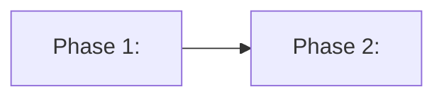

# Phase plan template

Use this structure for a `phase` plan. Keep every heading, in this order. Replace every placeholder. A section with nothing to say says "None."

Sizing rule: **one phase is one clean agentic session.** If a phase needs more context than one session holds, split it. Every phase ends with the repo's checks green.

````markdown
# PLAN-<id> — <title>

**Source:** <issue, milestone reference, or brief, with a link or path>
**Branch:** `<branch>` (create from `<default branch>`)
**Starting state:** <what exists now, from the repo>
**Goal:** <the outcome, in one or two sentences>

---

## 1. Scope

**In scope**

- <item>

**Out of scope**

- <item>

---

## 2. Findings and decisions

| #   | Finding                | Consequence                |
| --- | ---------------------- | -------------------------- |
| F1  | <fact from the source> | <what it means for a plan> |

**Open questions**

- <question, and the default if unresolved. Label assumptions.>

---

## 3. Execution order



Each phase is one agentic session. Each phase begins by reading this plan and the previous handoff. Each phase ends with <the repo's check command> green, and updates this file: tick the checklist, fill "As built", and write the **Handoff** block. Do not commit until the user has reviewed the changes. Commit using the repo's convention.

---

## 4. Phases

### Phase 1 — <name>

**Goal:** <one sentence, verifiable>

**Context to load:** <the files and sections this phase needs, and nothing else>

| Step | Work                           |
| ---- | ------------------------------ |
| 1.1  | <action, concrete and ordered> |

**Done when:** <observable conditions, including the checks passing>

**Status:** not started.

**As built (fill in at the end of the phase)**

- <what was built>: _pending_.
- Deviations from this plan: _pending_.

**Handoff to the next phase (write at phase end):** <what the next session must know: names, decisions, anything unfinished>

---

## 5. Exit checklist

- [ ] <a condition for the whole plan, each verifiable>

## 6. Risks specific to this plan

| Risk   | Mitigation   |
| ------ | ------------ |
| <risk> | <mitigation> |
````

## Rules

- Sections, in order: title, header block (Source, Branch, Starting state, Goal), Scope, Findings and decisions, Execution order, Phases, Exit checklist, Risks specific to this plan.
- Each phase has these parts, in order: **Goal**, **Context to load**, **Steps** (a table of step and work), **Done when**, **Status**, **As built**, **Handoff**. The final phase's handoff may say "None, last phase."
- "As built" and "Handoff" are written by the executing session, not by this skill. Leave them as placeholders.
- A phase's steps are concrete enough to run without re-planning. Name files and commands, not intentions.
- Show the phase dependency order in the diagram. Phases that can run in any order say so.
- The phase gate is named **Done when**. The plan's gate is the **Exit checklist**.
