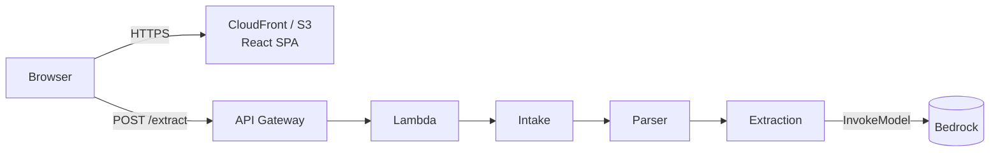
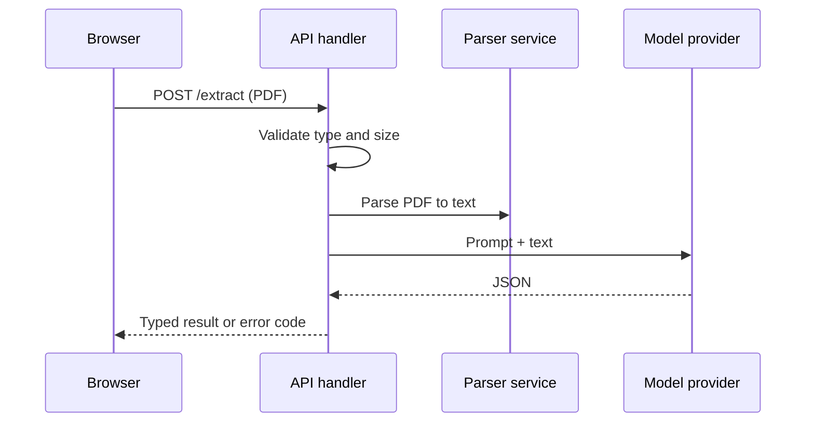

# Architecture Map Conventions

This is a deliberate separate copy: skills cannot share files, so `agents-md-author` carries its own `architecture-map.md`. The two agree on tree, annotation, depth, and marker rules. They differ on purpose: the project overview adds diagrams and a primary flow, while `AGENTS.md` stays lean.

How to present repository structure and runtime flow. The goal is that a newcomer can answer three questions in under two minutes: _Where does the code live? How do the parts connect? What happens when the main thing happens?_

## 1. Annotated folder map

Use a fenced tree, depth ≤ 2 (depth 3 only for the one or two directories that matter most). One line per entry, aligned comments, role first, detail second. Omit generated, vendored, and build-output directories.

```text
my-repo/
├── packages/
│   ├── shared/          # Contract: types + error codes shared by api and web. No runtime deps.
│   ├── api/             # Backend. handlers/ → services/ → utils/ (one-way dependency)
│   ├── web/             # React SPA (Vite). api/ client, components/, utils/
│   └── infra/           # IaC (AWS CDK). Single stack under src/stacks/
├── package.json         # npm workspaces root
├── tsconfig.base.json   # Shared compiler config
└── README.md
```

Rules:

- Describe **role** ("Backend", "Contract", "IaC"), not just content ("TypeScript files").
- State dependency direction inline when it is a rule (`handlers/ → services/ → utils/`).
- Mark inferred roles with `(inferred)`.
- Flag generated, vendored, or protected paths with `(generated)`, `(vendored)`, or `(do not edit)`.
- Prefer directories to files; list files only for entry points and config a reader must know by name.
- Group repetitive siblings (`migrations/ # 87 files, timestamped`) instead of listing them.

## 2. Package / component table (monorepos and multi-service repos)

When there are three or more packages, add a table after the tree:

| Package  | Role                  | Depends on | Entry point               | Test command      |
| :------- | :-------------------- | :--------- | :------------------------ | :---------------- |
| `shared` | Types and error codes | none       | `src/index.ts`            | n/a               |
| `api`    | Lambda handlers       | `shared`   | `src/handlers/extract.ts` | `npm test -w api` |

Only fill columns you verified; use `?` for unknown.

## 3. Component diagram (Mermaid)

Show the major runtime components and their relationships: 4–9 nodes. Prefer `flowchart LR` for request paths and `flowchart TB` for layered structure. Label edges with the protocol or data when it clarifies.



Rules:

- Nodes are runtime components or layers, not individual files.
- External systems get a distinct shape (cylinder or stadium).
- If you cannot confirm a relationship from code or config, omit the edge and list it under Open Questions.

## 4. Primary flow (Mermaid sequence or numbered list)

Document **one** end-to-end flow: the use case that defines the product (the main request, the main job, the main command). Use a `sequenceDiagram` when ≥3 actors interact; use a numbered list otherwise. Include where validation, persistence, and error handling happen.



## 5. Central contracts

Name the 1–3 files that define the system's shared language (shared types, OpenAPI/proto/GraphQL schema, DB schema, event schemas). Give the path and one sentence on why it matters. Quote a **short** excerpt only if it is the clearest way to convey the shape; otherwise link.

## 6. Dependency and layering rules

If you observed a rule (e.g. "services never import handlers"), state it in one line with the evidence (`verified by import scan of packages/api/src`). Unverified rules go under Open Questions.

## 7. What to leave out

- Per-file descriptions for more than ~10 files
- Version numbers unless they gate setup (e.g. "Node ≥ 20")
- Diagrams that restate the folder tree
- Anything you would have to guess
