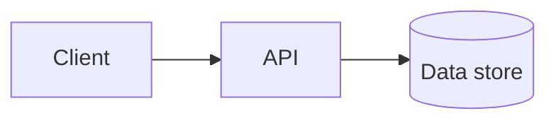

# Outline template

Use this structure for a `solution-outline` result. Replace every placeholder. Keep the banner and the last section. They are mandatory.

````markdown
# Solution outline: <name>

> **Draft for human review. Estimates are rough.**

**Date:** <YYYY-MM-DD>
**Stack:** <repo-stated, or stack-profile default and the reason>

## Summary

<Three to five lines: the problem, the proposed shape, the main risk.>

## Requirements and assumptions

**Functional**

- <requirement>

**Non-functional**

- <requirement, with a number where one was given>

**Constraints**

- <budget, team, deadline, existing systems>

**Assumptions** (each one changes the design if wrong)

| #   | Assumption | Impact if wrong |
| --- | ---------- | --------------- |
| A1  | <...>      | <...>           |

## Architecture

| Component | Responsibility | Interfaces | Notes        |
| --------- | -------------- | ---------- | ------------ |
| <name>    | <one line>     | <in, out>  | <assumption> |



## Key decisions

| #   | Decision | Options noted | Next step                      |
| --- | -------- | ------------- | ------------------------------ |
| D1  | <...>    | <A, B>        | `tech-eval`, then `adr-author` |

## Risks

| #   | Risk  | Likelihood        | Impact            | Mitigation |
| --- | ----- | ----------------- | ----------------- | ---------- |
| R1  | <...> | <low/medium/high> | <low/medium/high> | <...>      |

## Staffing and effort sketch

| Component or work item | Role      | Effort range | Assumption |
| ---------------------- | --------- | ------------ | ---------- |
| <name>                 | <backend> | <3 to 5 pd>  | <A1, ...>  |

**Total:** <low to high> person-days, **only valid under** <assumptions>, and **excluding** <unknowns>.

## Open questions

1. <question, who can answer it>

## Confidence and unknowns

- **Confidence:** <low, medium, or high, and why>
- **Biggest unknowns:** <what could move the estimate or the design most>
- **Not covered:** <for example, detailed design, security review, operations>
````

## Rules

- The banner is the first line after the title. Do not remove or soften it.
- Every estimate is a range with an assumption. No single-number totals.
- Mark inference as inference. Do not fill a section without an assumption behind it.
- Add a second diagram (sequence or data flow) only when one flow is hard to see from the component diagram.
