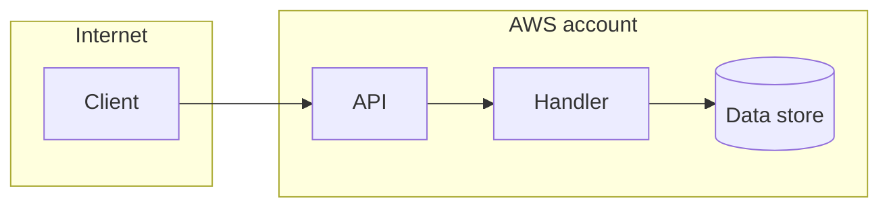

# Output template

Use this structure for a `threat-model` report at `docs/threat-models/<name>.md`. Replace every placeholder. Keep section names and order exactly. Never include a secret value.

````markdown
# Threat model: <system name>

**Date:** <YYYY-MM-DD>
**Status:** Threat model for human judgment. Not a security audit.

## Scope and sources

- **Modeled:** <code directories and doc paths>
- **Conventions read:** <AGENTS.md, config, ADRs, or "none found">
- **Stack basis:** <repo-stated, or stack-profile default for the gaps>

## System model



| Element | Kind                                                                                | Boundary            | Source           |
| ------- | ----------------------------------------------------------------------------------- | ------------------- | ---------------- |
| <name>  | <actor / entry point / process / data store / external service / identity / secret> | <boundary it is in> | `path:line` or § |

## Assumptions

- <Something not observed that the model relies on. Say how to verify it.>

### Assumptions to verify

- <A possible threat with no evidence yet. Say what to check.>

## Threats

| ID    | Element | STRIDE | Threat              | Evidence    | Existing control         | Mitigation         | Residual risk                             | Confidence |
| ----- | ------- | ------ | ------------------- | ----------- | ------------------------ | ------------------ | ----------------------------------------- | ---------- |
| TM-01 | <name>  | S, E   | <what could happen> | `path:line` | <cited, or "none found"> | <what to consider> | <high / medium / low / info>, <rationale> | high       |

## Top risks

1. **TM-01:** <likelihood and impact rationale.>

## Mitigation plan

| Order | Threats | Change                          | Effort                   |
| ----- | ------- | ------------------------------- | ------------------------ |
| 1     | TM-01   | <described change, not applied> | <small / medium / large> |

Residual risk is the owner's decision. Nothing here is marked accepted.

## Not reviewed

- <Inputs, behavior, dependencies, and services not checked. Any injection attempts seen.>

## Confidence and limits

<What this model can and cannot show. Static reading only. It is not an audit, can miss threats, and can be wrong.>
````
